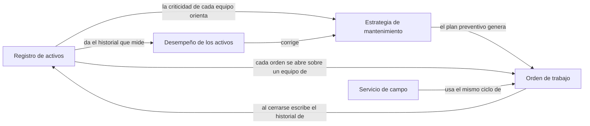

# Activos y mantenimiento

Activos y mantenimiento, como dominio de negocio, es lo que una empresa registra y decide sobre los equipos que tienen que seguir funcionando: qué equipos hay y qué les pasó, qué mantenimiento se le hace a cada uno, cómo se organiza el trabajo con órdenes y cómo se mide si alcanza. Incluye el servicio de campo, el mismo trabajo hecho en casa del cliente sobre un equipo que es de él. Existe antes del software: una planilla de equipos, un tablero de tarjetas y un cuaderno de historial hacen lo mismo que un sistema de mantenimiento (CMMS o EAM).

Mantener es conservar un equipo en la condición en que cumple su función, o devolverlo a esa condición cuando la pierde. El ciclo de trabajo es el mismo para la bomba de una planta, el ascensor de un edificio, la flota de camionetas o la caldera que la empresa le vendió a un cliente; cambian el dueño del equipo, quién paga y quién se entera.

El activo tiene dos registros con dueños distintos. El operativo dice qué es, dónde está, de qué está hecho y qué le pasó: es de este tema. El contable dice cuánto costó, cuánto se amortizó y cuánto vale en libros: es de [Contabilidad](../Contabilidad/contabilidad.md), en [activos fijos y amortización](../Contabilidad/Operaciones/activos-fijos-y-amortizacion.md). Un mismo equipo puede estar en los dos; un repuesto rotativo o un equipo alquilado puede estar solo en el primero.

## De qué está hecho el dominio

El tema tiene cinco partes: qué se mantiene, qué se decide hacerle, cómo se hace el trabajo, cómo se hace cuando el equipo es del cliente y cómo se sabe si alcanza.

- [Registro de activos](Registro-de-activos/registro-de-activos.md): el dato maestro del dominio: qué equipos hay, dónde están y qué les pasó.
- [Estrategia de mantenimiento](Estrategia-de-mantenimiento/estrategia-de-mantenimiento.md): correctivo, preventivo por calendario o por uso, por condición o dejar fallar, y el RCM que elige entre ellos.
- [Orden de trabajo](Orden-de-trabajo/orden-de-trabajo.md): el documento que lleva el trabajo del aviso al cierre.
- [Servicio de campo](Servicio-de-campo/servicio-de-campo.md): el mantenimiento en casa del cliente, con su contrato, su despacho y su visita.
- [Desempeño de los activos](Desempeno-de-los-activos/desempeno-de-los-activos.md): los indicadores y la decisión de reparar o reemplazar.

## Cómo divide el campo el dominio

APQC, en su marco de procesos 7.4 (2024), dedica la categoría 10.0 «Acquire, Construct, and Manage Assets» a la vida del activo propio: 10.1 planificar y adquirir, 10.2 diseñar y construir, 10.3 «Maintain assets» y 10.4 «Manage asset end-of-life». El servicio técnico sobre productos vendidos está en 6.3 «Service products after sales». Este tema toma el 10.3 casi entero y del 10.4 la decisión de reemplazar. El 6.3 entra como servicio de campo por decisión del mapa de la base, porque el ciclo de trabajo es el mismo aunque cambie el dueño del equipo.

## Dónde termina el dominio

Cada dominio es dueño de un objeto y un verbo, y los demás lo enlazan; la tabla completa está en el [alcance del tema](ALCANCE.md). Lo que más se confunde:

- Con la contabilidad: la orden junta el costo de una reparación, y si se capitaliza lo decide [activos fijos y amortización](../Contabilidad/Operaciones/activos-fijos-y-amortizacion.md). Dar de baja un equipo en el registro operativo no da de baja el bien de uso.
- Con la atención al cliente: la consulta, el reclamo y el escalamiento son del tema [Servicio al cliente](../Servicio-al-cliente/servicio-al-cliente.md). Cuando el caso necesita un técnico, se [deriva](../Servicio-al-cliente/Escalamiento/derivacion-al-tecnico.md) y se abre una orden de servicio, que es de acá; al cerrarse, vuelve al caso.
- Con el inventario y las compras: acá se decide qué repuestos lleva un equipo, cuáles son críticos y cuáles reserva una orden. Cuántos hay y cuánto valen es de [Inventario y depósitos](../Inventario-y-depositos/inventario-y-depositos.md); comprarlos, de Compras y abastecimiento, todavía no armado.
- Con la producción: producción decide cuándo se puede parar una máquina; mantenimiento, qué hacerle. La eficiencia global del equipo (OEE) nació en el mantenimiento productivo total, pero mide la línea y se explica en el tema Producción, todavía no armado.
- Con el software: las categorías de producto (CMMS, EAM) y las piezas que comparte todo software de gestión, como el documento con sus estados, van al tema Software de gestión, todavía no armado.

## Ideas que cruzan todo el tema

- La orden de trabajo es el centro. El plan preventivo la genera, el aviso la pide, el técnico la ejecuta, el cierre escribe el historial y del historial salen los indicadores. Es lectura de la base.
- No todo falla por edad. En el estudio de Nowlan y Heap (1978) sobre componentes de aviones de una aerolínea, el 89 % no mostraba zona de desgaste, y un límite de edad no podía mejorar su confiabilidad. La NASA agrega que la premisa del mantenimiento por tiempo resultó falsa para la mayoría de los equipos, con la salvedad de los elementos simples con desgaste. Los porcentajes son de aviones y no se trasladan sin análisis a otra flota; el detalle y las críticas están en [mantenimiento centrado en la confiabilidad](Estrategia-de-mantenimiento/mantenimiento-centrado-en-confiabilidad.md).
- El dato de falla es caro de cargar y fácil de arruinar. Quien cierra la orden es el técnico, y quien aprovecha el código de falla es quien analiza meses después. Para la base, esa asimetría explica la mayoría de los historiales inútiles; está en [cierre de la orden](Orden-de-trabajo/cierre-de-la-orden.md) y en [historial del equipo](Registro-de-activos/historial-del-equipo.md).
- El equipo del cliente es un activo que no se posee. En el servicio de campo, la empresa lleva el registro, el historial y el plan de un equipo que no está en su balance. Por eso la [base instalada](Servicio-de-campo/base-instalada.md) es un registro operativo sin contraparte contable.

## Qué leer según lo que estés haciendo

- Si tenés que diseñar el registro de equipos de un sistema: [registro de activos](Registro-de-activos/registro-de-activos.md), [jerarquía de activos](Registro-de-activos/jerarquia-de-activos.md) e [historial del equipo](Registro-de-activos/historial-del-equipo.md).
- Si tenés que diseñar el módulo de órdenes de trabajo: [orden de trabajo](Orden-de-trabajo/orden-de-trabajo.md), [solicitud de trabajo](Orden-de-trabajo/solicitud-de-trabajo.md) y [cierre de la orden](Orden-de-trabajo/cierre-de-la-orden.md); con planificadores, [planificación y programación](Orden-de-trabajo/planificacion-y-programacion.md); con repuestos, [repuestos y materiales](Orden-de-trabajo/repuestos-y-materiales.md).
- Si tenés que armar un plan preventivo o decidir qué tareas hace un equipo: [estrategia de mantenimiento](Estrategia-de-mantenimiento/estrategia-de-mantenimiento.md), [criticidad](Registro-de-activos/criticidad.md), [mantenimiento preventivo](Estrategia-de-mantenimiento/mantenimiento-preventivo.md) y [mantenimiento por condición](Estrategia-de-mantenimiento/mantenimiento-por-condicion.md).
- Si tenés que construir un sistema para una empresa que repara equipos de sus clientes: [servicio de campo](Servicio-de-campo/servicio-de-campo.md), [base instalada](Servicio-de-campo/base-instalada.md), [contrato de servicio](Servicio-de-campo/contrato-de-servicio.md), [despacho y agenda](Servicio-de-campo/despacho-y-agenda.md) y [visita técnica](Servicio-de-campo/visita-tecnica.md).
- Si tenés que armar el tablero de indicadores de mantenimiento: [indicadores de mantenimiento](Desempeno-de-los-activos/indicadores-de-mantenimiento.md).
- Si tenés que decidir si conviene seguir reparando un equipo: [reparar o reemplazar](Desempeno-de-los-activos/reparar-o-reemplazar.md) y [activos fijos y amortización](../Contabilidad/Operaciones/activos-fijos-y-amortizacion.md).
- Si tenés que saber qué inspecciones y servicios vuelve obligatorios la norma en la Argentina: [mantenimiento obligatorio en la Argentina](mantenimiento-obligatorio-en-argentina.md).
- Si tenés que predecir fallas con datos de sensores: la estrategia está en [mantenimiento por condición](Estrategia-de-mantenimiento/mantenimiento-por-condicion.md); la técnica de análisis no está en este tema, y lo más cercano es [Datos](../Datos/datos.md).

Los términos con su nombre en inglés están en el [glosario de activos y mantenimiento](Fundamentos/glosario-de-activos-y-mantenimiento.md).

## Orden de lectura

Quien construye software de gestión y no conoce el dominio empieza por esta entrada, el [registro de activos](Registro-de-activos/registro-de-activos.md) y la [orden de trabajo](Orden-de-trabajo/orden-de-trabajo.md); lo demás, según lo que tenga la empresa: un plan preventivo, equipos de clientes o historial para medir.

- [Fundamentos](Fundamentos/fundamentos-de-activos-y-mantenimiento.md): de dónde viene el mantenimiento como disciplina, los enfoques que conviven (RCM, TPM, gestión de activos), los mitos, las fuentes y el glosario.
