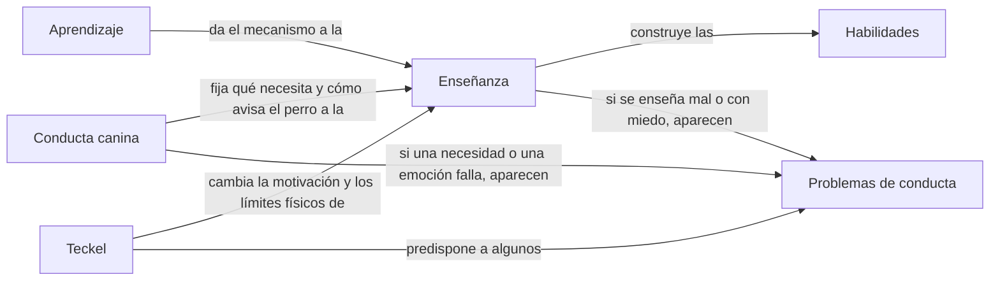

# Adiestramiento canino

Adiestrar un perro es cambiar lo que hace manejando las consecuencias y las asociaciones de su conducta; esta base lo explica para dueños, con foco en el teckel (perro salchicha), y dice en cada caso qué se apoya en estudios y qué es práctica.

El adiestramiento usa dos mecanismos. El perro repite lo que le trae algo que quiere y deja lo que no le sirve; además, asocia lugares, personas y objetos con lo que siente. Las técnicas, las herramientas y las escuelas usan esas dos palancas de maneras distintas. Antes de llamar "desobediencia" a una conducta conviene descartar que nunca se haya enseñado en ese lugar, que le falte cubrir una necesidad o que tenga miedo o dolor.

El tema cubre al perro de la casa, cachorro o adulto: lo que se enseña para convivir y lo que se hace cuando algo sale mal. Quedan afuera el adiestramiento como oficio, los deportes caninos, los perros de trabajo y la cría ([alcance](ALCANCE.md)).

> [!IMPORTANT]
> Esta base resume estudios, guías de sociedades veterinarias y práctica de adiestradores, y dice cuál es cuál. No reemplaza a un veterinario: un cambio de conducta brusco, una mordida o un dolor de espalda en un teckel se consultan primero con uno.

## De qué está hecho adiestrar un perro

El tema tiene seis partes. El aprendizaje es el mecanismo; la conducta canina dice qué animal aprende y qué necesita; la enseñanza son las técnicas que usan el mecanismo; las habilidades son lo que se enseña con ellas; los problemas aparecen cuando una necesidad, una emoción o una enseñanza falló; y el teckel cambia los pesos de todo lo anterior.

- [Aprendizaje](Aprendizaje/aprendizaje.md) — cómo aprende un perro: las consecuencias, las asociaciones y lo que le sirve de premio. Entrar para entender por qué algo funciona o deja de funcionar.
- [Conducta canina](Conducta-canina/conducta-canina.md) — qué animal es: cómo se comunica, la socialización del cachorro y lo que necesita cada día.
- [Enseñanza](Ensenanza/ensenanza.md) — las técnicas: el marcador, el señuelo y el moldeado, cómo se arma una sesión, cuándo y cómo se corrige, y los collares, el ahorque y el arnés.
- [Habilidades](Habilidades/habilidades.md) — lo que se enseña paso a paso: hacer sus necesidades afuera, venir cuando se lo llama, caminar sin tirar, quedarse solo, sentado, echado y quieto.
- [Problemas de conducta](Problemas-de-conducta/problemas-de-conducta.md) — ladrido, protección de recursos, reactividad y agresión, ansiedad por separación, y cuándo pedir ayuda profesional. Entrar primero si algo anda mal.
- [Teckel](Teckel/teckel.md) — la raza: su origen de perro de madriguera, lo que se midió de su temperamento, su columna y cómo cambia el adiestramiento con él.

Aparte de las seis partes, [Fundamentos](Fundamentos/fundamentos-del-adiestramiento.md) reúne lo que las cruza: las escuelas y su evidencia, los mitos, las fuentes y el glosario.

## Por qué el enfoque es pragmático y qué dice la evidencia

El campo está partido entre quienes entrenan solo con premios y quienes combinan premios con correcciones, el enfoque llamado "balanceado". Las sociedades de veterinarios conductistas, como la AVSAB, recomiendan solo métodos con premio (según el resumen de su declaración de 2021). Los estudios que las respaldan son en su mayoría encuestas y observaciones, con límites que sus críticos señalan. Esta base parte del refuerzo, que en esos estudios no se asocia a peor bienestar, y describe las correcciones y herramientas como el ahorque con su uso correcto, sus riesgos y lo que se sabe de ellas, sin prohibirlas. La disputa completa está en [escuelas de adiestramiento](Fundamentos/escuelas-de-adiestramiento.md).

Con un teckel pesa una razón más: es una raza condrodistrófica ([condrodistrofia](Fundamentos/glosario-de-adiestramiento.md#el-teckel): patas cortas y discos que envejecen antes) y sufre seguido de enfermedad de disco intervertebral (en la encuesta DachsLife 2015, el 15,7 % de 2031 teckels tenía un diagnóstico veterinario de la enfermedad), y eso cambia lo que conviene con el ejercicio, el peso y el cuello; en los saltos, la guía veterinaria y el estudio de la raza no coinciden. Está en [columna del teckel](Teckel/columna-del-teckel.md).

## Por dónde empezar

- **Para entender el método**, en orden: [condicionamiento operante](Aprendizaje/condicionamiento-operante.md), [reforzador](Aprendizaje/reforzador.md), [condicionamiento clásico](Aprendizaje/condicionamiento-clasico.md), [marcador](Ensenanza/marcador.md) y [sesión de entrenamiento](Ensenanza/sesion-de-entrenamiento.md).
- **Con un cachorro**: [socialización](Conducta-canina/socializacion.md), [hacer sus necesidades afuera](Habilidades/hacer-sus-necesidades-afuera.md) y [quedarse solo](Habilidades/quedarse-solo.md).
- **Con un adulto que ya tiene mañas**: [necesidades del perro](Conducta-canina/necesidades-del-perro.md), la nota del problema en [problemas de conducta](Problemas-de-conducta/problemas-de-conducta.md) y [cuándo derivar](Problemas-de-conducta/cuando-derivar.md).
- **Con un teckel**: [teckel](Teckel/teckel.md), [columna del teckel](Teckel/columna-del-teckel.md) y [adiestrar a un teckel](Teckel/adiestrar-a-un-teckel.md).
- **Antes de usar el ahorque o corregir**: [corrección](Ensenanza/correccion.md) y [collar, ahorque y arnés](Ensenanza/collar-ahorque-y-arnes.md).
