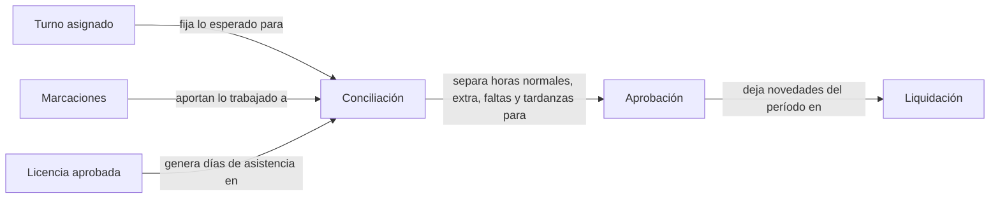

# Tiempo y asistencia

Tiempo y asistencia registra cuánto trabajó y cuánto faltó cada empleado en el período de liquidación: el turno que tenía que cumplir, lo que marcó, las horas extra y las licencias. De acá salen novedades, que la liquidación convierte en conceptos del recibo.

Dentro de [Administración de personal y nómina](../administracion-de-personal-y-nomina.md) es la vertical que se mueve todos los días. Lee del [legajo](../Legajo/legajo.md) quién trabaja, con qué modalidad, qué turno tiene y cuánto saldo de licencias le queda. Le pasa a la [liquidación de sueldos](../Liquidacion-de-sueldos/liquidacion-de-sueldos.md) las novedades del período, que se vuelven [conceptos de liquidación](../Liquidacion-de-sueldos/conceptos-de-liquidacion.md). Al terminar la relación, el saldo de vacaciones sin gozar pasa a la [liquidación final](../Liquidacion-de-sueldos/liquidacion-final.md). Sin software, la vertical es la planilla firmada de entrada y salida y el cuaderno de licencias. Con software, es el reloj, la tabla de marcaciones y el saldo de cada tipo de licencia.

## Del turno a la novedad

Cada hora que llega al recibo recorre la misma cadena. El turno dice qué se esperaba y la marcación, qué pasó. La conciliación compara las dos y la aprobación decide qué vale. La novedad es lo aprobado, en unidades que la liquidación sabe pagar (horas extra al 50 %, días de licencia, días de falta).

En esta cadena nacen los errores de nómina de la vertical, que la entrada del tema ubica en los datos de entrada. Una marcación sin salida, una hora extra que nadie aprobó o una licencia cargada después del cierre producen un recibo con el dato equivocado aunque el cálculo esté bien. Que la novedad tenga que estar aprobada antes del cierre del período de liquidación es inferencia de esta base sobre ese ciclo; no se encontró una fuente agnóstica que lo describa.

## Una licencia aprobada genera asistencia

La licencia y la asistencia se registran por separado, pero se cruzan. En un sistema abierto de gestión, aprobar una licencia crea un registro de asistencia con estado «en licencia» por cada día que abarca. El saldo de ese tipo de licencia se descuenta en un libro de movimientos, y si la licencia se cancela, el descuento se revierte. Así el día de licencia no aparece como falta en la conciliación y la liquidación recibe una sola versión de cada día.

El cruce va también en sentido contrario. Otro sistema abierto permite descontar horas extra aprobadas del saldo de licencias, que en la práctica se llama banco de horas o compensación de horas: la hora trabajada de más se devuelve en tiempo libre en lugar de pagarse con recargo. Las dos fuentes son documentación de producto, leída como evidencia de cómo se modela el dominio. El detalle está en [licencias y ausencias](licencias-y-ausencias.md) y en [jornada y turnos](jornada-y-turnos.md).

## Los valores son de cada país

En todas partes hay un límite de horas, un período sobre el que se cuenta, un recargo para lo que lo excede y una lista de excepciones. Lo que cambia son los valores. En el Reino Unido el límite es de 48 horas semanales de promedio, «normally averaged over 17 weeks»; en Estados Unidos, las horas por encima de 40 en una semana fija se pagan a 1,5 veces la tarifa, sin promedio entre semanas. Un diseño que guarda el límite, el período de cómputo y el recargo como parámetros sirve para los dos. Uno que fija «8 horas por día» sirve para uno solo (inferencia de esta base sobre esas dos fuentes).

Lo que fija la ley argentina (jornada, recargos, descanso, banco de horas, vacaciones por antigüedad y licencias) está en [jornada y licencias en la Argentina](jornada-y-licencias-en-argentina.md).

## Dónde termina la asistencia

La asistencia dice que alguien trabajó ocho horas un martes. En qué proyecto las trabajó y a qué cliente se le facturan es la carga de horas por proyecto, en [registro de horas](../../Servicios-profesionales-y-proyectos/Registro-de-horas/registro-de-horas.md), del tema Servicios profesionales y proyectos. Las dos pueden salir de la misma pantalla, pero responden preguntas distintas. La asistencia alimenta el recibo y el cumplimiento de los límites de jornada; la carga de horas, el costo y la factura del proyecto.

La política de vacaciones o de trabajo remoto de la empresa la decide [Gestión de personas](../../Liderazgo-y-direccion/Gestion-de-personas/gestion-de-personas.md). Acá se registra lo que esa política dice y lo que cada empleado hizo.

## Qué hay adentro de Tiempo y asistencia

- [Jornada y turnos](jornada-y-turnos.md) — la jornada como límite, los turnos, las horas extra y su recargo, el banco de horas y los descansos.
- [Registro de asistencia](registro-de-asistencia.md) — las marcaciones, cómo se corrigen, las ausencias y tardanzas, el trabajo remoto y lo que dice la evidencia sobre la vigilancia.
- [Licencias y ausencias](licencias-y-ausencias.md) — tipos de licencia, saldos y devengamiento de vacaciones, solicitud y aprobación, y su efecto en la liquidación.
- [Jornada y licencias en la Argentina](jornada-y-licencias-en-argentina.md) — la jornada legal, los recargos, el banco de horas de la Ley 27.802, las vacaciones por antigüedad y las licencias de la Ley de Contrato de Trabajo.
