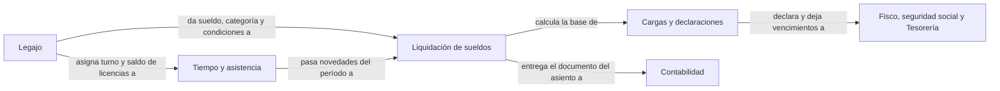

# Administración de personal y nómina

La administración de personal y nómina es lo que una empresa registra y calcula sobre la gente que trabaja en ella: quién es cada empleado y en qué condiciones trabaja, cuánto tiempo trabajó y cuánto faltó, cuánto se le paga y cuánto se les debe a la seguridad social y al fisco por eso. Es lo que lleva el módulo de personal y nómina de un software de gestión, pero existe antes del software: un legajo en carpeta, una planilla de asistencia y un recibo hecho a mano hacen lo mismo.

El tema trata el registro y el cálculo. Las decisiones sobre las personas (a quién contratar, cuánto pagarle, cómo evaluarla, cómo despedirla) son de [Gestión de personas](../Liderazgo-y-direccion/Gestion-de-personas/gestion-de-personas.md), dentro de Liderazgo y dirección. La frontera es nítida en cada caso: allá se decide un aumento, y acá se registra desde qué fecha vale y se liquida. El asiento contable que sale de cada nómina es de [Contabilidad](../Contabilidad/Operaciones/operaciones.md); acá está el cálculo que lo alimenta.

La nómina es la suma de lo que pasó en el período de liquidación (el mes, la quincena o la semana por los que se paga), y esa idea ordena el tema. Cada número del recibo sale de un dato del legajo (el sueldo, la categoría), de una novedad (lo que pasó en el período y cambia el pago: horas extra, una licencia, una falta) o de una regla (un aporte, una retención). Por eso, como criterio de esta base, conviene buscar un error de nómina primero en los datos de entrada (algo que llegó tarde, mal o con la fecha equivocada) y después en el cálculo. Los fracasos de sistemas de nómina con informe público están en [Fundamentos](Fundamentos/fundamentos-de-administracion-de-personal.md).

## Los cuatro objetos del dominio

El tema se divide en cuatro partes, en el orden en que se usa la información cada mes: quién trabaja, cuánto trabajó, cuánto cobra y cuánto se les debe a terceros.

- [Legajo](Legajo/legajo.md): el registro del empleado, sus documentos y su historia (cada cambio de puesto o de sueldo con la fecha desde la que vale), el puesto que ocupa, la modalidad de su contrato, cómo entra y cómo sale, y las búsquedas que lo trajeron. Entrá acá primero: todo lo demás lee de este registro.
- [Tiempo y asistencia](Tiempo-y-asistencia/tiempo-y-asistencia.md): la jornada y los turnos, las marcaciones y su conciliación, las horas extra y las licencias con sus saldos. Entrá acá cuando la pregunta sea cómo una hora trabajada o una ausencia llega al recibo.
- [Liquidación de sueldos](Liquidacion-de-sueldos/liquidacion-de-sueldos.md): el ciclo de cada período, los conceptos y su orden de cálculo, el recibo, los retroactivos, la liquidación final y el pago. Entrá acá para entender cómo se llega del bruto al neto.
- [Cargas y declaraciones](Cargas-y-declaraciones/cargas-y-declaraciones.md): lo retenido al empleado y lo que paga el empleador por su cuenta, la retención del impuesto sobre el sueldo, el libro de sueldos y la declaración periódica. Entrá acá para saber qué se les debe a terceros y cuándo.

## Dónde termina el tema

El límite con cada vecino sigue una regla: cada dominio es dueño de un objeto y un verbo, y los demás lo enlazan. La tabla completa está en el [alcance del tema](ALCANCE.md). Lo que más se confunde:

- **Con la gestión de personas.** Seleccionar, evaluar, fijar cuánto pagar y conducir una salida son decisiones, y viven en [Gestión de personas](../Liderazgo-y-direccion/Gestion-de-personas/gestion-de-personas.md): [contratar](../Liderazgo-y-direccion/Gestion-de-personas/contratar.md), [compensación e incentivos](../Liderazgo-y-direccion/Gestion-de-personas/compensacion-e-incentivos.md) y [rotación y salidas](../Liderazgo-y-direccion/Gestion-de-personas/rotacion-y-salidas.md). Acá quedan la búsqueda como registro, el aumento con su vigencia y la baja con su liquidación final.
- **Con la contabilidad.** La nómina liquidada es el documento; el asiento de sueldos y cargas está en [operaciones](../Contabilidad/Operaciones/operaciones.md), y los gastos que rinde un empleado, en [gastos y rendiciones](../Contabilidad/Operaciones/gastos-y-rendiciones.md).
- **Con los impuestos y la tesorería.** Acá el empleador retiene y declara por cuenta del empleado. El impuesto como tal va al tema [Impuestos](../Impuestos/impuestos.md), que trata la [retención sobre sueldos](../Impuestos/Recaudacion-en-la-fuente/recaudacion-en-la-fuente.md#retención-sobre-sueldos) como régimen, y la ejecución del pago, a [Tesorería](../Tesoreria/tesoreria.md), donde el pago de sueldos todavía no tiene nota propia.
- **Con los proyectos.** La asistencia dice cuánto trabajó alguien; en qué proyecto y a quién se le factura va al [registro de horas](../Servicios-profesionales-y-proyectos/Registro-de-horas/registro-de-horas.md), del tema Servicios profesionales y proyectos.
- **Con el software.** Que un sueldo vale desde una fecha y que lo liquidado no se edita son reglas del negocio y del derecho laboral; cómo se modelan está en [registro de movimientos](../Bases-de-datos/Modelos-de-datos/registro-de-movimientos.md) y en [fechas, vigencias y cierre](../Software-de-gestion/Columnas-tecnicas/fechas-vigencias-y-cierre.md), del tema Software de gestión; la categoría de producto que lleva este dominio es el [HCM](../Software-de-gestion/Categorias-de-producto/hcm.md).
- **Con el recorrido entero.** La contratación a la baja (hire-to-retire) es un proceso de punta a punta, en [de la contratación a la baja](../Procesos-de-negocio/de-la-contratacion-a-la-baja.md); cada paso se explica acá.

## Qué leer según lo que estés haciendo

- Si tenés que construir el módulo de personal y nómina de un sistema, en este orden: [legajo](Legajo/legajo.md) y [puesto y estructura](Legajo/puesto-y-estructura.md); [tiempo y asistencia](Tiempo-y-asistencia/tiempo-y-asistencia.md); [liquidación de sueldos](Liquidacion-de-sueldos/liquidacion-de-sueldos.md) y [conceptos de liquidación](Liquidacion-de-sueldos/conceptos-de-liquidacion.md); [retroactivos y reliquidaciones](Liquidacion-de-sueldos/retroactivos-y-reliquidaciones.md); [cargas y declaraciones](Cargas-y-declaraciones/cargas-y-declaraciones.md); y lo del país.
- Si tenés que diseñar el registro del empleado y su historia: [legajo](Legajo/legajo.md), [puesto y estructura](Legajo/puesto-y-estructura.md) y [modalidades de contratación](Legajo/modalidades-de-contratacion.md).
- Si tenés que llevar fichajes, turnos u horas extra: [jornada y turnos](Tiempo-y-asistencia/jornada-y-turnos.md) y [registro de asistencia](Tiempo-y-asistencia/registro-de-asistencia.md).
- Si tenés que llevar vacaciones y licencias: [licencias y ausencias](Tiempo-y-asistencia/licencias-y-ausencias.md), la antigüedad y la jornada del [legajo](Legajo/legajo.md), y el pago de lo no gozado en la [liquidación final](Liquidacion-de-sueldos/liquidacion-final.md); en la Argentina, [jornada y licencias en la Argentina](Tiempo-y-asistencia/jornada-y-licencias-en-argentina.md).
- Si tenés que calcular un sueldo de bruto a neto: [conceptos de liquidación](Liquidacion-de-sueldos/conceptos-de-liquidacion.md), [aportes y contribuciones](Cargas-y-declaraciones/aportes-y-contribuciones.md) y [retención de impuestos sobre sueldos](Cargas-y-declaraciones/retencion-de-impuestos-sobre-sueldos.md).
- Si tenés que emitir el recibo: [recibo de sueldo](Liquidacion-de-sueldos/recibo-de-sueldo.md).
- Si tenés que pagar un aumento con fecha pasada o corregir un mes cerrado: [retroactivos y reliquidaciones](Liquidacion-de-sueldos/retroactivos-y-reliquidaciones.md).
- Si tenés que dar de baja a alguien: [ingreso y egreso](Legajo/ingreso-y-egreso.md) y [liquidación final](Liquidacion-de-sueldos/liquidacion-final.md); cómo se conduce la salida está en [rotación y salidas](../Liderazgo-y-direccion/Gestion-de-personas/rotacion-y-salidas.md).
- Si vas a contratar a la primera persona de una empresa: [ingreso y egreso](Legajo/ingreso-y-egreso.md) y, en la Argentina, [relación laboral en la Argentina](Legajo/relacion-laboral-en-argentina.md), [cargas sociales en la Argentina](Cargas-y-declaraciones/cargas-sociales-en-argentina.md) y lo que lleva el recibo en [liquidación en la Argentina](Liquidacion-de-sueldos/liquidacion-en-argentina.md).
- Si tenés que registrar una búsqueda y sus postulantes: [búsquedas y postulantes](Legajo/busquedas-y-postulantes.md); cómo se selecciona está en [contratar](../Liderazgo-y-direccion/Gestion-de-personas/contratar.md).
- Si tenés que liquidar sueldos en la Argentina: [liquidación en la Argentina](Liquidacion-de-sueldos/liquidacion-en-argentina.md), [jornada y licencias en la Argentina](Tiempo-y-asistencia/jornada-y-licencias-en-argentina.md), [cargas sociales en la Argentina](Cargas-y-declaraciones/cargas-sociales-en-argentina.md), [Ganancias sobre sueldos en la Argentina](Cargas-y-declaraciones/ganancias-sobre-sueldos-en-argentina.md) y [libro de sueldos digital](Cargas-y-declaraciones/libro-de-sueldos-digital.md).
- Si tenés que registrar contablemente la nómina: la sección de sueldos de [operaciones](../Contabilidad/Operaciones/operaciones.md), en Contabilidad.
- Si tenés que decidir cuánto pagar o cómo armar un bono: no es de este tema; está en [compensación e incentivos](../Liderazgo-y-direccion/Gestion-de-personas/compensacion-e-incentivos.md).

## Orden de lectura

Para quien no liquidó nunca un sueldo: esta entrada, [legajo](Legajo/legajo.md), [liquidación de sueldos](Liquidacion-de-sueldos/liquidacion-de-sueldos.md) y [conceptos de liquidación](Liquidacion-de-sueldos/conceptos-de-liquidacion.md); después [cargas y declaraciones](Cargas-y-declaraciones/cargas-y-declaraciones.md) para ver a dónde va cada descuento, y recién ahí [tiempo y asistencia](Tiempo-y-asistencia/tiempo-y-asistencia.md) y lo del país.

- [Fundamentos](Fundamentos/fundamentos-de-administracion-de-personal.md): de dónde viene la nómina como primera tarea que se automatizó, cómo dividen el dominio los marcos, los fracasos de sistemas de nómina que dejaron informes públicos y los mitos.
- [Glosario de administración de personal](Fundamentos/glosario-de-administracion-de-personal.md): cada término del tema en una línea, con su nombre en inglés y la nota que lo explica.
- [Fuentes de administración de personal](Fundamentos/fuentes-de-administracion-de-personal.md): dónde se produce el saber del dominio y qué leer para cada parte.
