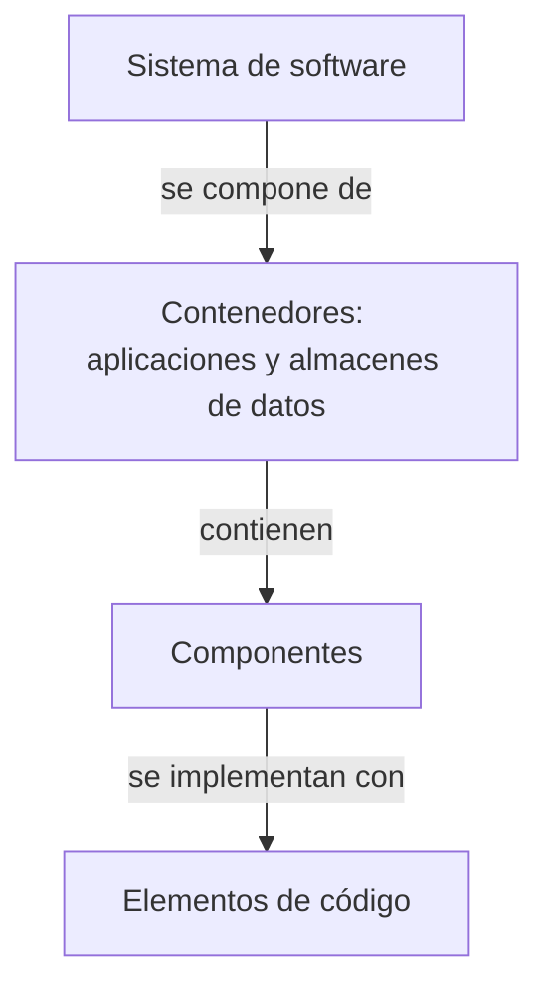

# Diagramas

Un diagrama de arquitectura muestra la estructura de un sistema con un vocabulario que todos leen
igual; el modelo C4 lo organiza en cuatro niveles de zoom (contexto, contenedores, componentes y
código), cada uno para una audiencia distinta.

## El problema de las cajas y flechas sueltas

Un diagrama sin reglas mezcla niveles: en la misma hoja aparecen un servicio, una tabla, una clase
y un proveedor externo, y cada lector entiende otra cosa por "caja". El modelo C4, de Simon Brown,
resuelve eso con un vocabulario fijo y niveles separados. Su sitio lo presenta como un "easy to
learn, developer friendly approach to software architecture diagramming". Richards y Ford tienen un
capítulo propio, "Diagramming Architecture", en la parte de técnicas de su libro.

> [!NOTE] Sin fuente todavía: qué dice el capítulo de Richards y Ford y cómo se relaciona con C4
> (no se pudo leer).

## Las abstracciones de C4

C4 define pocas piezas, anidadas. "A software system is made up of one or more containers
(applications and data stores)"; cada contenedor "contains one or more components", y los
componentes se "implemented by one or more code elements". Contenedor no quiere decir contenedor de
Docker: es cualquier cosa que corre o guarda datos por separado, como una aplicación web, una API o
una base.

## Los cuatro niveles

| Nivel | Muestra | Para quién sirve |
|---|---|---|
| Contexto del sistema | El sistema como una caja, con sus usuarios y los sistemas con que habla | Cualquiera, también quien no es técnico |
| Contenedores | Las aplicaciones y almacenes de datos que lo forman y cómo se comunican | Quien diseña, opera o despliega |
| Componentes | Las piezas de adentro de un contenedor | Quien construye ese contenedor |
| Código | Clases o funciones de un componente | Casi nunca hace falta dibujarlo |

La columna "para quién sirve" es una lectura de esta base sobre los niveles; el sitio define los
niveles y las abstracciones. C4 suma diagramas suplementarios: el panorama de sistemas (system
landscape), el dinámico, para un flujo concreto, y el de despliegue.

## Dónde se usan los diagramas en las decisiones

El diagrama de contenedores suele ser el que se usa en un [análisis de riesgo](analisis-de-riesgo.md),
porque ahí se ven las dependencias por la red, y el que acompaña a un [ADR](adr.md) cuando la
decisión cambia la estructura (las dos cosas son lectura de esta base, no del sitio de C4). En un sistema con
un modelo de IA, el modelo y el
[gateway](../Sistemas-con-modelos/router-y-gateway-de-modelos.md) aparecen en el nivel de
contenedores como dependencias externas, igual que cualquier otra API.

## Qué leer

c4model.com, empezando por la página de abstracciones y después la de los cuatro niveles. Fijarse
en los niveles y en qué es un contenedor. Lo completa el capítulo
"Diagramming Architecture" de Richards y Ford.
