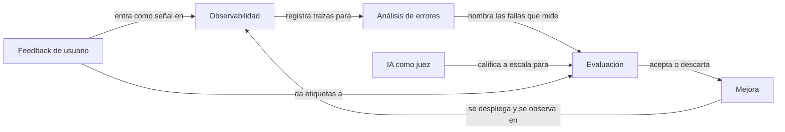

# Evaluación y observabilidad

Evaluación y observabilidad es la parte de la arquitectura que mide si un sistema con un modelo
adentro hace lo que tiene que hacer: registra lo que pasa en producción, lo lee para encontrar las
fallas, las convierte en pruebas repetibles y devuelve el uso como dato.

En el tema, esta vertical es la que decide. Cada pieza de
[Sistemas con modelos](../Sistemas-con-modelos/sistemas-con-modelos.md) (contexto, router, cache,
agente) entra cuando una medición muestra que hace falta, que es la regla de
[Empezar simple](../Decisiones/empezar-simple.md). Lo que se mide son las
[características](../Caracteristicas/caracteristicas.md) del sistema, con el
[costo y la latencia](../Caracteristicas/costo-y-latencia.md) al frente, y los resultados son la
evidencia que queda en un [ADR](../Decisiones/adr.md). Según Huyen, "Evaluation is necessary at
every step of the development process".

## El bucle que va de la traza a la mejora

Las cinco piezas forman un ciclo. La observabilidad deja una traza de cada consulta; el análisis de
errores lee esas trazas a mano y nombra las fallas; la evaluación convierte cada falla en un caso
que se puede correr de nuevo; la mejora (un prompt, más contexto, otro modelo) se acepta o se
descarta según esa evaluación, y el feedback del usuario vuelve a entrar como traza y como etiqueta.

El ciclo no es de Huyen ni de una sola fuente: es la síntesis de esta base. Huyen ordena el libro
con la evaluación primero (capítulos 3 y 4, antes de prompting, RAG y fine-tuning) y la
observabilidad y el feedback al final (capítulo 10). Husain describe un ciclo equivalente desde la
práctica: mirar trazas, anotar fallas, contarlas, escribir pruebas y volver a mirar.

## Por qué la evaluación va antes que las piezas

Con un modelo, la misma entrada puede dar salidas distintas, y "correcto" pasa a ser una proporción
sobre un conjunto de casos. Sin ese conjunto no hay forma de saber si un cambio mejoró o empeoró el
sistema. Husain lo dice sin rodeos: "Rigorous and systematic evaluation is the most important part
of the whole system." Huyen cuenta entre los errores comunes llegar rápido al 60 % y descubrir que
del 60 al 100 es lo difícil; lo que hace visible esa distancia es la evaluación.

La evaluación tampoco termina en el modelo. Muchas veces la falla está en el producto: Huyen relata
equipos que midieron la calidad del resumen cuando a sus usuarios no les importaba el resumen, y
concluye "the issue wasn't with AI, but with product". Por eso el bucle incluye el
[feedback de usuario](feedback-de-usuario.md) y no solo pruebas automáticas.

## Cómo falla el bucle

- **Se mide antes de mirar.** Se eligen métricas genéricas sin haber leído trazas, y miden cosas que
  no fallan. Lo corrige el [análisis de errores](analisis-de-errores.md).
- **Se confía en el juez sin validarlo.** Un modelo que califica a otro tiene sesgos propios; ver
  [IA como juez](ia-como-juez.md).
- **No se registra lo intermedio.** Sin la traza de cada paso, una falla del final no se puede
  atribuir a la recuperación, al prompt o al modelo; ver [observabilidad](observabilidad-de-modelos.md).
- **Se pide feedback que nadie da.** Las señales explícitas son escasas y sesgadas; ver
  [feedback de usuario](feedback-de-usuario.md).

Lo que la salida del modelo no puede emitir, por seguridad o por forma, no se evalúa después: se
bloquea antes con [guardrails](../../IA/guardrails.md). Las dos cosas se complementan.

## Qué hay adentro de la evaluación y la observabilidad

- [Evaluación](evaluacion.md) — cómo se prueba algo cuya salida cambia: niveles, conjuntos de casos y
  por qué la prueba unitaria sola no alcanza.
- [Análisis de errores](analisis-de-errores.md) — leer trazas a mano para saber qué medir; el paso que
  más se saltea.
- [IA como juez](ia-como-juez.md) — usar un modelo para calificar salidas a escala, sus sesgos y cómo
  se valida.
- [Observabilidad](observabilidad-de-modelos.md) — qué se registra en producción (métricas, logs y trazas) y
  con qué vocabulario.
- [Feedback de usuario](feedback-de-usuario.md) — las señales explícitas e implícitas del uso y sus
  límites como dato.
