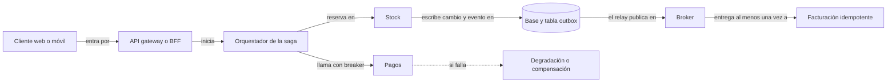

# Sistemas distribuidos

Sistemas distribuidos es la parte de la arquitectura que se ocupa de lo que aparece cuando el sistema se reparte entre procesos que se llaman por la red: fallas parciales, datos repartidos en varias bases y bordes frente a muchos clientes. Cada uno de esos problemas tiene sus patrones.

La vertical empieza donde un [estilo](../Estilos/estilos.md) reparte el sistema: [service-based](../Estilos/service-based.md), [event-driven](../Estilos/event-driven.md) o [microservicios](../Estilos/microservicios.md). Un [monolito modular](../Estilos/monolito-modular.md) no necesita casi nada de lo que sigue, y esa es una de las razones del tema para empezar por él. Qué servicios de nube transportan los mensajes está en [Mensajería](../../Cloud/Mensajeria/mensajeria.md), en Cloud, y cómo se mira un sistema repartido en producción, en [Observabilidad](../../DevOps/Operacion/observabilidad.md), en DevOps.

## Los tres costos de distribuir

Fowler resume en tres los costos de partir un sistema en servicios: la distribución ("remote calls are slow and are always at risk of failure"), la consistencia eventual entre las bases de cada servicio y la complejidad operativa. Los patrones de esta vertical se ordenan por los dos primeros, más los bordes del sistema; el tercero lo cubren [DevOps](../../DevOps/devops.md) y [Platform Engineering](../../Platform-Engineering/platform-engineering.md).

**Fallas parciales.** En un proceso, una función responde o tira una excepción. Por la red, una dependencia puede tardar, fallar a medias o no contestar, y esa falla se propaga a quien la llama. El [circuit breaker](circuit-breaker.md) deja de llamar a una dependencia que viene fallando; la [degradación controlada](degradacion-controlada.md) decide qué se responde mientras tanto.

**Datos repartidos.** Cuando cada servicio tiene su base, una operación que toca varios no cabe en una transacción. La [saga](saga.md) la parte en transacciones locales con compensaciones; el [outbox](outbox.md) garantiza que cada paso publique su evento si y solo si confirmó su cambio; la [clave de idempotencia](clave-de-idempotencia.md) hace seguro el reintento, y [CQRS](cqrs.md) separa el modelo que escribe del que lee cuando las dos necesidades divergen.

**Bordes.** Muchos clientes frente a muchos servicios necesitan una puerta: el [API gateway y el BFF](api-gateway-y-bff.md). [API-led connectivity](api-led-connectivity.md) dice en qué capa va cada API, y [multi-tenancy](multi-tenancy.md), cómo se sirve a varios clientes desde una instancia sin mezclar sus datos.

## Cómo se encadenan en un pedido

Los patrones no se usan sueltos. En un checkout repartido entre servicios, el pedido entra por el gateway, un orquestador corre la saga, cada servicio publica por su outbox y cada llamada síncrona va protegida por un breaker:

El ejemplo es de esta base: muestra cómo cada patrón cubre un hueco que el anterior deja. El breaker evita esperar, pero no dice qué responder (degradación); la saga confirma pasos por separado, pero necesita publicarlos sin perderlos (outbox); el outbox publica al menos una vez, y por eso el consumidor tiene que ser idempotente.

## Cuándo no hace falta nada de esto

Cada patrón de esta vertical es una pieza más que construir, probar y operar. Si el sistema todavía es un solo despliegue, la mayoría sobra: una transacción local reemplaza a la saga y al outbox, y una llamada a un método no necesita breaker. Es la regla de [Empezar simple](../Decisiones/empezar-simple.md): el patrón entra cuando la falla o la carga que resuelve aparece medida. Fowler lo dice de [CQRS](cqrs.md) con todas las letras: "for most systems CQRS adds risky complexity".

## Qué hay adentro

- [Circuit breaker](circuit-breaker.md) — corta las llamadas a una dependencia que viene fallando, con sus tres estados.
- [Degradación controlada](degradacion-controlada.md) — qué responde un servicio cuando falla una dependencia, según el tipo de operación.
- [Saga](saga.md) — una operación entre servicios como secuencia de transacciones locales con compensaciones, coreografiada u orquestada.
- [Outbox](outbox.md) — guardar el cambio y su evento en la misma transacción para no perder ni inventar eventos.
- [Clave de idempotencia](clave-de-idempotencia.md) — un identificador que hace seguro reintentar una operación sin repetir el efecto.
- [CQRS](cqrs.md) — modelos separados para escribir y para leer, con event sourcing como variante.
- [API gateway y BFF](api-gateway-y-bff.md) — la puerta única delante de los servicios y el backend dedicado a cada experiencia.
- [API-led connectivity](api-led-connectivity.md) — las APIs en tres capas: System, Process y Experience.
- [Multi-tenancy](multi-tenancy.md) — servir a varios clientes desde una instancia, con pool, bridge o silo.
- [Proteger un cliente HTTP con Resilience4j en Spring Boot](resilience4j-en-spring-boot.md) — implementación del breaker, el retry y el fallback en Java.

[Strangler fig](../Estilos/strangler-fig.md), que se usa para partir un sistema en servicios sin apagarlo, vive en Estilos porque es una técnica de migración entre estilos.
