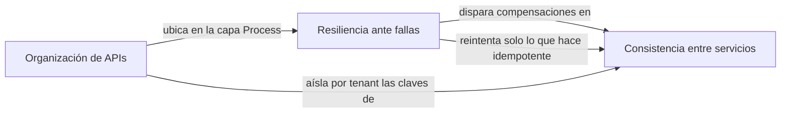

# Arquitectura

Patrones de arquitectura de software para sistemas distribuidos: cómo se organizan las APIs
entre servicios y cómo se resiste a las fallas de una dependencia.

Cuando un producto se reparte entre servicios con base propia que se llaman por la red, aparecen
tres problemas: en qué capa va cada API, qué se responde cuando una dependencia falla y cómo se
mantiene coherente una operación que toca varios servicios. Las tres partes del tema responden a
eso.

Las herramientas y prácticas de quien escribe el código (Git, YAML, configuración, pruebas de
API) están en [Desarrollo](../Desarrollo/desarrollo.md). Cómo una plataforma interna expone sus
capacidades está en [Plataforma API-first](../Platform-Engineering/Plataforma-interna/plataforma-api-first.md),
en Platform-Engineering: API-first dice cómo se expone una capacidad; API-led, en qué capa va.

## Las tres partes de un sistema distribuido

### Organización de APIs

Las APIs se ordenan en capas System, Process y Experience, y cada request lleva su tenant desde
el borde: la capa Experience lo resuelve y lo pasa a las de abajo. Las fallas se contienen en la
capa Process, que es la que llama a varias dependencias.

- [API-led connectivity](api-led-connectivity.md) — las capas System, Process y Experience; leerla primero si se diseña
  un sistema con varios servicios.
- [Multi-tenancy](multi-tenancy.md) — servir a varios clientes desde una misma instancia sin mezclar sus datos;
  leerla antes de diseñar el modelo de datos de un SaaS.

### Resiliencia ante fallas

Una dependencia que viene fallando se corta con un circuit breaker, y lo que se responde mientras
está abierto se decide antes, según la operación sea una lectura o un comando crítico. En Java,
las dos cosas se escriben con Resilience4j.

- [Circuit breaker](circuit-breaker.md) — cortar las llamadas a una dependencia que viene fallando; la base de las
  dos siguientes.
- [Degradación controlada](degradacion-controlada.md) — qué devolver cuando una dependencia falla, según sea una lectura o
  un comando crítico; leerla antes de escribir un fallback.
- [Proteger un cliente HTTP con Resilience4j en Spring Boot](resilience4j-en-spring-boot.md) — pasos para proteger un cliente HTTP con circuit breaker,
  retry y fallback, en un servicio Java.

### Consistencia entre servicios

Una operación que toca varios servicios con base propia no cabe en una transacción: se arma como
saga, con una compensación por paso, y cada paso que se reintenta necesita ser idempotente.

- [Saga](saga.md) — una secuencia de transacciones locales con compensaciones; leerla cuando una
  operación toca varios servicios con base propia y no cabe en una transacción.
- [Clave de idempotencia](clave-de-idempotencia.md) — reintentar una operación sin repetir su efecto; leerla al diseñar
  cualquier `POST` que el cliente pueda reintentar, como un pago.

## Los documentos de diseño originales

Los documentos de diseño de un MVP de e-commerce multi-tenant, de los que salen varias de estas
notas, están sin cambios en `Archivo/Arquitectura/` (`mvp-ecommerce-arquitectura.md` y
`circuit-breaking-resilience4j.md`). Son de un proyecto propio, cuyo frontend está en el repo
`SmallTechCo/ventos-ecommerce-front`.
