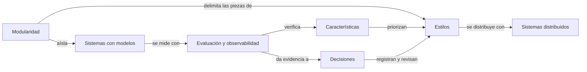

# Arquitectura

La arquitectura de software son las decisiones de estructura que cuestan caro cambiar: qué
características tiene que cumplir el sistema, cómo se parte en módulos, con qué estilo se arma y
cómo se verifica que sigue funcionando, también cuando una de sus piezas es un modelo de IA que no
responde siempre lo mismo.

El tema se escribe desde dos referencias que se complementan. Richards y Ford (*Fundamentals of
Software Architecture*, 2ª ed., 2025) ordenan el canon: características, modularidad, estilos y
decisiones. Chip Huyen (*AI Engineering*, 2025) agrega lo que el canon no tenía: un sistema con un
modelo adentro se arma de a una pieza por vez, y la evaluación decide cuándo hace falta la
siguiente. Según Huyen, "a component can be skipped if your system works well without it". El cruce
entre los dos índices es de esta base: ninguna de las dos fuentes lo hace.

Cómo funciona un modelo de lenguaje por dentro y cómo se acota lo que emite está en
[IA](../IA/ia.md). Las herramientas de quien escribe el código están en
[Desarrollo](../Desarrollo/desarrollo.md), y cómo una plataforma interna expone sus capacidades, en
[Platform Engineering](../Platform-Engineering/platform-engineering.md).

## De qué está hecha una arquitectura

Las características dicen qué tiene que cumplir el sistema; la modularidad y el estilo dicen cómo se
arma para cumplirlo; la evaluación y la observabilidad miden si lo cumple, y las decisiones dejan
escrito por qué se eligió cada cosa. Cuando una pieza es un modelo, su arquitectura propia
(contexto, router, cache, agente) se monta sobre la misma base y se mide con el mismo bucle.

- [Características](Caracteristicas/caracteristicas.md) — las "-ilities" que el sistema tiene que
  cumplir, cómo se eligen y cómo se miden; con un modelo adentro, el costo por consulta y la latencia
  pasan al frente.
- [Modularidad](Modularidad/modularidad.md) — dónde se pone un límite entre piezas y por qué el
  modelo va detrás de una interfaz propia.
- [Estilos](Estilos/estilos.md) — las formas de armar el sistema (monolito modular, capas, eventos,
  servicios, microservicios) y cómo se elige entre ellas.
- [Sistemas distribuidos](Sistemas-distribuidos/sistemas-distribuidos.md) — los patrones para cuando
  el sistema se reparte entre servicios que se llaman por la red: fallas, consistencia y bordes.
- [Sistemas con modelos](Sistemas-con-modelos/sistemas-con-modelos.md) — la arquitectura de un
  sistema con un modelo de IA adentro, en el orden en que Huyen suma las piezas.
- [Evaluación y observabilidad](Evaluacion-y-observabilidad/evaluacion-y-observabilidad.md) — cómo
  se prueba algo cuya salida cambia, cómo se mira lo que pasa en producción y cómo vuelve el uso como
  dato.
- [Decisiones](Decisiones/decisiones.md) — cómo se decide, se registra y se dibuja una arquitectura,
  empezando por lo más simple.
- [Fundamentos](Fundamentos/fundamentos-de-arquitectura.md) — las escuelas, lo que pierde peso y por
  qué, y la bibliografía.

## Empezar simple y medir antes de sumar

La idea que ordena el tema es la misma en el canon y en Huyen: cada pieza tiene un costo y entra
cuando hay evidencia de que hace falta. En el canon, eso es partir de un
[monolito modular](Estilos/monolito-modular.md) y no de microservicios. En un sistema con modelos, es
probar primero con el prompt, después con contexto y recién después con fine-tuning o un agente;
Huyen cuenta entre los errores comunes "use an agentic framework when direct API calls work". Lo que
decide si una pieza entra es la [evaluación](Evaluacion-y-observabilidad/evaluacion.md), y la regla
completa está en [Empezar simple](Decisiones/empezar-simple.md).

## Lo que cambia cuando una pieza no es determinista

Una prueba unitaria fija qué tiene que devolver una función. Con un modelo, la misma entrada puede dar
salidas distintas, y "correcto" pasa a ser una proporción sobre un conjunto de casos. Por eso la
evaluación ocupa dos capítulos del libro de Huyen antes de prompting, RAG y fine-tuning, y por eso en
este tema tiene vertical propia. Tres cosas del canon ganan peso con eso: medir características con
números ([fitness function](Caracteristicas/fitness-function.md)), aislar la pieza incierta detrás de
una interfaz ([aislar lo no determinista](Modularidad/aislar-lo-no-determinista.md)) y registrar por
qué se eligió cada modelo y cada umbral ([ADR](Decisiones/adr.md)).

## Catálogo de patrones

Cada patrón vive en la vertical de su problema; esta tabla los junta.

| Problema | Patrón | Nota |
|---|---|---|
| Una dependencia viene fallando y arrastra al resto | Circuit breaker | [Circuit breaker](Sistemas-distribuidos/circuit-breaker.md) |
| Qué responder cuando una dependencia no contesta | Degradación controlada | [Degradación controlada](Sistemas-distribuidos/degradacion-controlada.md) |
| Una operación toca varios servicios con base propia | Saga | [Saga](Sistemas-distribuidos/saga.md) |
| Un reintento no debe repetir el efecto | Clave de idempotencia | [Clave de idempotencia](Sistemas-distribuidos/clave-de-idempotencia.md) |
| Guardar un cambio y publicar su evento sin perder ninguno | Outbox | [Outbox](Sistemas-distribuidos/outbox.md) |
| Lecturas y escrituras con necesidades muy distintas | CQRS | [CQRS](Sistemas-distribuidos/cqrs.md) |
| Varios clientes (web, móvil) frente a muchos servicios | API gateway y BFF | [API gateway y BFF](Sistemas-distribuidos/api-gateway-y-bff.md) |
| En qué capa va cada API | API-led connectivity | [API-led connectivity](Sistemas-distribuidos/api-led-connectivity.md) |
| Varios clientes en una instancia sin mezclar datos | Multi-tenancy | [Multi-tenancy](Sistemas-distribuidos/multi-tenancy.md) |
| Reemplazar un sistema viejo sin apagarlo | Strangler fig | [Strangler fig](Estilos/strangler-fig.md) |
| El modelo no sabe lo que necesita para responder | RAG | [Contexto y RAG](Sistemas-con-modelos/contexto-y-rag.md) |
| Cada consulta necesita un modelo distinto, o hay que centralizar el acceso | Router y gateway | [Router y gateway de modelos](Sistemas-con-modelos/router-y-gateway-de-modelos.md) |
| Consultas repetidas cuestan y tardan | Cache de modelos | [Cache de modelos](Sistemas-con-modelos/cache-de-modelos.md) |
| La salida del modelo puede ser incorrecta o dañina | Guardrails | [Guardrails de LLM](../IA/guardrails.md) |
| La tarea pide varios pasos y herramientas | Agente | [Agente](Sistemas-con-modelos/agente.md) |
| Evaluar a escala sin personas | IA como juez | [IA como juez](Evaluacion-y-observabilidad/ia-como-juez.md) |

## Qué leer según lo que estés construyendo

- Si arrancás un producto con un LLM adentro: [Sistemas con modelos](Sistemas-con-modelos/sistemas-con-modelos.md),
  [Empezar simple](Decisiones/empezar-simple.md) y [Evaluación](Evaluacion-y-observabilidad/evaluacion.md).
- Si tenés que elegir cómo armar un sistema nuevo: [Características arquitectónicas](Caracteristicas/caracteristicas-arquitectonicas.md),
  [Elegir un estilo](Estilos/elegir-un-estilo.md) y [Monolito modular](Estilos/monolito-modular.md).
- Si dudás entre monolito y microservicios: [Monolito modular](Estilos/monolito-modular.md),
  [Microservicios](Estilos/microservicios.md) y, en [Lo que pierde peso](Fundamentos/lo-que-pierde-peso.md),
  la disputa sobre microservicios por defecto.
- Si tenés que probar algo cuya salida cambia: [Evaluación](Evaluacion-y-observabilidad/evaluacion.md),
  [Análisis de errores](Evaluacion-y-observabilidad/analisis-de-errores.md) e [IA como juez](Evaluacion-y-observabilidad/ia-como-juez.md).
- Si dudás entre mejorar el prompt, sumar RAG o hacer fine-tuning: [Prompt, RAG o fine-tuning](Sistemas-con-modelos/prompt-rag-o-finetuning.md).
- Si tenés que dejar escrita una decisión: [ADR](Decisiones/adr.md) y [Diagramas](Decisiones/diagramas.md).
- Si migrás un sistema viejo: [Strangler fig](Estilos/strangler-fig.md).
- Si un servicio llama a otros por la red: [Sistemas distribuidos](Sistemas-distribuidos/sistemas-distribuidos.md).
- Si querés saber qué no conviene estudiar primero: [Lo que pierde peso](Fundamentos/lo-que-pierde-peso.md).

## Del canon al sistema con modelos

Para aprender el tema, leé en este orden: [Características](Caracteristicas/caracteristicas.md),
[Modularidad](Modularidad/modularidad.md), [Estilos](Estilos/estilos.md) y
[Decisiones](Decisiones/decisiones.md) dan el canon. Después,
[Evaluación y observabilidad](Evaluacion-y-observabilidad/evaluacion-y-observabilidad.md), antes que
[Sistemas con modelos](Sistemas-con-modelos/sistemas-con-modelos.md), porque cada pieza de esa
vertical se justifica con una medición. [Sistemas distribuidos](Sistemas-distribuidos/sistemas-distribuidos.md)
se lee cuando el sistema se reparte entre servicios.
