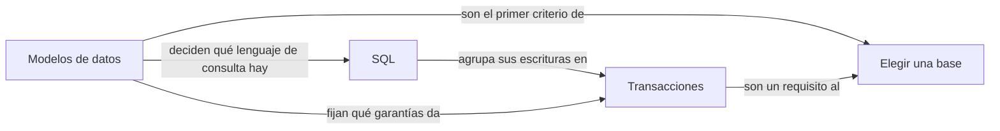

# Bases de datos

Base de datos se le dice al conjunto de datos de un sistema y al programa que lo guarda (el
motor), que lo deja consultar y modificar con un lenguaje (casi siempre SQL) y lo mantiene
correcto aunque muchos lo usen a la vez o el equipo se caiga. Este tema explica sus modelos, SQL
a fondo, las transacciones y cómo se elige una.

El [glosario](Fundamentos/glosario-de-bases-de-datos.md) separa los dos sentidos: el conjunto de
datos es la base, y el programa, el motor.

Una planilla también guarda datos, pero deja que cualquiera escriba cualquier cosa en cualquier
celda y no sabe qué pasa si dos personas cambian la misma fila. Una base hace cumplir reglas (este
campo es una fecha, este pedido tiene que tener un cliente que existe) y ordena las escrituras
simultáneas. El paso de una a otra está en [cuándo pasar a una base](../Planillas-de-calculo/cuando-pasar-a-una-base.md).

El tema se queda del lado de quien construye un sistema y tiene que elegir, consultar y modificar
su base. Cómo está hecho el motor por dentro (páginas, árboles B, registro de escrituras) y la
operación fina quedan afuera. El análisis de datos, los almacenes analíticos y SQL para análisis
están en [Datos](../Datos/datos.md); los servicios de bases de Azure, en
[Almacenamiento y bases de datos en Azure](../Cloud/Datos-operacionales/almacenamiento-y-bases-de-datos-en-azure.md);
cómo varios clientes comparten una base, en [Multi-tenancy](../Arquitectura/multi-tenancy.md).

## De qué está hecho trabajar con una base

Cuatro partes. El modelo de datos decide la forma en que se guarda todo; SQL es cómo se le habla
a una base relacional; las transacciones hacen que varias operaciones cuenten como una aunque haya
otros escribiendo al mismo tiempo; y elegir una base es juntar las tres con lo que cuesta operarla.

- [Modelos de datos](Modelos-de-datos/modelos-de-datos.md) — relacional, documentos, clave-valor y los modelos
  especializados (grafos, series de tiempo, búsqueda, vectores): qué forma tiene el dato en cada uno y cuándo
  conviene.
- [SQL](SQL/sql.md) — el lenguaje de las bases relacionales, a fondo: consultar, unir, agregar, ventanas, modificar,
  definir tablas, índices y cómo se usa desde una aplicación. Es la vertical más honda.
- [Transacciones](Transacciones/transacciones.md) — ACID (atomicidad, consistencia, aislamiento y
  durabilidad: lo que promete una [transacción](Transacciones/transaccion.md)), niveles de aislamiento y cómo evitar que dos
  personas compren el último producto.
- [Elegir una base](Elegir-una-base/elegir-una-base.md) — los criterios, cuándo alcanza SQLite, propia contra
  administrada, y la ficha de motores con versiones.

## El modelo se elige por cómo se va a consultar

Lo que más pesa al elegir es qué preguntas se le van a hacer a los datos, no cuántos hay. MongoDB lo
dice como principio de su modelado: "data that's accessed together should be stored together". Un
pedido que se lee siempre entero con sus ítems cabe bien en una
[base de documentos](Modelos-de-datos/base-de-documentos.md). Un comercio que cruza
pedidos con clientes, productos y stock en muchas direcciones necesita uniones, y eso es lo que hace
bien el modelo relacional. "NoSQL escala más" es una simplificación que discute la
[posición contraria](Fundamentos/fundamentos-de-bases-de-datos.md#ideas-que-no-se-sostienen).
Qué motor implementa cada modelo, con su versión vigente, está en la
[ficha de motores](Elegir-una-base/motores-de-bases-de-datos.md).

## Las garantías dependen del motor y del nivel

Una transacción no protege de todo por el solo hecho de existir. El
[nivel de aislamiento](Transacciones/nivel-de-aislamiento.md) por defecto
cambia de un motor a otro: READ COMMITTED en PostgreSQL y SQL Server, REPEATABLE READ en MySQL,
serializable en SQLite. El mismo nombre de nivel se comporta distinto según el motor. Por eso el
caso del stock se resuelve con una escritura condicional o un bloqueo explícito, como explica
[concurrencia](Transacciones/concurrencia.md), y no confiando en el nivel por defecto.

## Qué leer según lo que estés haciendo

- Si tenés que elegir la base de un sistema nuevo: [criterios de elección](Elegir-una-base/criterios-de-eleccion.md),
  después [modelos de datos](Modelos-de-datos/modelos-de-datos.md) y la
  [ficha de motores](Elegir-una-base/motores-de-bases-de-datos.md).
- Si tenés que escribir una consulta y no sabés por dónde empezar: [consulta SELECT](SQL/consulta-select.md),
  [join](SQL/join.md) y [agregación](SQL/agregacion.md); para «el último de cada uno», [funciones de ventana](SQL/funciones-de-ventana.md) y
  [subconsultas y CTE](SQL/subconsultas-y-cte.md) (una CTE es una consulta con nombre al principio
  de otra), que lo resuelve de cuatro formas.
- Si una consulta anda lenta: [índice](SQL/indice.md); si la lentitud viene de muchas consultas chicas desde la
  aplicación, [SQL desde una aplicación](SQL/sql-desde-una-aplicacion.md).
- Si dos usuarios pueden pisarse al escribir (stock, saldo, turnos): [concurrencia](Transacciones/concurrencia.md) y
  [nivel de aislamiento](Transacciones/nivel-de-aislamiento.md); el `UPDATE` que descuenta stock sin
  vender lo que no hay está en [modificar datos](SQL/modificar-datos.md#descontar-stock-sin-vender-lo-que-no-hay).
- Si dudás entre un ORM y escribir el SQL a mano: [SQL desde una aplicación](SQL/sql-desde-una-aplicacion.md#orm-o-sql-a-mano).
- Si tenés que diseñar las tablas: [definir tablas](SQL/definir-tablas.md) y [base relacional](Modelos-de-datos/base-relacional.md).
- Si tenés que diseñar el sistema de stock y ventas completo: no hay nota todavía; lo más cercano es
  [definir tablas](SQL/definir-tablas.md), [concurrencia](Transacciones/concurrencia.md) y
  [cuándo pasar a una base](../Planillas-de-calculo/cuando-pasar-a-una-base.md).
- Si una planilla ya no alcanza: [cuándo pasar a una base](../Planillas-de-calculo/cuando-pasar-a-una-base.md).

## Orden de lectura

Para quien viene de la planilla: esta entrada, [Modelos de datos](Modelos-de-datos/modelos-de-datos.md) y después
[SQL](SQL/sql.md) en el orden de su entrada, con los ejercicios de la [ruta de SQL](Fundamentos/ruta-de-sql.md) y el
[glosario](Fundamentos/glosario-de-bases-de-datos.md) a mano para los términos.
[Transacciones](Transacciones/transacciones.md) se lee cuando el sistema tiene más de un usuario escribiendo, y
[Elegir una base](Elegir-una-base/elegir-una-base.md) cuando hay que decidir.

- [Fundamentos](Fundamentos/fundamentos-de-bases-de-datos.md) — historia, enfoques en conflicto, ideas que no se
  sostienen, bibliografía y glosario.
