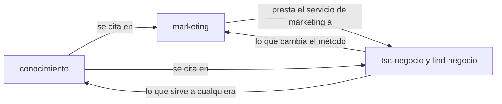

# Convenciones de esta base

Lo propio de esta base para la skill `documentar` (the-software-co/skills). El método general
está en la skill; esto lo completa.

- **Base**: la raíz de este repo, compartida por Matias y Fer. La entrada raíz es `conocimiento.md`, y la
  entrada de cada tema y de cada vertical se llama como su carpeta (`<Tema>/<tema>.md`). Los enlaces van como Markdown relativo
  (`[texto](Datos/Cohortes/cohorte.md)`), que se leen en GitHub y en cualquier editor.
- **Temas**: se estructuran por capas (el todo, las verticales como carpetas, los componentes y lo
  operativo), como dice el método de la skill. Los arma el modo `nuevo`, con su `ALCANCE.md` y sus
  informes crudos en `<Tema>/.investigacion/`. `Marketing/` es el ejemplo de referencia.
- **Agnóstica**: ninguna nota nombra a una empresa nuestra ni a un cliente. Lo que se aprendió en una
  empresa entra contado en general y se cita como `experiencia propia, <mes y año>, <tipo de empresa>`
  (por ejemplo, «una consultora de software»). Cómo aplica una idea a una empresa se escribe en el repo
  de esa empresa, que enlaza la nota de acá.
- **Dueños**: `matias` por defecto; una nota lleva `dueno` solo si es de `fer` o de `familia`.
- **Apuntes personales**: quedan en la carpeta de cada persona (p. ej. `Fer/Estudio/`) y se citan
  en `fuentes`.
- **Archivo**: los originales que se reemplazan van a `Archivo/<Tema>/`, en la raíz de la base.
- **Volcar desde el Marco**: cuando el volcado sale de una Idea Clarificada como Conocimiento en
  la Revisión semanal, la ruta de la nota principal, relativa a la base (p. ej.
  `Datos/Cohortes/cohorte.md`), es la que va en `nota_vault` del Clarificar.
- **Sitio**: la base se publica en <https://mtsdlf.github.io/conocimiento/> en cada cambio a `main`
  (`.github/workflows/sitio.yml`). Es **público**: cualquiera con la URL lo lee, borradores incluidos,
  así que lo que no puede leer cualquiera no entra a esta base. `./sitio/servir` lo levanta local en
  `http://127.0.0.1:8000`; solo necesita `uv`. Las áreas y su orden salen de `conocimiento.md`: un
  tema nuevo aparece en el sitio cuando se enlaza ahí.
- **Nunca**: secretos (van a Vaultwarden) ni lo confidencial de un empleador (queda en sus
  herramientas, con un enlace).

## Dónde va cada cosa

La organización tiene dos clases de repos: uno guarda el saber y los demás hacen el trabajo. La fuente de esta tabla, con los procesos que cruzan repos, es [`mtsdlf/procesos`](https://github.com/mtsdlf/procesos/blob/main/plataforma/donde-va-cada-cosa.md).

| Es | Va a |
|---|---|
| Un concepto, una técnica o algo aprendido que le sirve a cualquiera, también lo que se aprendió en una empresa contado sin nombrarla | `mtsdlf/conocimiento`, con la skill `documentar` |
| Cómo hacemos marketing: el método, sus plantillas, los playbooks por canal y los casos de cada cliente | `mtsdlf/marketing` |
| Lo de una empresa: su modelo, sus precios, sus clientes, sus decisiones | su repo: `mtsdlf/tsc-negocio` (la consultora) o `mtsdlf/lind-negocio` (Lind) |
| Lo de un sistema | los docs de su repo |
| Cómo se trabaja en la plataforma: procesos, runbooks, quién decide | `mtsdlf/procesos` |



El repo donde está abierta la sesión no decide a dónde va algo: si en una sesión de `marketing` o de una empresa sale un tema general, se escribe en `conocimiento`. Hacia abajo se enlaza, no se copia. Hacia arriba sube, sin nombres de empresas ni de clientes, lo que dejó de ser de una sola empresa: a `conocimiento` si es saber, y a `marketing`, con un issue con el label `propuesta`, si cambia el método. La experiencia propia se cita como `experiencia propia, <mes y año>, <tipo de empresa>`.

```yaml revisar
ignorar: []
```
