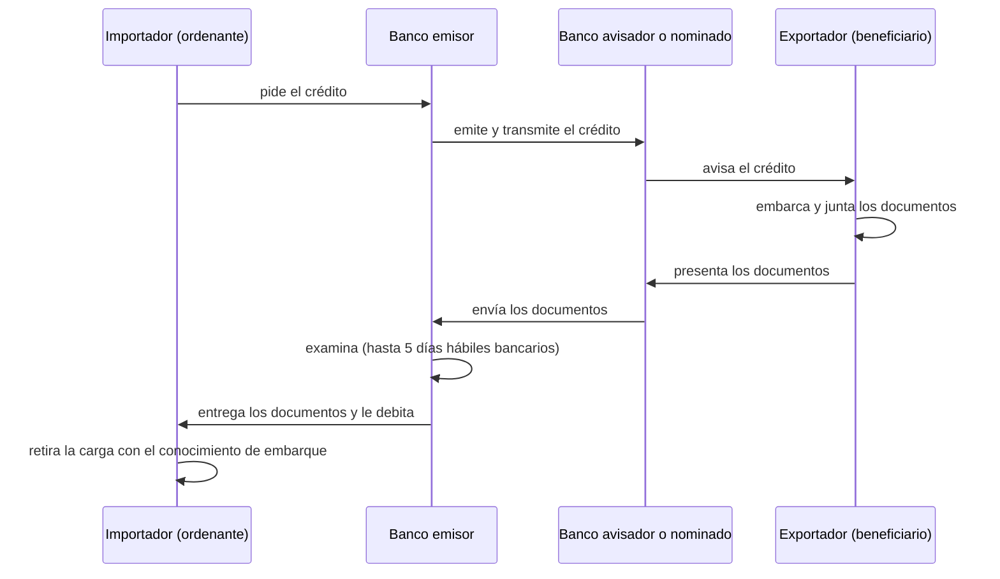

# Carta de crédito

La carta de crédito (crédito documentario) es el compromiso irrevocable de un banco, pedido por el importador, de pagarle al exportador si este presenta los documentos que el crédito exige y en los plazos que fija. El banco mira solo los papeles, no la mercadería, y las reglas que el crédito adopta cuando lo dice son las UCP 600 de la Cámara de Comercio Internacional.

Es uno de los [medios de pago del comercio exterior](medios-de-pago-del-comercio-exterior.md), el que reparte el riesgo entre las dos puntas. La alternativa más barata, en la que el banco maneja los documentos sin comprometerse a pagar, es la [cobranza documentaria](cobranza-documentaria.md). El crédito se apoya en los [documentos del comercio exterior](documentos-del-comercio-exterior.md), sobre todo en el conocimiento de embarque a la orden, que le da al banco un papel que representa la carga. Lo que el crédito le cuesta y le compromete a la empresa (la línea que le da el banco, la comisión, el plazo) es [financiamiento](../../Tesoreria/Financiamiento/financiamiento.md) de Tesorería, y que el banco emisor pague es un [riesgo de contraparte](../../Tesoreria/Riesgos-financieros/riesgos-financieros.md#riesgo-de-contraparte-quién-puede-no-cumplir). Las reglas cambiarias argentinas para pagar o cobrar con carta de crédito están en [pagos del comercio exterior en la Argentina](pagos-del-comercio-exterior-en-argentina.md).

## Qué problema resuelve

El exportador no quiere mandar la mercadería sin saber si va a cobrar, y el importador no quiere pagar sin saber si la mercadería salió. La guía de financiamiento del comercio de la International Trade Administration de EE. UU. (ITA) lo dice así: «For exporters, any sale is a gift until payment is received», y «For importers, any payment is a donation until the goods are received».

La carta de crédito pone a un banco en el medio. El exportador cobra del banco, no del importador, siempre que embarque y presente los documentos pedidos. El importador sabe que el banco no paga sin esos documentos, que prueban el embarque. Según la ITA, con la carta de crédito el riesgo «is spread between exporter and importer, provided that all terms and conditions as specified in the LC are adhered to», y conviene en «higher risk situations or new or less-established trade relationships». Sus contras, para la misma guía, son un proceso «labor intensive» y un costo de transacción relativamente alto.

## Las partes

Las UCP 600 definen a las partes en el art. 2:

| Parte | Quién es, según las UCP 600 | En la operación |
|---|---|---|
| Ordenante (applicant) | «the party on whose request the credit is issued» | El importador |
| Beneficiario (beneficiary) | «the party in whose favour a credit is issued» | El exportador |
| Banco emisor (issuing bank) | el que emite el crédito «at the request of an applicant or on its own behalf» | El banco del importador; es el que se compromete a pagar |
| Banco avisador (advising bank) | el que avisa el crédito «at the request of the issuing bank» | Un banco en el país del exportador que le comunica el crédito |
| Banco confirmador (confirming bank) | el que agrega su confirmación «upon the issuing bank's authorization or request» | Suma su propio compromiso al del emisor |
| Banco nominado (nominated bank) | «the bank with which the credit is available», o cualquier banco si el crédito está disponible con cualquiera | Donde el exportador presenta los documentos y cobra |

Un mismo banco puede ocupar varios papeles: el avisador puede ser también el nominado y el confirmador (lectura de la base sobre las definiciones, que no lo impiden).

## Tres reglas que hacen a la carta de crédito

**Es irrevocable.** «A credit is irrevocable even if there is no indication to that effect» (art. 3). El emisor queda obligado «as of the time it issues the credit» (art. 7 b). Cómo se modifica un crédito ya emitido lo regula el art. 10, sobre enmiendas, que no se leyó.

**Es independiente de la compraventa.** «A credit by its nature is a separate transaction from the sale or other contract on which it may be based. Banks are in no way concerned with or bound by such contract» (art. 4 a). La consecuencia, en lectura de la base: si la mercadería llegó mal pero los documentos están bien, el banco paga, y el reclamo va por el contrato.

**El banco mira documentos.** «Banks deal with documents and not with goods, services or performance to which the documents may relate» (art. 5). Por eso una condición que el crédito pone sin pedir un documento que la pruebe no cuenta: los bancos «will deem such condition as not stated and will disregard it» (art. 14 h).

Las UCP rigen solo si el crédito lo dice: se aplican «when the text of the credit expressly indicates that it is subject to these rules» (art. 1). Son reglas privadas que las partes adoptan, no una ley.

## Cómo corre un crédito

La ITA describe el recorrido en ocho pasos, que se agrupan en cinco con las reglas de las UCP en cada uno.

1. **Pedido y emisión.** El importador le pide el crédito a su banco con las condiciones pactadas en la compraventa: monto, moneda, documentos, último día de embarque, vencimiento. El banco lo emite si le da crédito al importador para eso (lectura de la base: el emisor asume el pago y después se lo cobra).
2. **Aviso.** Un banco en el país del exportador le comunica el crédito. Si el exportador desconfía del banco emisor o del país, pide que un banco de su confianza lo confirme.
3. **Embarque.** El exportador carga la mercadería y junta los documentos que el crédito pide. Las UCP tienen reglas propias para la factura comercial, el documento de transporte y el seguro; la lista de empaque y el certificado de origen se piden cuando el crédito los nombra.
4. **Presentación y examen.** El exportador presenta los documentos al banco nominado dentro del plazo. Si la presentación es conforme, el banco paga o se compromete a pagar, y manda los documentos al emisor, que los examina otra vez.
5. **Entrega de documentos.** El emisor le debita el pago al importador y le entrega los documentos. Con el documento de transporte, si es un conocimiento a la orden, el importador retira la carga (lectura de la base sobre las [funciones del conocimiento](documentos-del-comercio-exterior.md#las-tres-funciones-del-conocimiento-de-embarque)).

### Cuándo y cómo cobra el exportador

El crédito dice cómo está disponible, y eso fija cuándo cobra el exportador (art. 2, definición de «honour», y art. 7 a):

- **Pago a la vista**: el banco paga al recibir una presentación conforme.
- **Pago diferido**: el banco asume «a deferred payment undertaking and pay at maturity», es decir, se compromete a pagar en una fecha posterior.
- **Aceptación**: el banco acepta una letra de cambio que gira el beneficiario y la paga al vencimiento.
- **Negociación**: el banco nominado compra los documentos o las letras y le adelanta la plata al beneficiario antes de que le reembolsen.

El pago diferido y la aceptación le dan plazo al importador; la negociación, en cambio, es el banco nominado adelantándole la plata al exportador. En lectura de la base, un compromiso de pago diferido o una letra aceptada por un banco se pueden descontar para cobrar antes. Cómo se calcula el costo de un descuento está en [costo del financiamiento](../../Tesoreria/Financiamiento/costo-del-financiamiento.md).

## La presentación conforme y sus plazos

Una presentación es conforme si está «in accordance with the terms and conditions of the credit, the applicable provisions of these rules and international standard banking practice» (art. 2). La práctica bancaria internacional la recoge el ISBP, que la ICC publica aparte; las UCP no lo nombran. La versión vigente es la ISBP 821, edición 2023, y según la ICC «should always be read in conjunction with UCP 600».

El estándar del examen no es la igualdad letra por letra. Los datos de un documento, leídos en contexto, «need not be identical to, but must not conflict with, data in that document, any other stipulated document or the credit» (art. 14 d). La ICC aclaró en 2022 que «the term 'strict compliance' is not used in the UCP 600 despite a widely conceived misunderstanding that documents must strictly comply with the terms and conditions of the documentary credit». La descripción de la mercadería en la factura sí tiene que corresponder con la del crédito (art. 18 c).

Tres plazos ordenan la presentación:

| Plazo | Qué dice | Artículo |
|---|---|---|
| Para presentar | «not later than 21 calendar days after the date of shipment», y nunca después del vencimiento del crédito, cuando se presenta un documento de transporte original | 14 c |
| Para examinar | «a maximum of five banking days following the day of presentation», que no se acorta aunque el crédito venza en el medio | 14 b |
| Para rechazar | el aviso de rechazo va «no later than the close of the fifth banking day following the day of presentation» | 16 d |

Un día hábil bancario es el día en que el banco abre normalmente en el lugar donde se hace el acto (art. 2). Los 21 días se cuentan corridos.

Algunos documentos tienen reglas propias en las UCP. La factura comercial tiene que parecer emitida por el beneficiario, a nombre del ordenante y en la moneda del crédito, y «need not be signed» (art. 18). El conocimiento de embarque tiene que nombrar al transportista, estar firmado por él, el capitán o un agente, e indicar que la carga se embarcó a bordo de un buque nombrado (art. 20). El seguro no puede ser una nota de cobertura («Cover notes will not be accepted»), no puede tener fecha posterior al embarque salvo que cubra desde ese día, y si el crédito no dice el monto, cubre «at least 110% of the CIF or CIP value of the goods» (art. 28). El 110 % conecta con los [Incoterms](incoterms.md): CIF y CIP son las dos reglas en que el vendedor contrata el seguro.

## Discrepancias: el punto donde falla

Una discrepancia es cualquier cosa que hace que la presentación no sea conforme: un plazo vencido, un dato que choca entre dos documentos, un documento que falta. Si el banco encuentra una, puede rechazar (art. 16 a). El emisor puede, por su cuenta, preguntarle al importador si renuncia a la discrepancia y acepta igual; esa consulta no extiende los cinco días (art. 16 b).

El rechazo tiene forma. Va en «a single notice» que dice que el banco rechaza, enumera cada discrepancia y dice qué hace con los documentos (art. 16 c). Un banco que no rechaza a tiempo o en esa forma «shall be precluded from claiming that the documents do not constitute a complying presentation» (art. 16 f): pierde el derecho a no pagar.

Las discrepancias son lo habitual. La ICC estima que «the global percentage of documents refused on first presentation under documentary credits ranges between 65-80%» (Technical Advisory Briefing No. 3, 2022), una estimación sin metodología publicada. El rechazo en la primera presentación no quiere decir que el exportador no cobre, aclara la ICC, pero trae demora y más comisiones. Las causas que lista son la mala redacción del crédito, formularios de pedido viejos, desconocimiento de las UCP, falta de atención al detalle, datos innecesarios en los documentos y poco acceso al ISBP. Las discrepancias más frecuentes, según el mismo documento, son de plazos (vencimiento, embarque, presentación), datos en conflicto entre documentos, documentos faltantes, descripción de la mercadería, puertos, seguro con fecha posterior al embarque y la nota de a bordo ausente.

> [!NOTE] Sin fuente todavía: la cifra de «60 a 70 %» de discrepancias que circula, y las de la ICC de 2010 (70 %) y SITPRO de 2003 (50 a 60 %), aparecieron solo en resúmenes secundarios; no se leyeron los originales.

## Los tipos que se usan

| Tipo | Qué es | Fuente |
|---|---|---|
| Confirmada | Un segundo banco suma su compromiso al del emisor. Sin confirmación, según la ITA, el exportador queda expuesto al riesgo de pago del banco extranjero y al riesgo político del país del importador | UCP 600 art. 2; ITA cap. 4 |
| Transferible | Dice expresamente que es «transferable», y el primer beneficiario puede pasarla en todo o en parte a un segundo; el segundo no puede volver a transferirla, y ningún banco está obligado a transferir sin consentirlo. En lectura de la base, sirve al intermediario que compra a un proveedor y vende al importador | UCP 600 art. 38 |
| Stand-by | Funciona como garantía y no como medio de pago: según la ITA, asegura «that payment will be made if the importer fails to pay as agreed». Las UCP la cubren en lo que sea aplicable (art. 1), pero su regla propia es ISP98, publicación 590 de la ICC | UCP 600 art. 1; ITA caps. 4 y 6; ficha de ISP98 |
| Rotativa (revolving) | «the issuing bank restores the credit to its original amount each time it is drawn down»: sirve para embarques que se repiten | ITA cap. 4 |

> [!NOTE] Sin fuente todavía: el crédito back-to-back (un intermediario abre un segundo crédito respaldado en el que recibió); la fecha de vigencia de ISP98.

La stand-by funciona más como una garantía que como un medio de pago (lectura de la base sobre la definición de la ITA): el banco paga solo si el importador no paga. Por eso entra entre las garantías que se le pueden pedir a un cliente, que trata [crédito a clientes](../../Tesoreria/Credito-y-cobranzas/credito-a-clientes.md), y la ITA la nombra como una forma de cubrir la venta en cuenta abierta.

## Las reglas y sus versiones

| Regla | Qué es | Versión vigente |
|---|---|---|
| UCP 600 | Las reglas del crédito documentario, sexta revisión desde 1933 | ICC Publication no. 600, vigente desde el 1 de julio de 2007 |
| ISBP | La práctica bancaria para examinar documentos | ISBP 821, edición 2023 |
| eUCP | El suplemento para presentar documentos electrónicos, «a supplement and digital companion to the UCP 600» | versión 2.1; las fuentes no coinciden en el año |
| ISP98 | Las reglas de la carta de crédito stand-by | ICC Publication 590, de 1998 |

La eUCP 2.1, según una fuente secundaria, alinea el suplemento con la Ley Modelo sobre Documentos Transmisibles Electrónicos de UNCITRAL, la misma que permite el [conocimiento de embarque electrónico](documentos-del-comercio-exterior.md#el-documento-electrónico-transmisible).

No hay una revisión de las UCP en marcha, según la prensa del sector. En la reunión de París del 18 y 19 de marzo de 2026, los comités nacionales de la ICC respondieron una consulta sobre revisar las UCP 600 y actualizar el ISBP 821. LCViews informa 20 votos en contra y 7 a favor en cada una, y que no se anunció una decisión final; Documentary Credit World da 20 o 21 en contra y 7 u 8 a favor, y que «No revision will be undertaken at this time». Según el mismo medio, en agosto de 2026 la Comisión Bancaria no tenía mandato para revisar ninguna de las dos y armó tres grupos de trabajo: aclaración e interpretación de las UCP, transporte y práctica documental, y stand-by y alineación de reglas. No se leyó un comunicado de la ICC.

> [!NOTE] Sin fuente todavía: el comunicado de la ICC sobre la consulta de 2026; la fecha de vigencia de la eUCP 2.1 y de aprobación del ISBP 821; los arts. 6, 8 a 13, 19, 21 a 27, 29 a 37 y 39 de las UCP 600 (incluidos el de enmiendas y el de embarques parciales), que no se leyeron.

## Cuánto se usa

No hay una cifra de cuánto comercio se paga con carta de crédito. El Trade Register de la ICC junta las cartas de crédito de importación y exportación con las garantías de cumplimiento y el financiamiento de la cadena, y según el resumen de su informe 2022 todo eso es «approximately 24% of global traditional trade finance flows and 9% of all global trade flows» (28 % y 12 % en el informe 2021). Según la OMC, que cita a la Corporación Financiera Internacional, la cuenta abierta es «70-90 percent of trade finance»; está en [medios de pago del comercio exterior](medios-de-pago-del-comercio-exterior.md#cómo-se-elige).

## Lo que registra un sistema

Como criterio de la base, una carta de crédito es un registro propio que cuelga de la [operación de comercio exterior](comercio-exterior.md#la-operación-de-comercio-exterior-como-registro) y de las órdenes de compra o pedidos de venta que paga:

- Número, banco emisor, avisador, confirmador y nominado, ordenante y beneficiario.
- Monto, moneda, tolerancia y forma de disponibilidad (a la vista, diferido, aceptación, negociación) con su plazo.
- Fechas: emisión, último día de embarque, vencimiento y lugar de vencimiento. El sistema calcula el último día de presentación como el menor entre el embarque más 21 días corridos y el vencimiento.
- La lista de documentos pedidos, cada uno con sus condiciones (originales y copias, a la orden de quién, qué dice la descripción).
- Las enmiendas, cada una con su fecha y si el beneficiario la aceptó.
- Cada presentación, con su fecha, los documentos presentados, las discrepancias que marcó el banco, la renuncia del ordenante si la hubo y el resultado (pagada, aceptada, rechazada).
- Comisiones y gastos bancarios, que entran al [costo de llegada](../Transporte/flujo-de-entrada.md#el-costo-de-llegada) de la importación. Cómo se registran es de Contabilidad, en [costo de lo vendido](../../Contabilidad/Operaciones/costo-de-lo-vendido.md).

Para el exportador, el valor del sistema está en el chequeo previo: comparar la factura, el conocimiento de embarque y el seguro contra el crédito antes de presentar, con el criterio del art. 14 d (que no choquen) y no el de la igualdad exacta. Para el importador, en saber cuánto de su línea en el banco está tomada por créditos abiertos, que es un dato de la [posición de caja](../../Tesoreria/Caja-y-liquidez/posicion-de-caja.md) y del [financiamiento](../../Tesoreria/Financiamiento/financiamiento.md).

Para leer las reglas: el texto de las UCP 600, que es corto (39 artículos), y en particular los arts. 2, 4, 5, 14 y 16, que son los que deciden si se paga. Para el lado práctico, el Technical Advisory Briefing No. 3 de la ICC, que lista las discrepancias frecuentes y sus causas, y el cap. 4 de la guía de la ITA.
