# Comercio exterior

Comercio exterior, en este tema, es lo que cambia en el movimiento de la mercadería cuando cruza una frontera: se suman actores, un reparto pactado de costos y riesgos entre comprador y vendedor (los Incoterms), documentos que viajan con la carga y un control de la aduana antes de que la mercadería se pueda usar o embarcar.

Es la quinta parte de [Cadena de suministro y logística](../cadena-de-suministro-y-logistica.md). El viaje en sí lo cuenta [Transporte](../Transporte/transporte.md), con sus [modos](../Transporte/modos-de-transporte.md) y el [costo del flete](../Transporte/costo-del-flete.md); la salida desde la puerta, [Despacho y entrega](../Despacho-y-entrega/despacho-y-entrega.md). Comercio exterior agrega lo que pasa en el borde. Lo que se paga al cruzar (derechos, tasas, IVA y percepciones) existe y pesa en el costo, pero es de [Impuestos](../../Impuestos/impuestos.md); en la Argentina, [comercio exterior en Argentina](../../Impuestos/comercio-exterior-en-argentina.md). Cómo se paga la operación está abajo, y lo que el pago le pide a la caja y al crédito de la empresa, en [Tesorería](../../Tesoreria/tesoreria.md); en la Argentina, [comprar dólares y pagar importaciones](../../Tesoreria/tesoreria-en-argentina.md#comprar-dólares-y-pagar-importaciones). La diferencia de cambio entre la compra y el pago está en [moneda extranjera](../../Contabilidad/Operaciones/moneda-extranjera.md), de Contabilidad.

## Quién interviene cuando la carga cruza

Una compra local tiene dos partes y un transportista. Una importación suma por lo menos una aduana y alguien que hace los trámites ante ella: el propio importador o un despachante. Las figuras con fuente leída son estas; las definiciones legales son del Código Aduanero argentino, que sirve de ejemplo y se desarrolla en [la nota de la Argentina](../cadena-de-suministro-y-logistica-en-argentina.md).

| Actor | Qué hace | Fuente |
|---|---|---|
| Importador y exportador | Quien «en su nombre» importa o exporta, traiga la mercadería en persona o la traiga un tercero | Código Aduanero, art. 91 |
| Vendedor y comprador | Pactan con un Incoterm dónde se entrega, cuándo pasa el riesgo y quién contrata transporte y seguro | ITA, Know Your Incoterms |
| Despachante de aduana | Hace «en nombre de otros ante el servicio aduanero trámites y diligencias» de importación y exportación | Código Aduanero, art. 36 |
| Agente de transporte aduanero | Presenta ante la aduana el medio de transporte y su carga, en representación del transportista | Código Aduanero, art. 57 |
| Aduana | Controla lo que entra y sale, con gestión de riesgo, declaraciones simplificadas y coordinación con otros organismos de frontera | Convenio de Kyoto revisado; Acuerdo de Facilitación del Comercio |
| Transportista y aseguradora | Llevan y cubren la carga; quién los contrata lo dice el Incoterm | ITA; ICC |

El mismo código deja que el importador gestione «por sí» el despacho aduanero (art. 37): el despachante es una opción, no una obligación, al menos en la Argentina.

> [!NOTE] Sin fuente todavía: el agente de carga internacional (freight forwarder), la terminal y el depósito fiscal. Los bancos, cuando el pago va por [carta de crédito](carta-de-credito.md#las-partes) o [cobranza documentaria](cobranza-documentaria.md#las-partes-y-las-reglas), están en sus notas. Faltan una fuente que defina cada papel y un libro de texto que ordene la lista (Ballou o Chopra y Meindl, no abiertos).

## El recorrido de una importación

El orden que sigue es inferencia de la base, armada con las piezas que tienen fuente en las notas de esta vertical; ningún texto canónico se leyó para el recorrido completo.

```mermaid
flowchart LR
  C[Contrato con Incoterm] -->|fija entrega y riesgo| E[Entrega y embarque en origen]
  E -->|viaja con documentos| V[Tránsito internacional]
  V -->|llega y se declara| D[Declaración ante la aduana]
  D -->|selecciona por riesgo| K[Control documental o físico]
  K -->|libera| L[Mercadería libre]
  L -->|entra por la recepción| R[Depósito del importador]
```

1. Comprador y vendedor firman la compraventa y eligen un [Incoterm](incoterms.md) con su lugar. Eso define hasta dónde lleva el vendedor y desde dónde corre el riesgo del comprador.
2. El vendedor entrega la carga en el lugar pactado y se emite el [documento de transporte](documentos-del-comercio-exterior.md), que en el barco puede ser además título de la mercadería.
3. La carga viaja. Mientras tanto es stock en tránsito: está comprometida o pagada, y no se puede vender.
4. Al llegar, el importador o su despachante declara ante la [aduana](aduana.md) qué es, cuánto vale y para qué entra. La aduana decide con gestión de riesgo cuánto controla.
5. La aduana libera la mercadería (lo que haya que pagar para eso es de Impuestos; en la Argentina, los [tributos de la aduana](../../Impuestos/comercio-exterior-en-argentina.md#tributos-de-la-aduana)) y la carga hace el último tramo del [flujo de entrada](../Transporte/flujo-de-entrada.md) y entra al depósito por la [recepción](../../Inventario-y-depositos/Operacion-del-deposito/recepcion.md), de Inventario.

La exportación recorre lo mismo al revés: la declaración y el control ocurren antes del embarque, y el documento de transporte se emite al cargar.

## Por qué pesa el plazo largo

Un pedido al exterior tarda más y con más variación que uno local: suma el tránsito internacional y el tiempo en la aduana, y la aduana puede revisar o no según el riesgo. Las cuentas de reposición lo sienten en dos lugares (lectura de la base). La posición de stock incluye mucho tiempo de mercadería pedida y en camino, que figura [en tránsito](../../Inventario-y-depositos/Existencias/estados-del-stock.md) y no se puede prometer. Y un plazo largo y variable pide más [stock de seguridad](../../Inventario-y-depositos/Reposicion/stock-de-seguridad.md#cuando-el-plazo-también-varía).

> [!NOTE] Sin fuente todavía: plazos típicos de tránsito marítimo y aéreo y de despacho aduanero, con cifras y fecha.

## Cómo se paga una operación

Comprador y vendedor no se conocen o están lejos, y alguno de los dos tiene que adelantarse: el vendedor manda sin cobrar o el comprador paga sin recibir. Los [medios de pago del comercio exterior](medios-de-pago-del-comercio-exterior.md) se ordenan por quién corre ese riesgo, del pago anticipado a la cuenta abierta. Dos de ellos, la [carta de crédito](carta-de-credito.md) y la [cobranza documentaria](cobranza-documentaria.md), atan el pago a los documentos de la carga.

## La operación de comercio exterior como registro

Como criterio de la base, un sistema que importa o exporta necesita un objeto propio, la operación de comercio exterior, que cuelga de una o varias órdenes de compra o pedidos de venta y junta lo que el pedido no tiene:

- El sentido (importación o exportación), el país de origen o destino, la moneda y el [Incoterm](incoterms.md#el-incoterm-como-dato-de-la-operación) con su lugar y su versión.
- El embarque, que es la carga de la operación puesta en el medio de transporte: medio, contenedores o bultos, fechas estimadas y reales de salida y llegada.
- Los [documentos](documentos-del-comercio-exterior.md#el-documento-como-registro) que viajan con la carga, cada uno con su número y su estado.
- La [declaración ante la aduana](aduana.md#la-declaración-como-registro), con su canal de control y su estado.
- El medio de pago y, si lo hay, la [carta de crédito](carta-de-credito.md#lo-que-registra-un-sistema) o la [cobranza](cobranza-documentaria.md#lo-que-registra-un-sistema) que la paga.
- Los costos del flete, el seguro, el despacho aduanero y los gastos bancarios, que después se reparten sobre los artículos como [costo de llegada](../Transporte/flujo-de-entrada.md#el-costo-de-llegada). Cómo entran al costo es de Contabilidad, en [costo de lo vendido](../../Contabilidad/Operaciones/costo-de-lo-vendido.md).

Los estados siguen el recorrido: planificada, embarcada, en tránsito, arribada, en aduana, liberada y recibida. La lista es de la base.

> [!NOTE] Sin fuente todavía: cómo modelan la operación, el embarque y la declaración los sistemas abiertos; no se consultaron.

## Notas de Comercio exterior

- [Incoterms](incoterms.md): las once reglas de la ICC, sus dos grupos, lo que no regulan y el Incoterm como dato de la operación.
- [Documentos del comercio exterior](documentos-del-comercio-exterior.md): el conocimiento de embarque y sus tres funciones, la guía no negociable y los documentos electrónicos transmisibles.
- [Medios de pago del comercio exterior](medios-de-pago-del-comercio-exterior.md): los cinco medios, del pago anticipado a la consignación, según quién corre el riesgo.
- [Carta de crédito](carta-de-credito.md): el compromiso de un banco de pagar contra documentos, las UCP 600, la presentación conforme, sus plazos y las discrepancias.
- [Cobranza documentaria](cobranza-documentaria.md): el banco suelta los documentos contra pago o contra aceptación, sin garantizar; las URC 522.
- [Pagos del comercio exterior en la Argentina](pagos-del-comercio-exterior-en-argentina.md): el acceso al mercado de cambios para pagar importaciones y la obligación de ingresar los cobros de exportaciones.
- [Aduana](aduana.md): la declaración, la clasificación arancelaria con el Sistema Armonizado, la valoración, los regímenes y el control por gestión de riesgo.
