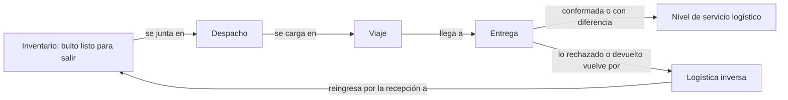

# Despacho y entrega

Despacho y entrega es el tramo que va desde que el bulto preparado sale por la puerta del depósito hasta que llega a manos del destinatario, y el camino de vuelta de lo que se devuelve. Se despacha (se documenta y se carga lo que sale), se viaja y se entrega (el destinatario recibe y conforma), y cada paso deja un documento con estado propio.

Es la cuarta parte de [Cadena de suministro y logística](../cadena-de-suministro-y-logistica.md) y la que casi todo sistema de gestión tiene que registrar. Recibe de [Inventario y depósitos](../../Inventario-y-depositos/inventario-y-depositos.md) el pedido ya preparado y embalado. Carga la mercadería en el [transporte](../Transporte/transporte.md), que decide con quién, en qué y a qué [costo del flete](../Transporte/costo-del-flete.md) viaja, y cómo se juntan cargas y se arman recorridos en [consolidación y ruteo](../Transporte/consolidacion-y-ruteo.md). Lo que se promete al cliente sobre cuándo llega es la [fecha prometida](../../Relacion-con-clientes/Pedido-de-venta/fecha-prometida.md) del pedido de venta; esta vertical dice si se cumplió.

## Despachar, viajar, entregar

El tramo tiene tres momentos, y cada uno cambia el estado de la mercadería y de quién responde por ella:

1. Despachar. Lo preparado se junta en un despacho, se identifica cada bulto, se emite el documento que acompaña el traslado y se avisa al destinatario lo que va a llegar. Se carga en el vehículo y se confirma la salida. Está en [despacho](despacho.md).
2. Viajar. El transportista lleva la carga y el envío pasa a estar en tránsito. El seguimiento informa dónde está. La elección del transportista y del recorrido es de [Transporte](../Transporte/transporte.md).
3. Entregar. El destinatario recibe, revisa y firma, con o sin observaciones. Si no se pudo entregar, o llegó menos o dañado, se registra la diferencia. Está en [prueba de entrega](prueba-de-entrega.md).

Lo que vuelve (una devolución, un envase retornable, lo que el destinatario rechazó) recorre el mismo camino al revés, con su propia autorización y su propio destino final. Está en [logística inversa](logistica-inversa.md). Si todo el tramo funcionó se mide al final, pedido por pedido, en [nivel de servicio logístico](nivel-de-servicio-logistico.md).

## Dónde corta con el depósito

La frontera con Inventario es la puerta, pero las fuentes no la marcan en el mismo lugar. APQC 7.4 pone «4.4.3.4 Pick, pack, and ship product for delivery» dentro de la operación del depósito (4.4.3), con «ship» incluido, y hace empezar el transporte de salida en 4.4.4 «Operate outbound transportation». Ese proceso tiene cuatro pasos: «4.4.4.1 Plan, transport, and deliver outbound product», «4.4.4.2 Track carrier delivery performance», «4.4.4.3 Manage transportation fleet» y «4.4.4.4 Process and audit carrier invoices and documents».

El plan de la salida está en otro lado. APQC lo pone en la planificación, 4.1.5 «Plan distribution requirements», con «4.1.5.8 Manage dispatch plan attainment» y «4.1.5.9 Calculate and optimize destination load plans». Planificar qué sale y cómo se arma la carga es del marco de [Planificación](../Planificacion/planificacion.md); ejecutarlo es de acá.

La confirmación de salida es, entonces, una zona compartida. Uno de los sistemas abiertos consultados la muestra así: un mismo documento de envío pasa por «Picked», «Packed», «Shipped» y «Delivered», es decir, el depósito y el despacho escriben en él uno detrás del otro. La base corta en el bulto que [preparación de pedidos](../../Inventario-y-depositos/Operacion-del-deposito/preparacion-de-pedidos.md) deja registrado como listo para salir. De ahí para afuera es de esta vertical; preparar, embalar y controlar el pedido es de Inventario. El corte es de la base, no del marco.

## Cada paso es un documento con estado

Todo lo que pasa en este tramo se registra como un hecho que no se edita: el despacho confirmado, la entrega conformada, la diferencia, la devolución. Cada uno tiene un estado. A juicio de la base, la mercadería baja del stock cuando se confirma la salida; en otro sistema abierto, según su resumen, al confirmar la nota de entrega se asienta el movimiento en el libro de stock. Cómo se guarda una cadena de hechos así está en [registro de movimientos](../../Bases-de-datos/Modelos-de-datos/registro-de-movimientos.md).

No hay un estándar de estados para la entrega. Los sistemas consultados separan, a juicio de la base, tres cosas que conviene no mezclar: el despacho (el documento de salida), el envío con el transportista y el viaje de entrega, que agrupa despachos. El detalle está en [despacho](despacho.md).

En la Argentina, el documento que acompaña todo traslado es el remito, y en algunas jurisdicciones se suma el código de operación de traslado (COT); está en [Inventario y depósitos en la Argentina](../../Inventario-y-depositos/inventario-y-depositos-en-argentina.md#todo-traslado-lleva-remito-aunque-no-haya-venta).

## Fallas del tramo

Estas fallas son criterio de la base.

- La salida no se confirma o se confirma tarde. El stock sigue figurando en el depósito aunque ya viaja, y el disponible para prometer miente (inferencia de la base).
- Se entrega sin dejar constancia. Sin firma, fecha ni observaciones, después no se puede reclamar al transportista ni probar la entrega al cliente. En el transporte internacional por carretera, recibir sin reservas pesa como prueba de que todo llegó bien; está en [prueba de entrega](prueba-de-entrega.md).
- Se mide «a tiempo» contra una fecha que nadie fijó. Si la base de la fecha y la tolerancia no se acuerdan antes, el indicador sale distinto según quién lo calcule; está en [nivel de servicio logístico](nivel-de-servicio-logistico.md).
- La devolución entra como si fuera una venta al revés. Sin autorización previa ni inspección, lo devuelto vuelve a disponible sin saber si sirve; está en [logística inversa](logistica-inversa.md).

## Cuándo es comercio electrónico

Una tienda online hace lo mismo con paquetes chicos y casi siempre a través de un transportista o un agregador (lectura de la base). Cómo se ve en una tienda (la etiqueta, el agregador, el costo del envío, el fulfillment) está en [Envíos y logística](../../Comercio-electronico/Operaciones-del-comercio/Envios-y-logistica/envios-y-logistica.md), y la devolución de una tienda, en [devoluciones](../../Comercio-electronico/Operaciones-del-comercio/devoluciones.md). Esta vertical da el concepto general, que vale también para un camión propio que reparte a comercios.

## Notas de Despacho y entrega

- [Despacho](despacho.md): el documento que registra lo que sale, sus datos y estados, el aviso de despacho anticipado, el SSCC y la etiqueta logística, y el seguimiento.
- [Prueba de entrega](prueba-de-entrega.md): la conformidad del destinatario, la entrega fallida, la diferencia en destino y los plazos para reclamar del CMR, el convenio de transporte internacional por carretera de Ginebra, 1956.
- [Nivel de servicio logístico](nivel-de-servicio-logistico.md): a tiempo y completo (OTIF), pedido perfecto y tasa de cumplimiento de la entrega, y por qué sus definiciones varían.
- [Logística inversa](logistica-inversa.md): lo que vuelve por la cadena, la autorización de devolución y qué se hace con lo devuelto.
