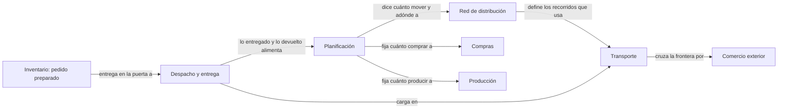

# Cadena de suministro y logística

Cadena de suministro y logística, como dominio de negocio, es lo que una empresa planifica y hace con la mercadería entre un lugar y otro: cuánto va a vender, cómo acuerda un plan entre áreas, cuánto manda a cada depósito, dónde los tiene, cómo mueve la carga, cómo despacha y entrega, y qué cambia cuando la mercadería cruza una frontera. Es lo que llevan la planificación de un ERP, un sistema de gestión de transporte y uno de comercio exterior, pero existe antes del software: una planilla de ventas por mes, una reunión entre áreas y una hoja de ruta por camión hacen lo mismo.

El tema mira dos cosas: el plan que dice cuánto hace falta y dónde, y el movimiento que lleva la mercadería de un lugar a otro. Lo que pasa adentro de cada lugar es de otros dominios. Adentro del depósito, recibir, guardar, reservar, preparar el pedido y reponer artículo por artículo es de [Inventario y depósitos](../Inventario-y-depositos/inventario-y-depositos.md). Elegir al proveedor y emitir la orden de compra es de Compras y abastecimiento. Transformar la materia prima en la planta, con su plan maestro y su MRP, es de Producción. Lo que se paga al cruzar una frontera es de Impuestos. Esos tres temas todavía no están armados en la base.

Las fuentes no cortan así. APQC 7.4 pone la planificación en 4.1 («Plan for and align supply chain resources»), con el pronóstico, el plan maestro y el plan de distribución juntos, y pone el depósito y el transporte en un mismo proceso, 4.4 «Manage logistics and warehousing». SCOR, el modelo de referencia de ASCM, divide la cadena en procesos que incluyen abastecer y transformar. El corte es de la base, que le da a cada dominio un objeto y un verbo: este tema es dueño de lo que pasa entre lugares y del plan agregado, y de pronosticar, planificar, distribuir, despachar, transportar, entregar, importar y exportar. Los límites con cada vecino están en el [alcance](ALCANCE.md).

## Las cinco partes de la cadena

El tema se divide en el plan, los lugares, el movimiento, la salida hasta el destinatario y la frontera.

- [Planificación](Planificacion/planificacion.md): cuánto se va a vender y cuánto hace falta en cada período. El pronóstico de la demanda y cómo se mide su error, el plan de ventas y operaciones (S&OP) que acuerdan las áreas (en el único caso leído, una vez por mes), la planificación de la distribución (DRP) que reparte entre depósitos, y el efecto látigo, que amplifica la demanda a medida que sube por la cadena.
- [Red de distribución](Red-de-distribucion/red-de-distribucion.md): dónde están los lugares y cómo fluye la mercadería entre ellos. Cuántos depósitos tener y dónde, qué stock se ahorra al centralizar, y qué se gana y qué se pierde al tercerizar en un operador logístico.
- [Transporte](Transporte/transporte.md): cómo se mueve la carga, mirado desde quien la manda. Los modos (camión, tren, barco, avión), carga completa o consolidada, de qué se arma el costo del flete y cómo se juntan cargas y se arman recorridos.
- [Despacho y entrega](Despacho-y-entrega/despacho-y-entrega.md): de la puerta de salida a las manos del destinatario, y de vuelta. El documento del despacho y sus estados, la prueba de entrega, cómo se mide si se entregó a tiempo y completo, y la logística inversa.
- [Comercio exterior](Comercio-exterior/comercio-exterior.md): lo que cambia cuando la mercadería cruza una frontera. Los actores, los Incoterms, los documentos que viajan y lo que hace la aduana.

Lo propio de la Argentina (el despachante y la aduana según el Código Aduanero, lo que se pudo confirmar del transporte de cargas, y el remito, que ya está en Inventario) está en [Cadena de suministro y logística en la Argentina](cadena-de-suministro-y-logistica-en-argentina.md). Lo fiscal del comercio exterior va a Impuestos.

## Ideas que cruzan todo el tema

- El plan se hace con un pronóstico, y el pronóstico se equivoca. Todo lo que se planifica por período (cuánto comprar, cuánto producir, cuánto mandar a cada depósito) parte de un número que tiene error. Un buen plan sabe cuánto se equivoca y dimensiona el colchón con ese error, como explican [error de pronóstico](Planificacion/error-de-pronostico.md) y, en Inventario, [stock de seguridad](../Inventario-y-depositos/Reposicion/stock-de-seguridad.md).
- La variabilidad crece a medida que se sube por la cadena: es el [efecto látigo](Planificacion/efecto-latigo.md). Una de sus causas, según Lee, Padmanabhan y Whang, es la señal de demanda: cada eslabón ve los pedidos del siguiente y no lo que se vende al final. Entre sus contramedidas, la primera de su tabla es dar acceso a los datos de venta.
- Costo y velocidad tiran para lados opuestos. Menos depósitos bajan el stock y las instalaciones y alargan el viaje hasta el cliente, como muestra [diseño de la red](Red-de-distribucion/diseno-de-la-red.md#la-curva-de-costo-total). Esperar a juntar más carga abarata el flete y demora los primeros pedidos, como explica [consolidación y ruteo](Transporte/consolidacion-y-ruteo.md#consolidar-qué-viaja-junto-y-cuándo-sale). El avión llega antes y cuesta más, según la comparación de [modos de transporte](Transporte/modos-de-transporte.md#cómo-se-comparan-los-modos). Casi todas las decisiones del tema equilibran el [costo logístico total](Red-de-distribucion/red-de-distribucion.md#el-costo-logístico-total) contra el servicio.
- Todo movimiento deja un documento. Un despacho, una entrega conformada, una devolución o un traslado entre depósitos se registran como hechos que no se editan, igual que los movimientos de stock. Cómo se guarda en una base está en [registro de movimientos](../Bases-de-datos/Modelos-de-datos/registro-de-movimientos.md).

## Qué leer según lo que estés haciendo

- Si tenés que pronosticar la demanda o elegir un método: [pronóstico de demanda](Planificacion/pronostico-de-demanda.md) y, para saber si sirve, [error de pronóstico](Planificacion/error-de-pronostico.md).
- Si tenés que armar o diseñar la reunión de planificación entre áreas: [plan de ventas y operaciones](Planificacion/plan-de-ventas-y-operaciones.md); para el presupuesto anual, [presupuesto](../Contabilidad/Contabilidad-de-gestion/presupuesto.md), de Contabilidad.
- Si tenés que decidir cuánto mandar a cada depósito o sucursal: [planificación de la distribución](Planificacion/planificacion-de-la-distribucion.md); si cada local repone solo con un mínimo, [punto de pedido](../Inventario-y-depositos/Reposicion/punto-de-pedido.md), de Inventario.
- Si tenés que decidir cuántos depósitos tener y dónde: [diseño de la red](Red-de-distribucion/diseno-de-la-red.md) y [centralización del stock](Red-de-distribucion/centralizacion-del-stock.md).
- Si estás por tercerizar el depósito o el transporte: [tercerización logística](Red-de-distribucion/tercerizacion-logistica.md); para una tienda online, [fulfillment](../Comercio-electronico/Operaciones-del-comercio/Envios-y-logistica/fulfillment.md).
- Si tenés que elegir cómo mandar la carga o entender una factura de flete: [modos de transporte](Transporte/modos-de-transporte.md) y [costo del flete](Transporte/costo-del-flete.md); para paquetería de una tienda, [costo del envío](../Comercio-electronico/Operaciones-del-comercio/Envios-y-logistica/costo-del-envio.md).
- Si tenés que armar recorridos de reparto: [consolidación y ruteo](Transporte/consolidacion-y-ruteo.md).
- Si tenés que diseñar el módulo de despacho de un sistema: [despacho](Despacho-y-entrega/despacho.md) y [prueba de entrega](Despacho-y-entrega/prueba-de-entrega.md); lo anterior a la puerta, [preparación de pedidos](../Inventario-y-depositos/Operacion-del-deposito/preparacion-de-pedidos.md), de Inventario.
- Si te piden un tablero de la entrega: [nivel de servicio logístico](Despacho-y-entrega/nivel-de-servicio-logistico.md); el del inventario, [indicadores de inventario](../Inventario-y-depositos/Reposicion/indicadores-de-inventario.md).
- Si tenés que manejar devoluciones o envases retornables: [logística inversa](Despacho-y-entrega/logistica-inversa.md); en una tienda, [devoluciones](../Comercio-electronico/Operaciones-del-comercio/devoluciones.md).
- Si importás o exportás: [comercio exterior](Comercio-exterior/comercio-exterior.md), [Incoterms](Comercio-exterior/incoterms.md), [documentos del comercio exterior](Comercio-exterior/documentos-del-comercio-exterior.md) y [aduana](Comercio-exterior/aduana.md); para la diferencia de cambio, [moneda extranjera](../Contabilidad/Operaciones/moneda-extranjera.md). Cuánto se paga de impuestos es de Impuestos, todavía no armado.
- Si el sistema es para la Argentina y mueve o importa mercadería: [Cadena de suministro y logística en la Argentina](cadena-de-suministro-y-logistica-en-argentina.md) y, para el remito y el COT, [Inventario y depósitos en la Argentina](../Inventario-y-depositos/inventario-y-depositos-en-argentina.md).
- Si tenés que decidir cuánto y a quién comprar: no es de acá; es de Compras y abastecimiento, todavía no armado.

Los términos con su nombre en inglés están en el [glosario de cadena de suministro](Fundamentos/glosario-de-cadena-de-suministro.md).

## Orden de lectura

Para quien construye software de gestión y no conoce el dominio: esta entrada, después [Despacho y entrega](Despacho-y-entrega/despacho-y-entrega.md), que es lo que casi todo sistema tiene que registrar, y [Planificación](Planificacion/planificacion.md), que explica de dónde salen los números. [Transporte](Transporte/transporte.md) y [Red de distribución](Red-de-distribucion/red-de-distribucion.md) importan cuando la empresa mueve carga propia o tiene más de un depósito, y [Comercio exterior](Comercio-exterior/comercio-exterior.md), cuando importa o exporta.

- [Fundamentos](Fundamentos/fundamentos-de-cadena-de-suministro.md): de dónde viene el campo, los [marcos](Fundamentos/marcos-de-la-cadena-de-suministro.md) que lo ordenan (SCOR, APQC), las escuelas (empujar o tirar, eficiente o que responde, eficiencia o resiliencia), la evidencia en contra de las ideas más repetidas y dónde se produce el saber.
