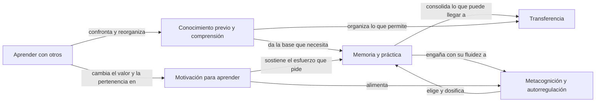

# Ciencias del aprendizaje

Las ciencias del aprendizaje estudian cómo una persona llega a saber y a saber hacer algo nuevo: qué trae, cómo comprende, cómo retiene, cómo lo lleva a otro contexto y qué la sostiene. Son el lado de quien aprende en la pedagogía.

Es la base sobre la que se apoya el resto del área: la [didáctica](../Didactica/didactica.md) y el [diseño instruccional](../Diseno-instruccional/diseno-instruccional.md) deciden cómo enseñar a partir de lo que acá se sabe sobre cómo se aprende, la [evaluación educativa](../Evaluacion-educativa/evaluacion-educativa.md) decide cómo comprobarlo y la [tecnología educativa](../Tecnologia-educativa/tecnologia-educativa.md) pregunta qué cambia un medio. El mecanismo psicológico (condicionamiento, memoria, práctica espaciada y recuperación, experticia) vive en [Aprendizaje y memoria](../Psicologia/Aprendizaje-y-memoria/aprendizaje-y-memoria.md), del tema Psicología, y se enlaza; este tema lo mira desde la educación. El desarrollo de los chicos está en [Psicología infantil](../Psicologia-infantil/psicologia-infantil.md), y cómo estudia solo un adulto, en [aprender por cuenta propia](../Desarrollo-personal/Efectividad-personal/aprender-por-cuenta-propia.md).

La idea que ordena todo el tema es que quien aprende no puede ver directamente su propio aprendizaje. Lo que se ve mientras se estudia es el rendimiento del momento, y ese rendimiento engaña: lo que se siente fácil puede dejar poco y lo que cuesta, más (Bjork y Bjork, 2011). Casi todas las verticales son una variación de esa brecha.

## De qué está hecho aprender

El campo se divide de varias maneras. El manual de Cambridge de las *learning sciences* tiene partes de fundamentos, metodologías, tecnología, aprender juntos, conocimiento disciplinar y llevar la investigación al aula. Esta base corta por lo que le pasa a quien aprende, en seis partes:

- [Conocimiento previo y comprensión](Conocimiento-previo-y-comprension/conocimiento-previo-y-comprension.md): lo que se trae como recurso y como obstáculo, en qué se diferencia un novato de un experto y cómo se mueve una idea equivocada. Entrá acá para entender por qué la misma clase sirve a uno y no a otro.
- [Memoria y práctica](Memoria-y-practica/memoria-y-practica.md): por qué el rendimiento durante la práctica engaña, las dificultades deseables y el intercalado. Entrá acá para organizar práctica que dure.
- [Transferencia](Transferencia/transferencia.md): usar lo aprendido en otro contexto, por qué falla tan seguido y qué la favorece. Entrá acá cuando alguien sabe resolver el ejercicio y no el caso real.
- [Metacognición y autorregulación](Metacognicion-y-autorregulacion/metacognicion-y-autorregulacion.md): cómo juzga alguien cuánto sabe, por qué se equivoca y cómo dirige su estudio. Entrá acá para entender por qué la gente elige mal cómo estudiar.
- [Motivación para aprender](Motivacion-para-aprender/motivacion-para-aprender.md): el valor, la autonomía y las creencias sobre la propia capacidad, como resultado de cómo se enseña. Entrá acá para saber qué del entorno cambia las ganas.
- [Aprender con otros](Aprender-con-otros/aprender-con-otros.md): la teoría sociocultural y el aprendizaje situado, separados de las técnicas con efecto medido (cooperativo, entre pares, aprender enseñando).
- [Fundamentos](Fundamentos/fundamentos-de-ciencias-del-aprendizaje.md): las teorías del aprendizaje, la andragogía, los mitos, las fuentes y el glosario.

## La diferencia que importa es lo que se sabe, no la edad

El árbol no tiene una parte para «quién aprende». La edad, el ser adulto, el estilo o el tipo de inteligencia aparecen como si cambiaran cómo enseñar, y la evidencia los achica o los descarta. Cayó adaptar la enseñanza al estilo de aprendizaje, aunque la preferencia existe. Que los adultos aprenden distinto se achicó: la [andragogía](Fundamentos/andragogia.md) quedó como buenas prácticas para cualquier edad. Las diferencias de hemisferio son un [mito](Fundamentos/mitos-del-aprendizaje.md). Lo que sí cambia qué enseñanza sirve es cuánto sabe la persona del tema: es el [conocimiento previo](Conocimiento-previo-y-comprension/conocimiento-previo.md), y del lado de quien enseña, la [inversión de la experticia](../Didactica/Practica-guiada-y-andamiaje/inversion-de-la-experticia.md). Que pese más que la edad es inferencia de esta base sobre estudios escolares.

Las diferencias de desarrollo de 0 a 12 años y las dificultades específicas del aprendizaje viven en [Psicología infantil](../Psicologia-infantil/psicologia-infantil.md), con [desarrollo cognitivo](../Psicologia-infantil/Desarrollo/desarrollo-cognitivo.md) y [escuela y aprendizaje](../Psicologia-infantil/Contextos/escuela-y-aprendizaje.md).

## Cuánto creerle a cada nota

Casi toda la evidencia del tema viene de escuelas y universidades, y buena parte de experimentos de laboratorio con material de estudio. Cuando una nota la lleva a adultos que aprenden un oficio, o a enseñar programación, lo dice como inferencia. Los efectos de laboratorio se achican en el aula, y los ensayos grandes en escuelas dan efectos chicos; cómo leer esas cifras está en [evidencia en educación](../Didactica/Fundamentos/evidencia-en-educacion.md). Los informes de investigación de este tema leyeron casi todo por abstract, y cada nota lo dice.

## Qué leer según lo que estés haciendo

- Si tenés que armar un curso o una clase para gente que llega con niveles distintos: [conocimiento previo](Conocimiento-previo-y-comprension/conocimiento-previo.md) y, en Didáctica, [inversión de la experticia](../Didactica/Practica-guiada-y-andamiaje/inversion-de-la-experticia.md).
- Si tus alumnos aprueban la práctica y a la semana no recuerdan nada: [aprendizaje y rendimiento](Memoria-y-practica/aprendizaje-y-rendimiento.md), [dificultades deseables](Memoria-y-practica/dificultades-deseables.md) y [práctica espaciada y recuperación](../Psicologia/Aprendizaje-y-memoria/practica-espaciada-y-recuperacion.md).
- Si tenés que armar ejercicios de práctica: [intercalado](Memoria-y-practica/intercalado.md) y [dificultades deseables](Memoria-y-practica/dificultades-deseables.md).
- Si saben resolver el ejercicio pero no el caso real: [transferencia](Transferencia/transferencia.md) y [camino alto y camino bajo](Transferencia/camino-alto-y-camino-bajo.md).
- Si alguien insiste en una idea equivocada aunque se la expliques: [cambio conceptual](Conocimiento-previo-y-comprension/cambio-conceptual.md).
- Si quien aprende cree que sabe y no sabe: [ilusión de saber](Metacognicion-y-autorregulacion/ilusion-de-saber.md) y [calibración](Metacognicion-y-autorregulacion/calibracion.md).
- Si querés que alguien aprenda a estudiar solo: [aprendizaje autorregulado](Metacognicion-y-autorregulacion/aprendizaje-autorregulado.md) y [aprender por cuenta propia](../Desarrollo-personal/Efectividad-personal/aprender-por-cuenta-propia.md).
- Si el grupo pierde las ganas o abandona: [motivación para aprender](Motivacion-para-aprender/motivacion-para-aprender.md), [valor y expectativas](Motivacion-para-aprender/valor-y-expectativas.md) y [apoyo a la autonomía](Motivacion-para-aprender/apoyo-a-la-autonomia.md). El abandono como tal no tiene nota todavía; lo más cercano es [finalización de MOOC](../Tecnologia-educativa/Aprendizaje-en-linea/finalizacion-de-mooc.md).
- Si tenés que acompañar o mentorear a alguien que empieza: [tutoría](../Didactica/Tutoria-y-mentoria/tutoria.md), [mentoría](../Didactica/Tutoria-y-mentoria/mentoria.md), [motivación para aprender](Motivacion-para-aprender/motivacion-para-aprender.md) e [inversión de la experticia](../Didactica/Practica-guiada-y-andamiaje/inversion-de-la-experticia.md). El abandono no tiene nota; lo más cercano es [finalización de MOOC](../Tecnologia-educativa/Aprendizaje-en-linea/finalizacion-de-mooc.md).
- Si te proponen un programa de mentalidad de crecimiento o de entrenamiento cerebral: [mentalidad de crecimiento](Motivacion-para-aprender/mentalidad-de-crecimiento.md) y [entrenamiento cognitivo](Transferencia/entrenamiento-cognitivo.md).
- Si vas a poner a trabajar en grupo o en pares: [aprendizaje cooperativo](Aprender-con-otros/aprendizaje-cooperativo.md), [instrucción entre pares](Aprender-con-otros/instruccion-entre-pares.md) y [aprender enseñando](Aprender-con-otros/aprender-ensenando.md).
- Si te dicen que los adultos aprenden distinto: [andragogía](Fundamentos/andragogia.md).
- Si un curso, una charla o un libro te vende un hallazgo sobre el cerebro: [mitos del aprendizaje](Fundamentos/mitos-del-aprendizaje.md) y, en Didáctica, [mitos de la enseñanza](../Didactica/Fundamentos/mitos-de-la-ensenanza.md).
- Si tenés que adaptar la enseñanza a una persona con dislexia u otra dificultad específica: no hay nota en este tema; lo más cercano es [escuela y aprendizaje](../Psicologia-infantil/Contextos/escuela-y-aprendizaje.md), en Psicología infantil, que es de chicos.

## Del aprendiz a lo que lo rodea

1. [Teorías del aprendizaje](Fundamentos/teorias-del-aprendizaje.md), para tener las cuatro respuestas a qué es aprender.
2. [Aprendizaje y memoria](../Psicologia/Aprendizaje-y-memoria/aprendizaje-y-memoria.md), en Psicología, para el mecanismo.
3. [Conocimiento previo y comprensión](Conocimiento-previo-y-comprension/conocimiento-previo-y-comprension.md): conocimiento previo antes que cambio conceptual.
4. [Memoria y práctica](Memoria-y-practica/memoria-y-practica.md): aprendizaje y rendimiento antes que dificultades deseables e intercalado.
5. [Metacognición y autorregulación](Metacognicion-y-autorregulacion/metacognicion-y-autorregulacion.md): ilusión de saber, calibración, aprendizaje autorregulado.
6. [Transferencia](Transferencia/transferencia.md): cercana y lejana, caminos, entrenamiento cognitivo.
7. [Motivación para aprender](Motivacion-para-aprender/motivacion-para-aprender.md) y [Aprender con otros](Aprender-con-otros/aprender-con-otros.md), que miran lo que rodea a quien aprende.
8. [Mitos del aprendizaje](Fundamentos/mitos-del-aprendizaje.md), al final, para ver cuánto de lo que se repite cae con lo leído.
