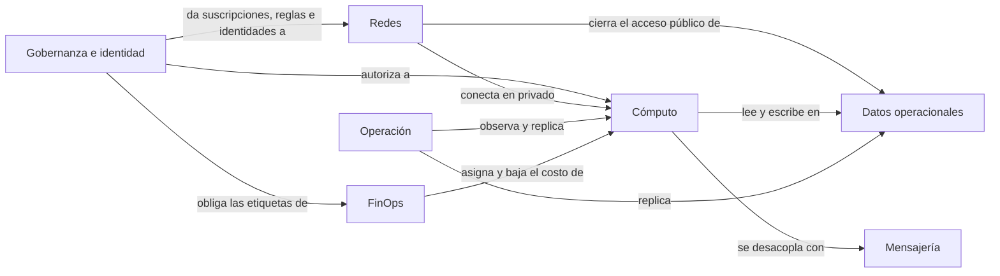

# Cloud

Cloud es cómo se arma, se conecta, se opera y se paga un entorno en la nube pública, hoy sobre
Azure: la base común de gobernanza e identidad, la red, el cómputo, los datos, la mensajería, la
operación y el costo.

El tema trata la nube como un sistema de partes que se apoyan unas en otras, no como un catálogo
de servicios. Cada carga de trabajo se despliega sobre una base común que ya trae suscripciones,
reglas, red y observabilidad, y cada decisión de diseño se mide en lo que cuesta. Termina donde
empiezan otros temas: la base de Terraform (módulos, estado remoto, pipeline) y el split-horizon
DNS viven en [Infraestructura](../Infraestructura/infraestructura.md); el CI/CD hacia AKS, en
[DevOps](../DevOps/devops.md); la gobernanza, el golden path y la observabilidad vistos como
plataforma interna, en [Platform Engineering](../Platform-Engineering/platform-engineering.md).

## De qué está hecho un entorno en la nube

Siete partes. La gobernanza da la base sobre la que se despliega todo; la red conecta en privado
al cómputo con los datos; la mensajería desacopla las piezas del cómputo; la operación observa y
replica lo que corre, y FinOps reparte y baja lo que todo eso cuesta.

- [Gobernanza e identidad](Gobernanza-e-identidad/gobernanza-e-identidad.md) — la landing zone, las políticas, quién puede hacer qué y cómo se despliega como código. Se lee primero: todo lo demás vive adentro.
- [Redes](Redes/redes.md) — la VNet, el filtrado, el ruteo, el hub-and-spoke, la conectividad con la red propia, la entrada y la salida, y el acceso privado a los servicios PaaS.
- [Cómputo](Computo/computo.md) — dónde corre el código, de la VM a Functions, y cómo se elige.
- [Datos operacionales](Datos-operacionales/datos-operacionales.md) — dónde guarda sus datos la aplicación en línea y qué se decide al principio.
- [Mensajería](Mensajeria/mensajeria.md) — órdenes, flujos de eventos y avisos entre sistemas.
- [Operación](Operacion/operacion.md) — métricas, logs y alertas, y la alta disponibilidad y la recuperación ante desastres.
- [FinOps](FinOps/finops.md) — la práctica de hacerse dueño del gasto y las palancas para bajarlo en Azure.

## Privado por defecto

Una idea cruza casi todas las partes: lo que no necesita estar en internet no lo está. Desde marzo
de 2026, las subredes de las VNets nuevas no salen a internet sin un método explícito, como una
[NAT Gateway](Redes/nat-gateway.md). Los servicios PaaS nacen con IP pública y se cierran con un
[private endpoint](Redes/Acceso-privado-a-PaaS/private-endpoint.md) o un
[network security perimeter](Redes/Acceso-privado-a-PaaS/network-security-perimeter.md), y
[Azure Policy](Gobernanza-e-identidad/azure-policy.md) puede negar los que queden abiertos. Las
identidades siguen la misma lógica: [managed identities y OIDC](Gobernanza-e-identidad/identidad-y-acceso-en-azure.md)
en lugar de secretos guardados.

## Cómo se combinan en una solución

Las partes se juntan en cada carga de trabajo. Dos notas lo tratan desde arriba:

- [Arquitecturas de referencia en Azure](arquitecturas-de-referencia-en-azure.md) — tres combinaciones probadas de servicios: una web global segura, un sistema por eventos y una plataforma analítica.
- [Diseñar una solución en Azure](disenar-una-solucion-en-azure.md) — los pasos para responder un diseño de solución, p. ej. en una entrevista: requisitos, servicio mínimo, trade-offs, HA y DR, costo y operación.

## Cómo recorrer el tema

Para consultar, se entra por la parte que corresponde. Para aprender, el orden del diagrama:
gobernanza, redes, cómputo, datos, mensajería, operación y costo, y al final las dos notas de
diseño. [Fundamentos](Fundamentos/fundamentos-de-cloud.md) tiene el recorrido de redes para quien ya sabe
redes en general.
