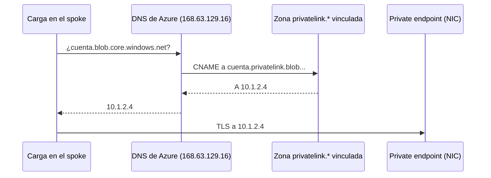

# DNS privado para Private Link

Para usar un private endpoint, el nombre público del servicio tiene que resolver a su IP privada:
se logra con zonas DNS privadas privatelink.* vinculadas a las VNets y, desde la red propia, con
Azure DNS Private Resolver.

## Por qué importa

El [[private-endpoint]] puede estar bien creado y la aplicación igual sale a la IP pública, porque
resolvió el nombre con un DNS que no conoce la zona privada. Con el acceso público apagado, eso
se ve como un 403 o un timeout que no parece un problema de DNS.

## Cómo funciona

1. Al crear el endpoint, el nombre público pasa a ser un CNAME a
   `cuenta.privatelink.blob.core.windows.net`.
2. Una **zona DNS privada** con ese nombre (`privatelink.blob.core.windows.net`) guarda el
   registro A con la IP del endpoint.
3. La zona se **vincula** a cada VNet que tiene que resolverla. El DNS de Azure (`168.63.129.16`)
   responde la IP privada solo en las VNets vinculadas.
4. **Desde la red propia**, el DNS local reenvía esos dominios al endpoint de entrada de un
   **DNS Private Resolver** en el hub, que consulta al DNS de Azure.

**Una zona por servicio, compartida**: la guía de Microsoft centraliza las zonas `privatelink.*`
en la suscripción de conectividad y las vincula a todas las VNets. Dos endpoints del mismo
recurso en VNets distintas que comparten la zona pisan el mismo registro A: Microsoft recomienda
un solo endpoint por recurso en una red con DNS común.

## Ejemplo

Un homelab con el hub y dos spokes comparte las zonas de blob y de Key Vault, vinculadas a las
tres VNets. Cada recurso tiene un solo endpoint, en el spoke de su proyecto; así se evitó la
colisión de registros que habría aparecido con un segundo endpoint al mismo Storage desde el otro
spoke.

## No confundir con

[[split-horizon-dns]]: un nombre que resuelve distinto según quién pregunta. La zona `privatelink`
es un caso de eso dentro de Azure: el mismo nombre da la IP privada en las VNets vinculadas y la
pública en internet.

## Relaciones

- Requiere: [[private-endpoint]] — la zona guarda la IP del endpoint.
- Usa: [[conectividad-hibrida-azure]] — el camino desde la red propia hasta el resolver.
- En otro Tema: [[split-horizon-dns]] — el mismo principio aplicado a una LAN.
