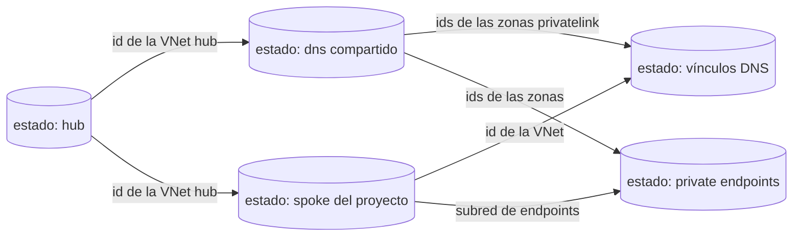

# Landing zone con Terraform

Una landing zone en Terraform se parte en stacks de plataforma y de proyecto, cada uno con su
propio estado; los stacks se leen entre sí por remote state y se despliegan en orden desde un
pipeline que se autentica en Azure con OIDC.

## Por qué importa

Un solo estado para toda la [Azure landing zone](azure-landing-zone.md) obliga a planear el hub cada vez que un equipo
toca su spoke, y un error en un proyecto bloquea a todos. Con un estado por stack, cada `plan` es
chico y el daño de un `apply` queda dentro de su stack.

## Cómo funciona

- **Stacks de plataforma**: fundación (presupuestos, alertas, políticas), observabilidad, hub de
  red y zonas DNS compartidas. Los mantiene el equipo de plataforma.
- **Stacks de proyecto**: el spoke, los vínculos de DNS y los private endpoints de cada proyecto.
  Se agregan copiando el stack de un proyecto y cambiando variables.
- **Estado**: cada stack guarda el suyo en un [Estado remoto de Terraform](../Infraestructura/estado-remoto-de-terraform.md). Un stack expone
  outputs (el ID de la VNet del hub, los IDs de las zonas DNS) y el siguiente los lee con
  `terraform_remote_state`.
- **Módulos**: los stacks llaman a [Módulo de Terraform](../Infraestructura/modulo-de-terraform.md) reutilizables (VNet, peering, NAT,
  private endpoint), así un proyecto nuevo no reescribe recursos.
- **Pipeline**: el [Armar un pipeline de Terraform](../Infraestructura/pipeline-de-terraform.md) corre cada stack en el orden de sus dependencias y
  entra a Azure con una identidad federada por OIDC, sin secretos guardados. Funciona igual con
  **HCP Terraform (Terraform Cloud)**, un workspace por stack con credenciales dinámicas, o con
  **GitHub Actions**, un job por stack con `azure/login` y backend `azurerm`.

El orden que sale del diagrama: hub, DNS compartido, spoke, vínculos DNS y private endpoints.

## Ejemplo

En un homelab con un hub y dos spokes, agregar un tercer proyecto fue sumar tres stacks (spoke,
vínculos DNS, endpoints) con sus variables; el hub y los otros proyectos no se volvieron a planear.

## No confundir con

[Organizar entornos en Terraform](../Infraestructura/organizar-entornos-en-terraform.md), que separa dev, test y prod. Acá se separa por capa y por
proyecto; cada stack puede tener además sus entornos. [Crossplane](../Platform-Engineering/crossplane.md) es la alternativa por
reconciliación continua desde Kubernetes, en lugar de `plan` y `apply` desde un pipeline.

## Relaciones

- Requiere: [Azure landing zone](azure-landing-zone.md) — define qué piezas hay que desplegar.
- Requiere: [Estado remoto de Terraform](../Infraestructura/estado-remoto-de-terraform.md) — cada stack comparte outputs a través de su estado.
- Usa: [Módulo de Terraform](../Infraestructura/modulo-de-terraform.md) y [Armar un pipeline de Terraform](../Infraestructura/pipeline-de-terraform.md) — los bloques reutilizables y el flujo
  de `plan` y `apply`.
- Alternativa: [Crossplane](../Platform-Engineering/crossplane.md) — infraestructura como API declarativa reconciliada.
