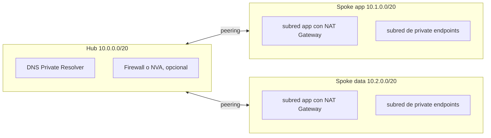

# Topología hub-and-spoke

Hub-and-spoke es una topología de red en Azure con una VNet central (hub) que aloja lo
compartido, como DNS, firewall y gateway, y una VNet por proyecto (spoke) unida solo al hub, así
los spokes quedan aislados entre sí.

## Por qué importa

Lo caro o lo delicado (el gateway a la red propia, el firewall, el DNS) se paga y se opera una vez,
en el hub. Cada proyecto recibe su spoke y no puede llegar a otro por accidente: el aislamiento
sale de que el [VNet peering](vnet-peering.md) no es transitivo.

## Cómo funciona

- **El hub**, según la arquitectura de referencia de Microsoft: el gateway a la red propia (VPN o
  ExpressRoute), el control de entrada y salida (Azure Firewall o un NVA, una VM que hace de firewall), Azure Bastion para
  administrar VMs sin IP pública, y el DNS (p. ej. DNS Private Resolver). Hay un hub por región.
- **Los spokes**: una VNet por proyecto o por equipo, con peering al hub y sin peering entre sí.
- **Tráfico entre spokes**: no existe salvo que se fuerce. Para habilitarlo, una UDR en cada spoke
  manda ese tráfico al firewall del hub, que decide (ver [Ruteo en Azure](ruteo-en-azure.md)).
- **Egreso a internet**: centralizado en el firewall del hub, o una [NAT Gateway](nat-gateway.md) por spoke si
  alcanza con una IP fija y no se necesita inspección.

## Ejemplo

Un homelab con el hub y dos spokes, `app` y `data`, sin firewall para ahorrar costo. Cada spoke
sale a internet por su propia NAT Gateway y llega solo a sus private endpoints; un `curl` desde
`app` a un endpoint de `data` termina en timeout.

## No confundir con

Virtual WAN, donde Microsoft administra el hub y la conectividad entre spokes, o los *connected
groups* de Virtual Network Manager, que arman una malla. En hub-and-spoke clásico el hub es una
VNet propia.

## Relaciones

- Requiere: [VNet peering](vnet-peering.md) — une cada spoke con el hub.
- Usa: [Ruteo en Azure](ruteo-en-azure.md), [NAT Gateway](nat-gateway.md) y [DNS privado para Private Link](dns-privado-para-private-link.md) — el egreso y el
  DNS compartido viven en el hub o en cada spoke.
- Base de: [Azure landing zone](azure-landing-zone.md) — la red de una landing zone suele ser hub-and-spoke.
