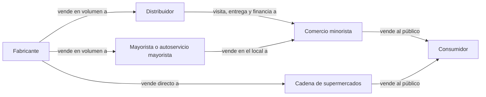

# Cadena de distribución

La cadena de distribución es el recorrido de un producto desde quien lo fabrica hasta el comercio que lo vende al público, con distribuidores y mayoristas en el medio. Cada eslabón vive de funciones como fraccionar, transportar y dar crédito, y la literatura de canales sostiene que esas funciones no desaparecen cuando se saltea un eslabón: las absorbe otro.

Es la estructura sobre la que se apoya todo el [comercio entre empresas](comercio-b2b.md): quién le vende a quién decide qué precio ve cada cliente ([precio por cliente](precio-por-cliente.md)), quién financia a quién ([cuenta corriente y crédito](cuenta-corriente-y-credito.md)) y quién visita los comercios ([preventa y autoventa](preventa-y-autoventa.md)).

## Los eslabones y lo que hace cada uno

- **Fabricante.** Produce y vende en volumen. Las marcas grandes suelen trabajar con una red de distribuidores oficiales por zona; Arcor, por ejemplo, dice que su «red de distribuidores oficiales» garantiza «el abastecimiento de productos en todo el país» (Mercado, 2025, dicho por la empresa).
- **Distribuidor.** Compra al fabricante y lleva el producto al comercio. Que tenga vendedores que visitan, camiones que reparten y una cartera de clientes a los que les fía es la descripción corriente del sector, sin una fuente que la mida. Puede ser exclusivo de una marca o multimarca.
- **Mayorista.** Según el manual abierto de OpenStax, compra productos terminados a fabricantes y los vende a minoristas, a otros mayoristas, a fabricantes e instituciones. El autoservicio mayorista es la versión en la que el comerciante va al local, elige y se lleva la mercadería.
- **Minorista.** Almacén, kiosco, autoservicio, ferretería, perfumería o farmacia: vende al público. En consumo masivo se distingue el **canal tradicional** (comercios independientes de cercanía, que compran a distribuidores y mayoristas) del **canal moderno** (cadenas de supermercados, que compran directo al fabricante).

Un curso universitario de canales (Washington State University, leído por el buscador) sostiene que un intermediario se puede eliminar pero su función no: pasa hacia adelante, al minorista, o hacia atrás, al fabricante. El manual de referencia del campo es *Marketing Channels* de Coughlan, Anderson, Stern y El-Ansary; su capítulo 1 trata la estructura y los flujos del canal, entre ellos la posesión física y la propiedad. El capítulo no se leyó: la lista completa de flujos y si sostiene la misma idea quedan sin verificar.

> [!NOTE]
> Sin fuente todavía: una descripción con fuente argentina de qué funciones cumple cada eslabón en consumo masivo (quién fracciona, quién transporta, quién da crédito y a cuántos días).

## La cadena en Argentina, con números

Las cifras completas, con su calificación, están en [cifras del comercio B2B](cifras-del-comercio-b2b.md). Lo que dibujan:

- **Muchos minoristas por cada mayorista.** En octubre de 2023 había 34.525 empresas mayoristas con empleados registrados y 109.418 minoristas (CEP XXI). NielsenIQ cuenta más de 194.700 puntos de venta independientes en consumo masivo, según una nota de junio de 2026.
- **El canal tradicional pesa alrededor de un tercio del consumo masivo.** NielsenIQ lo ubica en 35% de las ventas (canal tradicional más autoservicios independientes), según una nota de junio de 2026 que no dice el período. Otra nota sobre la misma consultora, del final de 2025, da 34% a almacenes, 15% a kioscos y minimercados y 14% a autoservicios independientes, y no queda claro sobre qué total: las dos no se pueden sumar ni comparar.
- **El autoservicio mayorista grande concentra mucha venta en pocas bocas.** El panel de INDEC de agosto de 2026 son 30 empresas con 188 bocas, que vendieron $395.434,5 millones en el mes. INDEC aclara que la encuesta no cubre a los distribuidores tradicionales.
- **El comercio de barrio creció y el mayorista cayó en 2025.** Según Scentia, en el acumulado de 2025 contra 2024, almacenes y kioscos subieron 9,1%, autoservicios independientes 0,1%, el comercio electrónico 14,1%, y bajaron los supermercados (−5,2%) y los mayoristas (−5%). Son variaciones de una consultora que vende el dato, citadas por la prensa.

En 2002, según datos de INDEC que citaba la cámara de autoservicios mayoristas, el 84,7% del consumo de alimentos y bebidas pasaba por el canal indirecto. Es un dato viejo; sirve para ver de dónde viene la cadena, no cómo está.

## Dónde se confunde y dónde falla

- **«Canal tradicional» no quiere decir lo mismo en todas las notas.** A veces incluye a los mayoristas y a veces solo a almacenes y kioscos. Antes de comparar cifras hay que leer la definición: el 35% de NielsenIQ y un «hasta 55%» que circula sin fuente miden cosas distintas.
- **El fabricante con app propia no saltea al distribuidor.** Las apps de los fabricantes toman el pedido, pero la entrega sigue en manos del distribuidor de la zona (detalle en [modelos de software B2B](modelos-de-software-b2b.md)). En las reseñas negativas de esas apps, los comercios se quejan primero de que la app falla y del soporte, y después de la entrega y del precio.
- **Sacar un eslabón cuesta capital.** Las plataformas de abastecimiento que compraban y repartían por su cuenta se achicaron o cerraron en la región entre 2022 y 2025; de la más citada, la prensa dice que se quedó sin capital, no sin demanda (fichas en [marketplaces y apps B2B de la región](marketplaces-y-apps-b2b-de-la-region.md)).

## Para leer a fondo

- **Coughlan, Anderson, Stern y El-Ansary, *Marketing Channels***, capítulo 1: la estructura y los flujos del canal. Fijarse en qué flujos lista y en quién los cumple en cada eslabón.
- **INDEC, Encuesta de autoservicios mayoristas** (mensual): panel de empresas y bocas, ventas por rubro y medio de pago y el cuadro de factura A y B. Es la única serie oficial de un eslabón mayorista; no cubre a los distribuidores.
