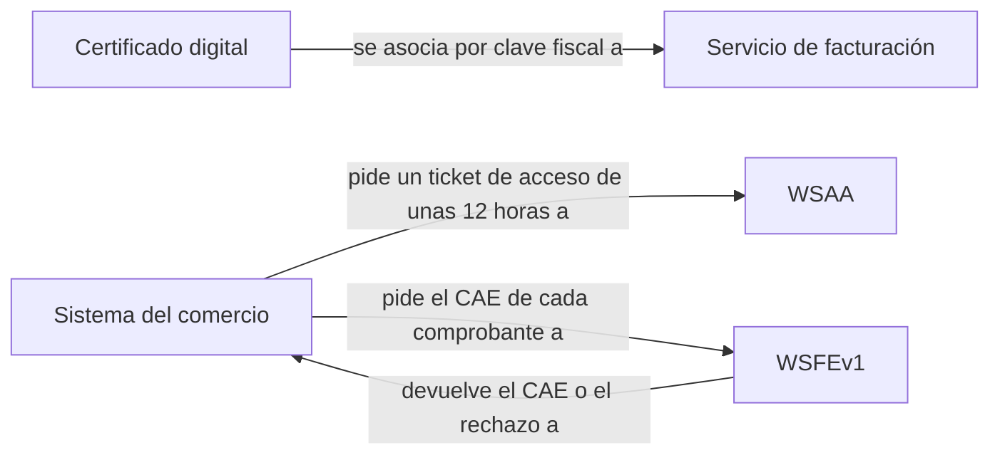

# Factura electrónica de ARCA

La factura electrónica de ARCA es el comprobante fiscal que en Argentina respalda cada venta: casi todo el que vende tiene que emitirla o usar un controlador fiscal, con una letra (A, B, C, E) que depende de quién vende y a quién, y un código de autorización (CAE) que ARCA da en el momento. Un sistema la emite conectándose a los web services de ARCA con un certificado digital.

> [!WARNING]
> Ley y dinero: esto no reemplaza a un contador. Las normas se leyeron en el Boletín Oficial el 2026-11-22; varias páginas de ARCA todavía no incorporan los cambios de 2025 y 2026. Antes de actuar, se lee la norma vigente.

Es el caso argentino de la regla de facturación que describe [Normativa](normativa.md). Toca a la tienda online y al local por igual: el comprobante lo emite la plataforma de tiendas, una app, un [sistema de gestión](../Operaciones-del-comercio/Sistemas-de-gestion-en-el-comercio/sistemas-de-gestion-en-el-comercio.md) o el [punto de venta](../Venta-en-varios-canales/Local-fisico-con-caja/punto-de-venta.md). El resto de las normas argentinas que alcanzan a una tienda está en la [ficha de normativa argentina](normativa-argentina.md).

## Quién tiene que facturar

Desde el 1 de noviembre de 2026, la RG ARCA 5893/2026 obliga a emitir comprobantes electrónicos y/o usar controlador fiscal «para respaldar todas sus operaciones realizadas en el mercado interno» a:

1. Los responsables inscriptos, exentos y no alcanzados en el IVA.
2. Los adheridos al monotributo, incluidos los del Régimen de Inclusión Social (monotributo social), que antes estaban exceptuados.

Los no alcanzados por el IVA entran el 1 de marzo de 2027. A un monotributista sin punto de venta electrónico, ARCA le habilita uno de oficio en «Comprobantes en línea». Desde esas fechas, los talonarios impresos quedan solo para contingencias. Hay dos fuentes independientes además del texto de la norma: un consejo profesional y la novedad de ARCA.

La página de ARCA «Factura electrónica vs. Controlador fiscal» todavía exceptúa al régimen de inclusión social: está desactualizada frente a la RG 5893.

## Factura electrónica o controlador fiscal

El comercio puede elegir una de las dos modalidades o las dos, «sin necesidad de informar previamente» a ARCA. Un controlador fiscal es un equipo homologado por ARCA que imprime tiques y facturas; su régimen es la RG AFIP 3561/2013. Según su texto actualizado, la obligación «se cumplirá únicamente por medio de algún equipamiento electrónico que haya sido homologado por este Organismo», provisto solo por las empresas que ARCA autoriza (art. 2), y la norma separa los equipos de «nueva tecnología» de los de vieja (art. 15). Lo que regula es el equipo, su proveedor y sus reportes; cómo se conecta un sistema de gestión con el equipo no lo regula ninguna norma leída.

Para un local que vende a consumidor final, **la obligación de facturar no obliga a comprar un controlador fiscal**: alcanza con la factura electrónica. Es una confusión frecuente. Hay tres casos en que no se puede elegir y la factura tiene que ser electrónica:

- las ventas de una pyme a una empresa grande o a otra pyme adherida a la Factura de Crédito Electrónica MiPyME;
- los no alcanzados por el IVA;
- las actividades del Anexo II de la RG 4291.

Quien factura por web service a consumidores finales en las actividades del anexo de la RG 4290 tiene que guardar además duplicados electrónicos.

## Qué letra lleva cada comprobante

Según la tabla de ARCA (una sola fuente oficial):

| Quien vende | A consumidor final o exento | A monotributista | A responsable inscripto | Exportación |
|---|---|---|---|---|
| Responsable inscripto | B | A | A | E |
| Monotributista o exento | C | C | C | E |

- La clase M ya no existe desde el 1 de diciembre de 2025: la reemplaza la A con la leyenda «OPERACIÓN SUJETA A RETENCIÓN» (RG 5762/2025). Puede seguir apareciendo en materiales viejos.
- Hay una clase T para turistas extranjeros, con su propio web service; la norma no se leyó.
- Las notas de crédito y débito solo las emite quien emitió la factura original, y se relacionan con ella. Remitos, presupuestos y recibos no reemplazan a la factura.
- En una venta de cosas muebles, el comprobante se emite hasta el último día del mes de la entrega; en el local, a consumidor final, se entrega en el momento.

Tres reglas recientes cambian lo que lleva un comprobante:

| Regla | Qué pide | Desde |
|---|---|---|
| Transparencia fiscal al consumidor (Ley 27.743, RG 5614/2024) | discriminar el «IVA Contenido» y los «Otros Impuestos Nacionales Indirectos» en facturas y tiques a consumidor final | 1 de abril de 2025 para todos (1 de enero para grandes empresas) |
| Consumidor final identificado (RG 5700/2025) | la leyenda «A CONSUMIDOR FINAL» y, si la operación es de $ 10.000.000 o más, CUIT, CUIL, CDI o DNI | 29 de mayo de 2025 |
| Condición frente al IVA del comprador (RG 5616/2024) | informar en cada comprobante electrónico si el comprador es inscripto, monotributista o consumidor final | la norma rige desde el 18 de diciembre de 2024 y su web service nuevo es obligatorio desde el 15 de abril de 2025; según el manual de ARCA y la prensa, el web service rechaza el comprobante sin ese dato desde el 1 de diciembre de 2026 |

La fecha del 1 de diciembre de 2026 no aparece en una norma leída: la dan el manual v4.8 de ARCA y una nota de iProfesional del 09/09/2026. Para un sistema conectado por web service, el dato tiene que viajar en cada pedido de CAE, no alcanza con tenerlo en la base de clientes.

## Cómo la emite un sistema

ARCA ofrece tres caminos, y cada uno usa su propio punto de venta (un número que no se comparte entre modalidades):

| Camino | Para quién | Cómo |
|---|---|---|
| Comprobantes en línea y Facturador Móvil | quien factura a mano | en la web de ARCA o en la app, con clave fiscal nivel 3; gratis |
| Facturador | monotributistas que venden a consumidores finales | herramienta simple, con un tope de $ 500.000 por operación ($ 250.000 para el monotributo social) |
| Web service | un sistema que factura solo | el sistema pide el CAE por cada comprobante |

El web service de mercado interno es el WSFEv1. Su manual describe el circuito:

1. El comercio genera un certificado digital con su clave fiscal y lo asocia al servicio de facturación electrónica.
2. El sistema pide al servicio de autenticación (WSAA) un ticket de acceso, que dura «alrededor de 12 horas» según el manual del WSAA; el vencimiento exacto viene en el ticket. El manual pide reusarlo hasta que venza, porque pedir otro para el mismo servicio antes de tiempo falla.
3. Por cada venta, el sistema manda el comprobante y recibe el CAE. Sin CAE, el comprobante no produce efectos frente a terceros (art. 12 de la RG 4291).

Un proveedor puede facturar por cuenta del comercio si el comercio le delega el servicio en el Administrador de Relaciones de Clave Fiscal; es así como funcionan los sistemas de gestión y las apps de facturación. ARCA ofrece un ambiente de prueba (homologación) para desarrollar.

El CAEA, un código que se pedía por adelantado para facturar sin consultar a ARCA venta por venta, quedó desde el 1 de junio de 2026 como procedimiento excepcional para contingencias (RG 5782/2025). Otros web services cubren casos aparte: con detalle de productos (WSMTXCA), exportación (WSFEXv1) y turistas (WSCT).

> [!NOTE] Sin fuente todavía: el texto de la RG 5866/2026, que según los considerandos de la RG 5893 «limitó los sujetos exceptuados» en etapas; los textos actualizados de las RG 4290 y 4291, y el de la RG 3561 entero (se leyeron sus arts. 1, 2 y 15); el monto mínimo vigente de la Factura de Crédito Electrónica MiPyME; el costo de un controlador fiscal; y cuántos contribuyentes emiten factura electrónica o cuántos comprobantes se emiten por año (el anuario de ARCA de 2025 no lo trae).

El recurso canónico es el texto de la RG 5893/2026 en el Boletín Oficial, arts. 2 y 5, para quién está obligado; para un desarrollador, el manual del WSFEv1 en la página de web services de ARCA, fijándose en el campo de la condición frente al IVA del receptor y en la sección de homologación.
