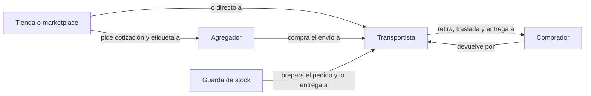

# Envíos y logística

Envíos y logística es la parte de las operaciones que saca el pedido del depósito y lo pone en manos del comprador, y que lo trae de vuelta si se devuelve. La hacen cuatro clases de actores que se apilan: el transportista que mueve el paquete, el agregador que cotiza y hace la etiqueta, el operador que guarda el stock y prepara el pedido, y la plataforma o el marketplace que mete todo eso adentro de la venta.

Es el eslabón de [Operaciones del comercio](../operaciones-del-comercio.md) que sigue al pedido y precede a la [devolución](../devoluciones.md). Recibe del [catálogo y stock](../catalogo-y-stock.md) el peso y las medidas de cada variante, que deciden el precio del envío, y le entrega al [checkout](../../Checkout-y-conversion/checkout-y-conversion.md) la cotización que ve el comprador antes de pagar.

Esta vertical es el envío de una tienda online. Lo general de mover mercadería entre lugares está en [Cadena de suministro y logística](../../../Cadena-de-suministro-y-logistica/cadena-de-suministro-y-logistica.md): el [despacho y la entrega](../../../Cadena-de-suministro-y-logistica/Despacho-y-entrega/despacho-y-entrega.md), el [transporte](../../../Cadena-de-suministro-y-logistica/Transporte/transporte.md) y su [costo del flete](../../../Cadena-de-suministro-y-logistica/Transporte/costo-del-flete.md), y la [tercerización logística](../../../Cadena-de-suministro-y-logistica/Red-de-distribucion/tercerizacion-logistica.md).

## Las capas que mueven un pedido

| Capa | Qué hace | Cómo cobra en general |
|---|---|---|
| Transportista | traslada y entrega, con red de sucursales y vehículos; el que responde por el paquete | por envío, según peso, distancia y servicio; una tarifa de mostrador y otra negociada para empresas |
| Agregador | cotiza varios transportistas, hace la etiqueta, coordina el retiro y, a veces, guarda stock y gestiona devoluciones | por envío con saldo cargado por adelantado, a veces con un plan mensual de software |
| Última milla | entrega dentro de una ciudad, en el día o al día siguiente, o en puntos de retiro | por envío, con un mínimo de paquetes por retiro |
| Guarda de stock (fulfillment) | almacena el stock del comercio, prepara cada pedido y lo despacha | almacenaje por volumen o unidad, más un cargo por pedido preparado |
| Plataforma o marketplace | integra la cotización y la etiqueta en el panel; el marketplace puede hacerlo todo con su red propia | por etiqueta con descuento, o con una tabla propia según peso, precio y reputación del vendedor |

Las capas se superponen: un mismo operador puede ser transportista, agregador y depósito. El detalle de las dos primeras está en [transportistas y agregadores](transportistas-y-agregadores.md) y el de la guarda de stock, en [fulfillment](fulfillment.md).

## Qué decide el comercio y con qué criterio

Un comercio chico decide tres cosas: con quién manda, quién paga el envío y si guarda el stock él o lo terceriza. En la encuesta anual de CACE de 2024 a empresas socias (63 respuestas, sin marketplaces), lo que más pesa al elegir operador es el precio (84%), el cumplimiento del plazo (83%) y la trazabilidad (57%). Esas empresas usan varios operadores a la vez: el 57% usa el transportista privado más grande del país, el 37% el segundo y el 25% el correo oficial. Son empresas medianas y grandes; del comercio chico no hay encuesta.

El precio del envío se arma con el peso (el real o el volumétrico, el mayor), la distancia, el servicio y el valor declarado, y se corrige después si el paquete pesa más que lo declarado. Cómo se arma y quién lo paga cuando el envío es gratis está en [costo del envío](costo-del-envio.md).

## Cómo falla

Las fallas se ven en las reseñas que dejan los comercios en las tiendas de apps de las plataformas, donde cada transportista y cada agregador tiene su integración. En una lectura completa de 1.734 reseñas de comercios argentinos (detalle en [envíos en Argentina](envios-en-argentina.md#lo-que-dicen-los-comercios)), las fallas se ordenan así:

1. **La integración**: la etiqueta que no se genera, el pago de la etiqueta que no se acredita o se cobra dos veces, el pedido que no se sincroniza. Crece después de cada cambio de versión de la app del transportista.
2. **El soporte**: nadie responde, y el siniestro queda sin dueño cuando hay un intermediario entre el comercio y el transportista.
3. **El servicio físico**: el paquete perdido, roto o demorado, el retiro que no pasa, y del lado del comprador, la visita que figura en el seguimiento y no ocurrió.
4. **La plata**: la cotización que pagó el comprador es menor que lo que le cobran al comercio al hacer la etiqueta, y la diferencia la pone el comercio.

En la lectura de la base, las dos primeras son fallas del software que une la tienda con el transportista y las otras dos, de la operación física y del precio. El comercio no siempre distingue de quién es la falla: la reseña mezcla a la plataforma, al agregador y al transportista.

## Lo que hay adentro de Envíos y logística

- [Transportistas y agregadores](transportistas-y-agregadores.md): quién mueve el paquete, quién lo intermedia, cómo cobra cada uno y por qué el siniestro depende de quién está atrás.
- [Costo del envío](costo-del-envio.md): de qué se arma el precio, la cotización al comprador contra el costo real y quién paga el envío gratis.
- [Fulfillment](fulfillment.md): la guarda de stock tercerizada, cómo se cobra y desde qué volumen conviene.
- [Envíos en Argentina](envios-en-argentina.md): los operadores del país, un envío tipo cotizado en cada uno, lo que cobra el marketplace, cuántos comercios despachan y lo que dicen sus reseñas, al 2026-11-22.

Las devoluciones, que recorren la misma cadena al revés, tienen su nota en la carpeta de arriba: [devoluciones](../devoluciones.md).
