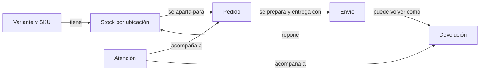

# Operaciones del comercio

Las operaciones del comercio son el trabajo que convierte una venta confirmada en un producto entregado: el catálogo y el stock que hacen posible la venta, el pedido, el envío, la devolución y la atención al comprador. Funcionan como una sola cadena de estados, que empieza en la variante de un producto y termina cuando el comprador se queda con lo que compró o lo devuelve.

La cadena arranca cuando [Pagos](../Pagos/pagos.md) confirma el cobro y libera el pedido. [Venta en varios canales](../Venta-en-varios-canales/venta-en-varios-canales.md) le suma pedidos de otros canales que descuentan del mismo stock. [Normativa](../Normativa/normativa.md) le fija dos reglas: el plazo para que el comprador se arrepienta y un mínimo de atención. La [plataforma de tiendas](../Plataforma-de-tiendas/plataforma-de-tiendas.md) suele traer el modelo de datos de todo esto, y las [apps para comerciantes](../Plataforma-de-tiendas/apps-para-comerciantes.md) cubren lo que la plataforma no trae.

## Una cadena y no seis listas

Las seis partes se estudian por separado, pero son estados de un mismo objeto. La venta descuenta una unidad de una variante, el pedido la aparta, el envío la saca del depósito y la devolución la vuelve a meter. Un error en un eslabón aparece en el siguiente: una variante mal cargada termina en un envío equivocado y en una devolución.

Cuando el pedido cruza sistemas separados (pagos, stock, transportista), coordinar sus pasos y deshacerlos si uno falla es el problema que resuelve una [saga](../../Arquitectura/saga.md).

## El catálogo: producto, variante y SKU

La unidad que se vende no es el producto, es la variante. En la documentación de Shopify, que describe el modelo de esa empresa y no el del campo, una variante es "una versión de un producto que tiene más de una opción, como talla o color". Cada variante pertenece a un producto y tiene su `sku`, el código que la identifica dentro de la tienda (distingue mayúsculas). Ese código hace falta para conectar un servicio externo de preparación de pedidos.

El stock cuelga de la variante. En el mismo modelo, cada variante tiene un ítem de inventario, y ese ítem tiene cantidades en cada ubicación (un depósito, un local). Una remera en tres talles y dos colores son seis variantes con seis stocks.

## El stock se reparte en estados

Una cantidad de stock sola no alcanza para vender sin errores. Shopify la parte en estados por ubicación:

| Estado | Qué cuenta |
|---|---|
| `incoming` | lo que está por llegar |
| `on_hand` | lo que está físicamente: la suma de los seis estados siguientes |
| `available` | lo que se puede vender |
| `committed` | lo apartado para pedidos que todavía no se cumplieron |
| `reserved` | lo reservado |
| `damaged` | lo dañado |
| `safety_stock` | un colchón contra la sobreventa, según el resumen leído |
| `quality_control` | lo que está en control de calidad |

`committed` no se puede ajustar por la API y sus cambios no disparan webhooks.

Sobreventa es vender más unidades de las que hay disponibles. En la lectura de la base, el riesgo crece con cada canal que descuenta stock por su cuenta, porque cada uno vende contra una copia del número que puede estar atrasada; el stock de seguridad es una de las defensas.

> [!NOTE] Sin fuente todavía: cuánto tarda en sincronizarse el stock entre una tienda propia, un marketplace y las redes, y con qué frecuencia se sobrevende. No se encontró fuente primaria.

## El pedido y su cumplimiento

El pedido es el registro de la venta, y su cumplimiento (fulfillment) es aparte. Shopify separa la orden de cumplimiento (`FulfillmentOrder`) del cumplimiento (`Fulfillment`), y el pedido contiene sus órdenes de cumplimiento. En la lectura de la base, la orden es lo que hay que preparar y el cumplimiento lo que salió, y un pedido con varias órdenes puede salir de dos depósitos. Cada una tiene su estado, y los valores posibles están en la referencia de la API, que no se leyó.

> [!NOTE] Sin fuente todavía: los estados de pago de un pedido (pagado, pendiente, reembolsado) y cómo modelan los estados de pedido otras plataformas y los marketplaces de la región.

## Envío y última milla en Argentina

El envío lleva el paquete del depósito a la puerta; la última milla es el tramo final, dentro de la ciudad. Un comercio chico no contrata a cada transportista: los elige dentro de su plataforma de tiendas o de un agregador de envíos.

Un ejemplo de cuántos operadores hay, consultado el 2026-11-22 en la ayuda de envíos de Tiendanube (fuente comercial, sin fecha en la página). Para Argentina integra un servicio de envíos propio, 18 transportistas nacionales (entre ellos Correo Argentino, Andreani, OCA, Urbano y Vía Cargo) y 8 servicios de entrega rápida locales (entre ellos Moova, Treggo y lockers de retiro). El envío de Mercado Libre no figura en esa lista. En la lectura de la base, el mercado está fragmentado y el correo oficial es un operador más.

Los costos extra (envío, impuestos y otras tarifas) están entre las razones de abandono que recoge la encuesta de Baymard, con su cifra y su método en [carrito abandonado](../Checkout-y-conversion/carrito-abandonado.md).

> [!NOTE] Sin fuente todavía: tarifas nacionales de Correo Argentino, Andreani, OCA y el envío de Mercado Libre; plazos de entrega por zona; quién paga el envío gratis y desde qué monto. Los sitios no se dejaron leer o no publican tarifario, y el resumen público del estudio de CACE de mitad de 2026 no trae envíos ni devoluciones (el informe completo es solo para socios).

## Devoluciones: lo que cuestan y lo que obliga la ley

Una devolución desanda la cadena: el producto vuelve, se revisa y, si sirve, vuelve al stock. La cifra más citada es de EE. UU. Según la nota de prensa de NRF y Happy Returns del 5/12/2024, los minoristas estiman que las devoluciones serán el 16,9% de sus ventas anuales de 2024, unos US$ 890.000 millones.

Es lo que estiman los propios minoristas, no una medición. Sale de dos encuestas de otoño de 2024: 2.007 consumidores de EE. UU. que devolvieron al menos una compra online en el último año y 249 profesionales de grandes minoristas (más de US$ 500 millones de ingresos). Happy Returns es de UPS y vende servicios de devoluciones, así que tiene interés comercial en el tema. La nota no separa la tasa de las ventas online.

En Argentina la ley fija parte del costo. El comprador a distancia puede revocar la compra en 10 días, y los gastos de devolución van por cuenta del vendedor; las normas están en la [ficha de normativa argentina](../Normativa/normativa-argentina.md).

> [!NOTE] Sin fuente todavía: una tasa de devolución de Argentina o América Latina con método publicado. Ni CACE ni otra cámara la publican en lo que se pudo leer.

## Atención al comprador

La atención acompaña al pedido y a la devolución: consultas, reclamos y bajas. En Argentina tiene un piso legal, fijado por una disposición de 2025, con horario mínimo y un canal visible en la web; el detalle está en la [ficha de normativa argentina](../Normativa/normativa-argentina.md).

> [!NOTE] Sin fuente todavía: evidencia sobre tiempos de respuesta, canal preferido por los compradores y costo de atender por cada canal.

## Cómo se usa al analizar plataformas de tiendas

Al comparar dos plataformas de tiendas online, conviene mirar en operaciones:

1. Si el stock es por variante y por ubicación, y si distingue lo disponible de lo apartado.
2. Si un mismo stock alimenta a la tienda, a los marketplaces y al local, o si cada canal tiene el suyo.
3. Con cuántos transportistas se integra en el país y si trae un servicio de envíos propio.
4. Cómo registra una devolución y si la devuelve al stock.

Lo que la plataforma no resuelve lo cubren las [apps para comerciantes](../Plataforma-de-tiendas/apps-para-comerciantes.md). Cómo se desarma un producto rival para ver esto está en [desarme de producto](../../Estrategia-competitiva/Analisis-de-competidores/desarme-de-producto.md).

El recurso canónico del modelo de datos es la guía de inventario de Shopify y su objeto `ProductVariant`: fijarse en los estados del stock y en que lo apartado no se ajusta por la API. Es el modelo de una empresa, no un estándar. Para devoluciones, el informe completo de NRF y Happy Returns, por su método y por la tasa online que la nota no da.

## Lo que falta de Operaciones del comercio

Operaciones lleva solo esta entrada, según el árbol aprobado. Cada eslabón puede ser un componente cuando haga falta: catálogo y variantes, stock y sobreventa, estados del pedido, envío y última milla (con una ficha de transportistas y tarifas por país), devoluciones y atención.
