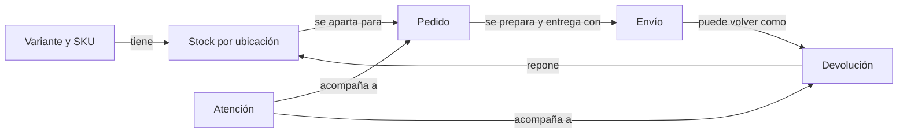

# Operaciones del comercio

Las operaciones del comercio son el trabajo que convierte una venta confirmada en un producto entregado: el catálogo y el stock que hacen posible la venta, el pedido, el envío, la devolución y la atención al comprador. Funcionan como una sola cadena de estados, que empieza en la variante de un producto y termina cuando el comprador se queda con lo que compró o lo devuelve.

La cadena arranca cuando [Pagos](../Pagos/pagos.md) confirma el cobro y libera el pedido. [Venta en varios canales](../Venta-en-varios-canales/venta-en-varios-canales.md) le suma pedidos de otros canales que descuentan del mismo stock. [Normativa](../Normativa/normativa.md) le fija dos reglas: el plazo para que el comprador se arrepienta y un mínimo de atención. La [plataforma de tiendas](../Plataforma-de-tiendas/plataforma-de-tiendas.md) suele traer el modelo de datos de todo esto, y las [apps para comerciantes](../Plataforma-de-tiendas/apps-para-comerciantes.md) cubren lo que la plataforma no trae.

## Una cadena y no seis listas

Las seis partes se estudian por separado, pero son estados de un mismo objeto. La venta descuenta una unidad de una variante, el pedido la aparta, el envío la saca del depósito y la devolución la vuelve a meter. Un error en un eslabón aparece en el siguiente: una variante mal cargada termina en un envío equivocado y en una devolución.

Cuando el pedido cruza sistemas separados (pagos, stock, transportista), coordinar sus pasos y deshacerlos si uno falla es el problema que resuelve una [saga](../../Arquitectura/Sistemas-distribuidos/saga.md).

## El catálogo y el stock

La unidad que se vende es la variante de un producto, con su SKU, y su stock se lleva por ubicación y repartido en estados (disponible, apartado, dañado). Cada canal que descuenta stock por su cuenta suma riesgo de sobreventa. El modelo completo está en [catálogo y stock](catalogo-y-stock.md), y lo general de cualquier depósito, en [Inventario y depósitos](../../Inventario-y-depositos/inventario-y-depositos.md).

## El sistema que lleva el registro

En una tienda chica, la plataforma de tiendas guarda el catálogo, el stock y los pedidos. Cuando el comercio suma un local, un marketplace o un mayorista, ese registro suele pasar a un [sistema de gestión](Sistemas-de-gestion-en-el-comercio/sistemas-de-gestion-en-el-comercio.md), que además factura, compra y lleva cuentas corrientes. Desde ahí, el sistema copia stock y precios a cada canal y recibe sus pedidos, con los riesgos que describe [integración con tiendas y marketplaces](Sistemas-de-gestion-en-el-comercio/integracion-con-tiendas-y-marketplaces.md).

## El pedido y su cumplimiento

El pedido es el registro de la venta, y su cumplimiento (fulfillment) es aparte. Shopify separa la orden de cumplimiento (`FulfillmentOrder`) del cumplimiento (`Fulfillment`), y el pedido contiene sus órdenes de cumplimiento. En la lectura de la base, la orden es lo que hay que preparar y el cumplimiento lo que salió, y un pedido con varias órdenes puede salir de dos depósitos. Cada una tiene su estado, y los valores posibles están en la referencia de la API, que no se leyó.

> [!NOTE] Sin fuente todavía: los estados de pago de un pedido (pagado, pendiente, reembolsado) y cómo modelan los estados de pedido otras plataformas y los marketplaces de la región.

## Envío y última milla

El envío lleva el paquete del depósito a la puerta; la última milla es el tramo final, dentro de la ciudad. Un comercio chico no contrata a cada transportista: los elige dentro de su plataforma de tiendas o de un agregador de envíos, y si vende mucho, puede tercerizar también la guarda del stock. Las capas, cómo se arma el costo y quién paga el envío gratis están en [envíos y logística](Envios-y-logistica/envios-y-logistica.md); los operadores de Argentina, un envío tipo cotizado y lo que dicen las reseñas, en [envíos en Argentina](Envios-y-logistica/envios-en-argentina.md). Preparar el pedido dentro del depósito es de [preparación de pedidos](../../Inventario-y-depositos/Operacion-del-deposito/preparacion-de-pedidos.md); despacharlo y transportarlo, dicho para cualquier empresa, de [Cadena de suministro y logística](../../Cadena-de-suministro-y-logistica/cadena-de-suministro-y-logistica.md).

Los costos extra (envío, impuestos y otras tarifas) están entre las razones de abandono que recoge la encuesta de Baymard, con su cifra y su método en [carrito abandonado](../Checkout-y-conversion/carrito-abandonado.md).

## Devoluciones

Una devolución desanda la cadena: el producto vuelve, se revisa y, si sirve, vuelve al stock. Cuánto cuestan y lo que fija la ley argentina (10 días para arrepentirse, la vuelta a cargo del vendedor) está en [devoluciones](devoluciones.md).

## Atención al comprador

La atención acompaña al pedido y a la devolución: consultas, reclamos y bajas. En Argentina tiene un piso legal, fijado por una disposición de 2025, con horario mínimo y un canal visible en la web; el detalle está en la [ficha de normativa argentina](../Normativa/normativa-argentina.md). La atención en cualquier empresa (el caso, sus canales, los niveles de servicio y el escalamiento) es el tema [Servicio al cliente](../../Servicio-al-cliente/servicio-al-cliente.md).

> [!NOTE] Sin fuente todavía: evidencia sobre tiempos de respuesta, canal preferido por los compradores y costo de atender por cada canal.

## Cómo se usa al analizar plataformas de tiendas

Al comparar dos plataformas de tiendas online, conviene mirar en operaciones:

1. Si el stock es por variante y por ubicación, y si distingue lo disponible de lo apartado.
2. Si un mismo stock alimenta a la tienda, a los marketplaces y al local, o si cada canal tiene el suyo.
3. Con cuántos transportistas se integra en el país y si trae un servicio de envíos propio.
4. Cómo registra una devolución y si la devuelve al stock.
5. Si se conecta con los sistemas de gestión del país, o si el comercio necesita un conector aparte.

Lo que la plataforma no resuelve lo cubren las [apps para comerciantes](../Plataforma-de-tiendas/apps-para-comerciantes.md) y los [sistemas de gestión](Sistemas-de-gestion-en-el-comercio/sistemas-de-gestion-en-el-comercio.md). Cómo se desarma un producto rival para ver esto está en [desarme de producto](../../Estrategia-competitiva/Analisis-de-competidores/desarme-de-producto.md).

## Lo que hay adentro de Operaciones del comercio

- [Catálogo y stock](catalogo-y-stock.md): variante, SKU, estados del stock y sobreventa.
- [Devoluciones](devoluciones.md): lo que cuestan y lo que obliga la ley argentina.
- [Sistemas de gestión en el comercio](Sistemas-de-gestion-en-el-comercio/sistemas-de-gestion-en-el-comercio.md): el software que lleva factura, stock, compras y cuentas detrás de la tienda, cómo se integra con los canales y quiénes operan en Argentina.

- [Envíos y logística](Envios-y-logistica/envios-y-logistica.md): transportistas, agregadores, última milla y guarda de stock, el costo del envío y los operadores de Argentina con sus precios y reseñas.

El pedido y la atención de una tienda siguen en esta entrada. Dichos para cualquier empresa, el pedido está en [pedido de venta](../../Relacion-con-clientes/Pedido-de-venta/pedido-de-venta.md) y la atención, en [Servicio al cliente](../../Servicio-al-cliente/servicio-al-cliente.md).
