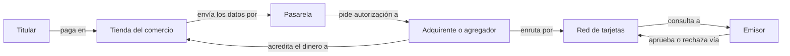

# Actores del pago

En un pago con tarjeta en una tienda online participan el titular y el banco que le emitió la tarjeta, la red de tarjetas, el adquirente que cobra para el comercio y, casi siempre, intermediarios técnicos como la pasarela, el procesador y el agregador. Cada uno cumple una función distinta y cobra por ella.

Saber quién es quién explica dos cosas del resto de la vertical: de dónde sale [el costo de cobrar](costo-de-cobrar.md), que se reparte entre estos actores, y por qué un pago aprobado todavía puede volverse atrás, que es [el contracargo](fraude-y-contracargos.md). Los medios que no usan la red de tarjetas tienen otros actores y están en [medios de pago locales](medios-de-pago-locales.md).

> [!WARNING]
> Ley y dinero: lo que se cuenta de la norma del BCRA no reemplaza el consejo de un abogado o un contador, y se leyó solo en parte; antes de actuar, se lee el texto ordenado vigente.

## Los roles de un pago con tarjeta

> [!NOTE]
> Sin fuente todavía: las definiciones de adquirente, procesador, pasarela y agregador de una fuente primaria (Visa, Mastercard o el glosario del BIS). Las de esta tabla son definiciones de trabajo del glosario del tema, sin fuente que las respalde; las de proveedor de servicios de pago y esquema de pago sí salen de la norma del BCRA, más abajo.

| Rol | Qué hace | En inglés |
|---|---|---|
| Titular | Paga con una tarjeta que le dio su banco | cardholder |
| Emisor | Banco que emitió la tarjeta del comprador; aprueba o rechaza cada pago | issuer |
| Red de tarjetas | Fija las reglas entre emisor y adquirente y transmite los mensajes entre ellos | card network, scheme |
| Adquirente | Procesa los cobros de tarjeta para el comercio y le acredita el dinero | acquirer |
| Procesador | Ejecuta técnicamente la autorización, por cuenta del emisor o del adquirente | processor |
| Pasarela | Transmite los datos del pago desde la tienda hasta el procesador | payment gateway |
| Agregador | Cobra por muchos comercios bajo una sola cuenta propia ante el adquirente | payment facilitator, aggregator |

Un mismo actor puede ocupar varios roles. Prisma Medios de Pago, por ejemplo, se describe en su página como «el mayor procesador emisor de pagos de Argentina», con unos 5.000 millones de transacciones de compra al año y 70 emisores en 13 países; es una autodescripción sin fecha, y su papel como adquirente no quedó verificado.

## Autorizar, compensar y liquidar

Un pago con tarjeta no se resuelve en un solo paso. Primero el emisor lo autoriza, es decir, lo aprueba. Después viene la compensación entre las partes y, por último, la liquidación: la transferencia del dinero al comercio por el adquirente o el agregador. Estas definiciones son las del glosario del tema, sin fuente primaria.

La Reserva Federal separa las redes por cómo hacen esos pasos. Las de mensaje dual, como Visa, Mastercard y Discover, «typically use separate messages to authorize and clear transactions»; las de mensaje único, como ACCEL, NYCE o STAR, usan un solo mensaje para las dos cosas. Es la descripción primaria más cercana que se obtuvo del flujo.

El diagrama es el modelo convencional de cuatro partes (titular, emisor, adquirente y comercio, con la red en el medio), no una figura de una fuente primaria.

> [!NOTE]
> Sin fuente todavía: el flujo de autorización, captura, compensación y liquidación con su diagrama en una fuente primaria (el informe de pagos minoristas del CPMI del BIS, Visa, Mastercard o la Reserva Federal), y qué es la captura y cuándo ocurre.

## El agregador cobra por muchos comercios

Con un agregador, el comercio no tiene contrato propio con un adquirente: cobra a través de la cuenta del agregador. La cadena se ve en lo que pasa cuando un titular desconoce un pago. Según la documentación de Stripe, «the card network debits Stripe», y Stripe «in turn debits your Stripe balance for the disputed amount plus a dispute fee»; la decisión final queda «at the sole discretion of the card issuer».

Esa posición tiene un costo para el comercio y un negocio para el agregador. Una plataforma de tiendas puede operar su propio medio de cobro, cobrar un cargo extra cuando el comercio usa uno de terceros, o las dos cosas; un ejemplo con cifras está en [costos de cobro en Argentina](costos-de-cobro-en-argentina.md), y por qué esa parte pesa tanto en el ingreso de una plataforma, en [el negocio de una plataforma](../Plataforma-de-tiendas/negocio-de-una-plataforma.md).

## Proveedores de servicios de pago en Argentina

El BCRA regula a quien interviene en un pago minorista sin ser entidad financiera. La Comunicación A 6885, del 30/1/2020, define a los proveedores de servicios de pago (PSP) como «personas jurídicas que, sin ser entidades financieras, cumplan al menos una función dentro de un esquema de pago minorista». La norma alcanza a los que ofrecen «cuentas de pago», que son «cuentas de libre disponibilidad ofrecidas por un PSP a sus clientes para ordenar y/o recibir pagos».

La misma norma define el esquema de pago como «sistemas de reglas comerciales, técnicas y/o operativas» con un ordenante, un receptor y uno o más PSP, y exige que cada esquema tenga un administrador que fije las reglas. Es la definición local de lo que en la tabla de arriba se llama red. Una billetera que guarda saldo del cliente es, en este marco, un PSP con cuenta de pago.

Hay otros tipos de PSP. MODO se presenta en su página como Play Digital S.A., «un Proveedor de Servicio de Iniciación de Pagos» que no está autorizado a operar como entidad financiera, disponible en las apps de más de 30 bancos.

La A 6885 ordena además inscribirse en un registro de PSP que ofrecen cuentas de pago, a cargo de la Superintendencia de Entidades Financieras y Cambiarias, dentro de los 30 días corridos posteriores al 1/3/2020. La nota de prensa del BCRA agrega que los PSP deben avisar que «los fondos no cuentan con garantía de los depósitos». Es una sola fuente, el BCRA, en dos formatos; [Normativa](../Normativa/normativa.md) todavía no trata a los PSP. Según el buscador, la modificaron después las A 6929 (2020), A 8038 (2024) y A 8284 y A 8285 (julio de 2025); ninguna se leyó, y el texto vigente está en el texto ordenado del BCRA sobre PSP.

## Lo que falla entre actores

Cada salto entre actores es una llamada por red que puede no contestar. Si la tienda reintenta un cobro sin protección, puede cobrar dos veces; eso lo evita una [clave de idempotencia](../../Arquitectura/clave-de-idempotencia.md). Si el pago queda pendiente mientras el pedido ya se creó, el checkout tiene que poder deshacer pasos, como muestra el ejemplo de checkout de la [saga](../../Arquitectura/saga.md).

## Cómo se usa al analizar una plataforma de tiendas

La primera pregunta sobre una plataforma de tiendas es qué rol ocupa en esta cadena. Puede ser agregador propio, integrar pasarelas de terceros o hacer las dos cosas, y cada opción cambia quién se queda con la tasa y quién carga con el riesgo. Se responde abriendo una cuenta de prueba y recorriendo la configuración de cobros, como describe el [desarme de producto](../../Estrategia-competitiva/Analisis-de-competidores/desarme-de-producto.md), y leyendo la sección de pagos de su documentación pública.

Para la norma argentina, el recurso es la propia [A 6885](https://www.bcra.gob.ar/archivos/Pdfs/comytexord/A6885.pdf): leer los puntos 1.1.1 a 1.1.5, que dicen quién es PSP y quién no puede serlo, y fijarse en la diferencia entre ofrecer cuentas de pago y solo iniciar pagos. Para el flujo internacional, el candidato es el informe de pagos minoristas del CPMI del BIS (el «Red Book»); no se verificó qué edición está vigente, así que hay que abrirlo antes de recomendarlo.
