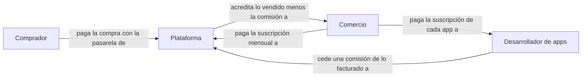

# Plataforma de tiendas

Una plataforma de tiendas es el software con el que un comercio arma y opera su tienda online: catálogo, vitrina, carrito, checkout y panel de gestión. Las plataformas se diferencian por quién opera el software, cómo dejan que otros lo extiendan, de qué cobran y a qué tamaño de comercio le venden.

Los términos de la vertical (GMV, take rate, MRR, headless, tienda de apps, webhook) están definidos en el [glosario](../Fundamentos/glosario-de-comercio-electronico.md).

Es la parte de [comercio electrónico](../comercio-electronico.md) por donde empieza una venta. La plataforma da la tienda y el checkout, que trata [Checkout y conversión](../Checkout-y-conversion/checkout-y-conversion.md); cobra con su pasarela o con la de otro, como explica [Pagos](../Pagos/pagos.md); pasa los pedidos a [Operaciones del comercio](../Operaciones-del-comercio/operaciones-del-comercio.md); y conecta o no otros canales, de [Venta en varios canales](../Venta-en-varios-canales/venta-en-varios-canales.md).

Una plataforma de tiendas es también una [plataforma](../../Producto/Plataformas/plataformas.md) en el sentido de Producto: junta a comercios, compradores y desarrolladores de apps. La teoría de esos lados (efecto de red, a cuál cobrarle, cuánto abrir) vive allá. Esta vertical trata lo propio del comercio electrónico.

## Tres maneras de tener una tienda

El tipo de plataforma decide quién carga con la operación, cómo se cobra y de quién es el cliente. En una alojada (SaaS), el proveedor corre el software y el comercio paga una suscripción. En una de código abierto autoalojada, el comercio instala y mantiene el software, que no cuesta, y paga aparte el alojamiento y las extensiones. En un marketplace, el comercio vende dentro del sitio de otro, paga comisión y el comprador es del marketplace.

Headless y composable no son un cuarto tipo. Separan la vitrina del motor o arman la tienda con servicios elegidos uno por uno, y se eligen con condiciones: dan independencia a cambio de integraciones propias y un equipo que las sostenga. Todas las cifras de costo que circulan sobre ellos vienen de quien vende una de las opciones (detalle en [tipos de plataforma](tipos-de-plataforma.md)).

## Una instalación para muchas tiendas, abierta a terceros

Una plataforma alojada corre una sola instalación para todas sus tiendas, con los datos de cada una aislados. Shopify reparte las tiendas en pods: "A pod is an isolated instance of Shopify consisting of an individual MySQL database shard". Así, una tienda con un pico de tráfico no tira a las demás, y el costo de operar se reparte entre todas.

Sobre esa instalación, la plataforma abre cuatro puertas: temas para la vitrina, una tienda de apps, APIs para leer y escribir datos, y webhooks que avisan de cada evento. Quien construye encima trabaja con límites de uso por tienda y migra cuando vence la versión de la API (detalle en [arquitectura de una plataforma](arquitectura-de-plataforma.md)).

## De dónde sale la plata: suscripción y pagos

Una plataforma alojada cobra una suscripción mensual y una parte de lo que vende cada comercio, sobre todo al procesar sus pagos. La segunda pesa más: en el ejercicio 2025 de Shopify, las soluciones para comerciantes, con los pagos a la cabeza, fueron el 76% del ingreso. La suscripción es fija por comercio, y la comisión crece con cada venta.

El diagrama muestra los tres cobros de la plataforma: la suscripción, la comisión por pagos y la parte de lo que facturan las apps. Se lee con cuatro métricas: GMV, take rate, MRR y penetración de pagos. Qué es cada una, cómo se calcula el take rate y cómo se leen en un competidor está en [el negocio de una plataforma](negocio-de-una-plataforma.md).

## A quién le vende: del emprendedor a la marca grande

Las plataformas separan a los comercios con una escalera de planes. El plan de entrada es gratis o barato y cobra la comisión por venta más alta; cada escalón sube la suscripción, baja la comisión y suma funciones, capacidad técnica y atención. Arriba, el precio se negocia.

Los nombres emprendedor, pyme, mediana y grande son de esta base, no de las plataformas, que usan nombres de planes. Los comercios grandes son pocos y concentran mucho volumen, y por eso contar tiendas no dice quién lidera en ventas (detalle en [segmentos de comerciantes](segmentos-de-comerciantes.md)).

## Las apps de terceros

Lo que la plataforma no trae lo ponen apps de terceros que el comercio instala desde la tienda de apps: analítica y rentabilidad, marketing, atribución de anuncios. Cobran casi siempre según el tamaño del comercio, por pedidos, por GMV o por gasto en anuncios. La plataforma se queda una comisión de lo que facturan y puede lanzar la misma función como propia.

Medir la presencia de una app es difícil: las tiendas de apps muestran reseñas y no instalaciones, y las cifras que publica cada app no tienen definición. [Escalafy](escalafy.md), una app de rentabilidad que se conecta a varias plataformas, es el ejemplo de la vertical (detalle en [apps para comerciantes](apps-para-comerciantes.md)).

## Cómo se usa al analizar plataformas de tiendas

Comparar plataformas por su lista de funciones deja afuera lo que más pesa. Antes de comparar funciones conviene fijar cuatro cosas de cada competidor:

1. Su tipo: quién paga la operación y de quién es el cliente.
2. De dónde sale su ingreso: cuánto de suscripción y cuánto de pagos, y qué parte del GMV pasa por su pasarela.
3. A qué segmento apunta: qué suma en cada plan y qué comisión cobra con pasarela externa.
4. Qué deja hacer a terceros: APIs, límites de uso, comisión de la tienda de apps, y qué funciones de apps ya absorbió.

Las fichas dan los datos fechados para llenar esas cuatro cosas. Cómo se arma el análisis de un competidor está en [Estrategia competitiva](../../Estrategia-competitiva/estrategia-competitiva.md), y cómo se leen sus reportes públicos, en [lectura de reportes públicos](../../Estrategia-competitiva/Analisis-de-competidores/lectura-de-reportes-publicos.md).

## Lo que hay adentro de Plataforma de tiendas

Los componentes, en orden de lectura:

- [Tipos de plataforma](tipos-de-plataforma.md): alojada, de código abierto autoalojada y marketplace, y cuándo conviene headless o composable. Se lee primero.
- [Arquitectura de una plataforma](arquitectura-de-plataforma.md): una instalación para muchas tiendas (los pods de Shopify), temas, tienda de apps, APIs, webhooks, límites de uso y versionado.
- [El negocio de una plataforma](negocio-de-una-plataforma.md): suscripción y soluciones para comerciantes, GMV, take rate, MRR y penetración de pagos, y cómo se leen en un competidor.
- [Segmentos de comerciantes](segmentos-de-comerciantes.md): del emprendedor a la marca grande, la escalera de planes y lo que cambia en los conteos de tiendas.
- [Apps para comerciantes](apps-para-comerciantes.md): qué resuelven, cómo cobran, qué se queda la plataforma, cómo se mide su presencia y el riesgo de que la plataforma copie la función.

Las fichas fechadas, consultadas el 2026-11-22. Plataformas:

- [Shopify](shopify.md): plataforma alojada global; planes en dólares y cifras del 10-K de 2025.
- [Tiendanube](tiendanube.md): plataforma alojada nacida en Argentina, Nuvemshop en Brasil, con pasarela propia; planes en pesos.
- [WooCommerce](woocommerce.md): plataforma de código abierto sobre WordPress; licencia, instalaciones y origen.
- [Adobe Commerce](adobe-commerce.md): la plataforma de Adobe, antes Magento; licencia y precios como hueco.
- [VTEX](vtex.md): plataforma alojada para marcas grandes que cobra un fijo más un porcentaje del GMV; cifras del 20-F de 2025.
- [Empretienda](empretienda.md): plataforma concentrada en Argentina; solo su conteo de tiendas.
- [Wix](wix.md): la tienda dentro del constructor de sitios Wix; planes con sus límites, sin precios.
- [Presencia en Argentina](presencia-en-argentina.md): cuántas tiendas tiene cada plataforma en el país según los rastreadores, con sus discrepancias.

Marketplace:

- [Mercado Libre](mercado-libre.md): marketplace con operación en varios países de la región; cifras del 10-K de 2025 y el cierre de Mercado Shops.

Apps:

- [Escalafy](escalafy.md): app de analítica de rentabilidad para Shopify, Tiendanube y Mercado Libre; cómo cobra y sus cifras discrepantes.
- [Apps de rentabilidad](apps-de-rentabilidad.md): las alternativas de Escalafy con datos públicos, con plataformas, unidad de cobro, precio de entrada y reseñas.

## Lo que falta de Plataforma de tiendas

> [!NOTE] Sin fuente todavía: las bajas (churn) y el ingreso promedio por comercio de una plataforma; el GMV oficial de Tiendanube y el take rate publicado de Mercado Libre; la comisión de la tienda de aplicaciones de Tiendanube; una clasificación de comercios por tamaño que use el campo; un estudio independiente sobre costos de headless y composable; y los temas y eventos de webhook de Tiendanube.
