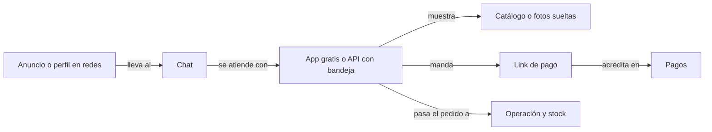

# Comercio conversacional

El comercio conversacional es vender atendiendo por chat: el comprador consulta, arma el pedido y recibe el cobro dentro de una conversación de WhatsApp, Instagram o Messenger, en lugar de un carrito. El canal es de un tercero, Meta, que pone las reglas, los precios y los bloqueos; el comercio pone la atención y cobra con un link de pago fuera del chat.

Es el tercer canal de [Venta en varios canales](../venta-en-varios-canales.md), «redes y mensajería». Se distingue del comercio social de la [entrada del tema](../../comercio-electronico.md) en que acá la venta se cierra conversando, con o sin catálogo; la OCDE solo cuenta como comercio electrónico el pedido hecho sobre un catálogo estructurado, así que buena parte de la venta por chat queda fuera de las estadísticas. El pedido que sale del chat lo atiende la misma [operación](../../Operaciones-del-comercio/operaciones-del-comercio.md) que el de la tienda, y el cobro pasa por los medios de [Pagos](../../Pagos/pagos.md).

## Cuatro piezas de una venta por chat

| Pieza | Qué hace | Dónde se explica |
|---|---|---|
| El canal | WhatsApp, Instagram o Messenger; las reglas y el precio los pone Meta | [WhatsApp Business y su API](whatsapp-business-y-su-api.md), [venta por Instagram](venta-por-instagram.md) |
| La herramienta de atención | la app gratis en un celular, o la API con una bandeja compartida, un bot o un CRM de un intermediario | [WhatsApp Business y su API](whatsapp-business-y-su-api.md), [proveedores en Argentina](proveedores-de-comercio-conversacional-en-argentina.md) |
| El catálogo | el catálogo de la app, uno externo que manda el pedido armado al chat, o fotos sueltas | [proveedores en Argentina](proveedores-de-comercio-conversacional-en-argentina.md) |
| El cobro | en Argentina, un link de pago o una transferencia: no hay pago dentro de WhatsApp ni de Instagram | [proveedores en Argentina](proveedores-de-comercio-conversacional-en-argentina.md#cobrar-por-chat) |

En un comercio chico las cuatro piezas no se hablan: quien atiende copia el pedido del chat, arma el link, mira el comprobante y descuenta el stock a mano. Las herramientas pagas existen para juntar piezas (bandeja con catálogo y link, bot que arma el carrito), y casi todas cobran en dólares.

## La app gratis y la API: dos productos distintos

Meta ofrece dos maneras de atender por WhatsApp, y el salto entre ellas es el principal cambio de costo del canal. La app WhatsApp Business es gratis para responder a mano desde un teléfono y hasta cuatro dispositivos vinculados (según el blog de WhatsApp y la prensa). La API (WhatsApp Business Platform) permite bots, varios agentes y envíos automáticos, y cobra por mensaje entregado según la categoría del mensaje y el país del destinatario. El detalle está en [WhatsApp Business y su API](whatsapp-business-y-su-api.md) y los valores de Argentina en [precios de WhatsApp en Argentina](precios-de-whatsapp-en-argentina.md).

Con tarifas de lista del 2026-11-22, un comercio que atiende 500 conversaciones por mes le paga a Meta entre unos USD 6 y 56 por mes, y uno con 3.000, entre unos USD 150 y 460, según cuántos mensajes manda por conversación; a eso se suma la bandeja o el bot, de unos USD 45 a 260. La cuenta, con sus supuestos, está en la ficha de precios.

## Cuántos venden por chat

No hay una medida representativa para Argentina. Las piezas que existen apuntan en la misma dirección:

- Entre los clientes de una plataforma de tiendas argentina (encuesta 2026, 3.773 respuestas, autoseleccionada), el 82,6% de los emprendedores vende además por Instagram y el 71,5% por WhatsApp; solo el 6,1% vende únicamente por su tienda.
- En Brasil, el Sebrae (más de 8.200 emprendedores, febrero y marzo de 2026) da WhatsApp como canal principal de comunicación y ventas para el 82% de los pequeños negocios y tienda propia para el 10%.
- La encuesta oficial argentina a empresas con diez o más ocupados (ventas de 2022) da que el 18,4% vende online y, de ellas, el 29% por redes; la pregunta no nombra WhatsApp. El fenómeno está sobre todo en cuentapropistas e informales, que esas encuestas no cubren.

Una cuenta de abajo hacia arriba, con supuestos marcados, da entre 0,5 y 1,35 millones de vendedores argentinos que venden por chat en algún grado y entre 0,2 y 0,77 millones que venden sobre todo por ahí. La cuenta completa está en el informe [`conversacional-tamano.md`](../../.investigacion/conversacional-tamano.md).

## El canal tiene dueño

Todo el comercio conversacional corre sobre plataformas de Meta, que cambia precios, términos y APIs con aviso de un mes a seis en los precios y sin calendario en los cierres y bloqueos. Entre abril de 2025 y octubre de 2026 cobró las difusiones de la app, pasó a cobrar por mensaje, apagó una API, prohibió en la API los asistentes de IA de propósito general, empezó a cobrar su propio agente de IA y volvió a cobrar la atención. En agosto de 2026 hubo bloqueos masivos de cuentas, y Meta dijo «A veces nos equivocamos». La línea de tiempo y lo que significa para quien construye encima está en [dependencia de Meta](dependencia-de-meta.md).

## Cómo falla

En 518 reseñas negativas leídas una por una (2026-11-22), de la app de WhatsApp Business y de bandejas, CRM y apps de chat, lo que más se repite es que la herramienta deja de andar (202) y que nadie responde cuando pasa (115). Después vienen el precio o un cobro nuevo (52), el acceso a la cuenta (45) y los bloqueos del número (36, casi todos de 2026). El detalle por tema, con citas, está en [quejas de los comercios que venden por chat](quejas-de-los-comercios-que-venden-por-chat.md).

## Lo que hay adentro de Comercio conversacional

- [WhatsApp Business y su API](whatsapp-business-y-su-api.md): la app gratis, la API, las ventanas de atención, las categorías de mensaje y los intermediarios.
- [Venta por Instagram](venta-por-instagram.md): vender por mensaje directo, sin tienda ni etiquetas de producto en Argentina desde 2023.
- [Dependencia de Meta](dependencia-de-meta.md): los cambios de precio, términos y APIs de 2023 a 2026, con fecha.
- [Quejas de los comercios que venden por chat](quejas-de-los-comercios-que-venden-por-chat.md): 518 reseñas negativas codificadas por tema.
- [Precios de WhatsApp en Argentina](precios-de-whatsapp-en-argentina.md): ficha con las tarifas de Meta en pesos y dólares y el costo mensual de un comercio tipo, al 2026-11-22.
- [Proveedores de comercio conversacional en Argentina](proveedores-de-comercio-conversacional-en-argentina.md): ficha con bandejas, bots, catálogos y links de pago, con su precio de lista, al 2026-11-22.
