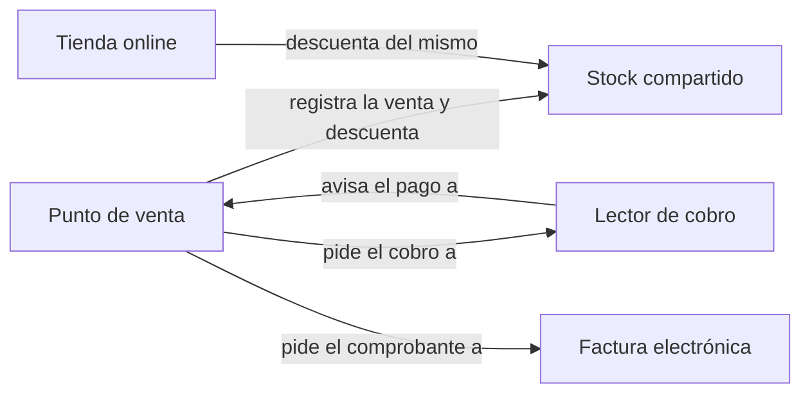

# Local físico con caja

Un local físico con caja que también vende online junta dos ventas que descuentan del mismo stock: la del mostrador, que pasa por un punto de venta, un lector de cobro y un comprobante fiscal, y la de la tienda online. Lo difícil no es cada pieza sino que las cuatro (venta, cobro, factura y stock) queden en un solo registro.

Es uno de los cuatro canales de [Venta en varios canales](../venta-en-varios-canales.md), y el que más toca a [Operaciones del comercio](../../Operaciones-del-comercio/operaciones-del-comercio.md): el local es una ubicación más del [stock](../../Operaciones-del-comercio/catalogo-y-stock.md). Quien lleva ese stock puede ser la plataforma de tiendas o un [sistema de gestión](../../Operaciones-del-comercio/Sistemas-de-gestion/sistemas-de-gestion.md), y el comprobante de cada venta lo pide la [factura electrónica de ARCA](../../Normativa/factura-electronica-de-arca.md) en Argentina.

## Cuatro piezas en el mostrador

Una venta en el local pasa por cuatro piezas, y en un comercio chico suelen ser cuatro productos distintos.

| Pieza | Qué hace | Dónde se explica |
|---|---|---|
| Punto de venta (POS) | registra la venta, lleva la caja y descuenta stock | [punto de venta](punto-de-venta.md) |
| Lector de cobro | cobra la tarjeta o el QR y liquida el dinero | [punto de venta](punto-de-venta.md) y [Pagos](../../Pagos/pagos.md) |
| Comprobante fiscal | la factura o el tique de cada venta | [factura electrónica de ARCA](../../Normativa/factura-electronica-de-arca.md) |
| Stock compartido | una sola cantidad para el local y la tienda | [retiro en el local y stock compartido](retiro-en-el-local-y-stock-compartido.md) |

Cuando las piezas no se hablan, el empleado del mostrador hace de puente: cobra en el lector, tipea el monto en el POS y emite la factura en otro sistema. En la oferta argentina relevada el 2026-11-22 ese es el caso común: el POS de la plataforma de tiendas más usada registra a mano el cobro hecho en un lector externo y deja la factura a una app de terceros. El detalle, con precios, está en [puntos de venta en Argentina](puntos-de-venta-en-argentina.md).

## Lo que la integración cambia

La evidencia más citada sobre integrar el local con lo online es de Gallino y Moreno (2014), con una cadena de más de 80 tiendas de Norteamérica. Al ofrecer compra online con retiro en el local, y por eso mostrar online un stock confiable, bajaron las ventas online cerca de las tiendas y subieron las ventas y las visitas de las tiendas. Los autores lo explican por gente que investiga online y compra en el local y por ventas cruzadas en el mostrador. El detalle y sus límites están en [retiro en el local y stock compartido](retiro-en-el-local-y-stock-compartido.md).

Esa evidencia es de minoristas grandes de otros países. No se encontró un estudio de pymes de América Latina.

## Cómo falla

- **Sobreventa**: el local vende la última unidad que la tienda todavía muestra, o al revés. Una reseña de 2020 de la app de administración de una plataforma de tiendas lo cuenta así: «vendí en mi local algo que ya había vendido por la tienda y era el último que tenía en stock».
- **Doble carga**: el cobro del lector y la venta del POS no coinciden porque alguien tipeó mal; el cierre de caja no cierra.
- **Factura aparte**: la venta queda registrada pero el comprobante se emite en otro sistema, o no se emite.

> [!NOTE] Sin fuente todavía: cuántos comercios con local sufren sobreventa o diferencias de caja, y cuánto les cuesta. No hay una masa de reseñas públicas del POS de las plataformas ni del lector de cobro que se pueda codificar; la única medición con método es la de Gallino y Moreno, de otro mercado.

## Lo que hay adentro de Local físico con caja

- [Punto de venta](punto-de-venta.md): qué hace un POS y en qué se diferencia del lector de cobro y del sistema de gestión.
- [Retiro en el local y stock compartido](retiro-en-el-local-y-stock-compartido.md): stock por ubicación, retiro, envío desde el local y devolución cruzada, con la evidencia de sus efectos.
- [Puntos de venta en Argentina](puntos-de-venta-en-argentina.md): los POS de las plataformas de tiendas, los lectores de cobro y sus comisiones, al 2026-11-22.
