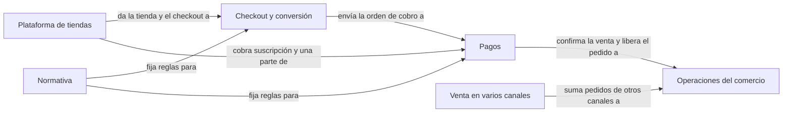

# Comercio electrónico

El comercio electrónico es la compra o venta de bienes o servicios en la que el pedido se hace por un medio digital diseñado para eso, como una tienda online, una app o un marketplace, aunque el pago y la entrega ocurran fuera de línea. Vender así pide resolver cinco cosas: el software de la tienda, el cobro, el paso del carrito a la compra, la operación que entrega lo vendido y las reglas que lo regulan.

Es el tema de dominio del plan de análisis de competencia: lo que hay que saber de esta industria para evaluar con criterio a las plataformas de tiendas online. Cómo se analiza a un competidor está en [Estrategia competitiva](../Estrategia-competitiva/estrategia-competitiva.md); cómo funciona un producto de dos lados, en [Plataformas](../Producto/Plataformas/plataformas.md); y el marketing de una tienda, en [Marketing](../Marketing/marketing.md).

## Qué cuenta como comercio electrónico

La OCDE lo define por el método con que se hace el pedido, no por el pago ni por la entrega. Su definición dice: "An e-commerce transaction is the sale or purchase of goods or services, conducted over computer networks by methods specifically designed for the purpose of receiving or placing of orders". El texto es el mismo desde 2009; en 2025 la OCDE cambió las guías para interpretarlo.

Las guías de 2025 incluyen los pedidos por páginas web, apps, extranets e intercambio electrónico de datos (EDI). Excluyen el teléfono, el fax, los kioscos y códigos QR en el local y los mensajes tipeados a mano. Una venta por redes o mensajería entra solo si el pedido usa un catálogo estructurado dentro de la app; si la app manda a una web, cuenta la web. Así, una compra online que se retira en el local es comercio electrónico, y un pedido por chat escrito a mano no lo es.

## Los modelos de comercio

Las combinaciones de quién vende y quién compra ordenan el campo. Las definiciones de esta tabla son las convencionales del área; no se verificaron contra un libro de texto.

| Modelo | Quién vende a quién | Ejemplo |
|---|---|---|
| B2C | una empresa a consumidores | una marca de ropa con tienda propia |
| B2B | una empresa a otra | un mayorista que toma pedidos online |
| C2C | personas entre sí, con una plataforma en el medio | la venta de usados |
| D2C (directo al consumidor) | el fabricante vende sin intermediarios | una marca que deja de depender de distribuidores |
| Marketplace | muchos vendedores en el sitio de un tercero, que cobra una comisión | un marketplace generalista |
| Comercio social | la compra ocurre dentro de una red o una app de mensajería | un catálogo con carrito dentro de una app de chat |

El marketplace cambia quién es dueño de la relación con el cliente. La OCDE describe a las plataformas de intermediación como las que "enable third-party transactions without taking ownership of the goods or services involved for a fee". La decisión de vender en un marketplace, en una tienda propia o en ambos está en [Venta en varios canales](Venta-en-varios-canales/venta-en-varios-canales.md).

## De qué está hecho vender online

Las cinco partes siguen el recorrido de una venta. El comercio arma su tienda sobre una plataforma; el comprador llega, llena el carrito y pasa por el checkout; el pago se autoriza y se acredita; la operación prepara y entrega el pedido; y las reglas atraviesan todo el recorrido.

- [Plataforma de tiendas](Plataforma-de-tiendas/plataforma-de-tiendas.md): el software con el que un comercio vende online, sus tipos, cómo está hecho, cómo gana plata y las apps de terceros que viven en ella. Es la vertical más desarrollada, con una ficha por plataforma y por app de referencia.
- [Pagos](Pagos/pagos.md): quién participa en un cobro, cuánto cuesta, quién pierde con el fraude y cómo funcionan las cuotas y los medios locales.
- [Checkout y conversión](Checkout-y-conversion/checkout-y-conversion.md): del carrito a la compra, por qué se abandona y qué sostiene la investigación sobre el checkout.
- [Operaciones del comercio](Operaciones-del-comercio/operaciones-del-comercio.md): catálogo, stock, pedidos, envío y devoluciones.
- [Venta en varios canales](Venta-en-varios-canales/venta-en-varios-canales.md): tienda propia, marketplace, redes y local físico, y qué se sabe de combinarlos.
- [Normativa](Normativa/normativa.md): lo que regula la venta online, con fichas por país.

## Cómo se usa al analizar plataformas de tiendas

Una plataforma de tiendas compite en las cinco partes a la vez. Vende el software, y además gana con los pagos, decide cuánto del checkout puede cambiar el comercio, se integra o no con los transportistas y cumple o no las reglas locales. Por eso comparar plataformas solo por sus funcionalidades deja afuera de dónde sale la mayor parte de su ingreso; cómo se lee eso está en [el negocio de una plataforma](Plataforma-de-tiendas/negocio-de-una-plataforma.md).

El análisis completo, de la decisión al seguimiento y con este tema como dominio de ejemplo, se hace con el [recorrido de un análisis de competencia](../Estrategia-competitiva/Fundamentos/recorrido-analisis-de-competencia.md).

Las cifras de este dominio cambian rápido y vienen muchas veces de quien vende algo. Cada nota da el año de los datos, quién los publica y si tiene interés comercial. Las cifras del mercado y sus discrepancias están en [Fundamentos](Fundamentos/fundamentos-de-comercio-electronico.md).

## Orden de lectura

Para quien no conoce el dominio: esta entrada, después [Plataforma de tiendas](Plataforma-de-tiendas/plataforma-de-tiendas.md) y [Pagos](Pagos/pagos.md), que explican de dónde sale la plata, y después [Checkout y conversión](Checkout-y-conversion/checkout-y-conversion.md). Operaciones, canales y normativa se leen cuando hacen falta.

- [Fundamentos](Fundamentos/fundamentos-de-comercio-electronico.md): historia breve, bibliografía, fuentes y cifras del mercado, mitos y glosario.
