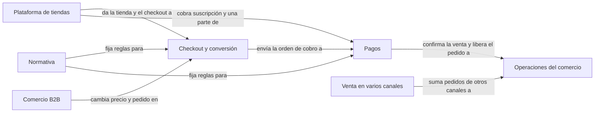

# Comercio electrónico

El comercio electrónico es la compra o venta de bienes o servicios en la que el pedido se hace por un medio digital diseñado para eso, como una tienda online, una app o un marketplace, aunque el pago y la entrega ocurran fuera de línea. Vender así pide resolver cinco cosas: el software de la tienda, el cobro, el paso del carrito a la compra, la operación que entrega lo vendido y las reglas que lo regulan.

Es el tema de dominio del plan de análisis de competencia: lo que hay que saber de esta industria para evaluar con criterio a las plataformas de tiendas online. Cómo se analiza a un competidor está en [Estrategia competitiva](../Estrategia-competitiva/estrategia-competitiva.md); cómo funciona un producto de dos lados, en [Plataformas](../Producto/Plataformas/plataformas.md); y el marketing de una tienda, en [Marketing](../Marketing/marketing.md).

## Qué cuenta como comercio electrónico

La OCDE lo define por el método con que se hace el pedido, no por el pago ni por la entrega. Su definición dice: "An e-commerce transaction is the sale or purchase of goods or services, conducted over computer networks by methods specifically designed for the purpose of receiving or placing of orders". El texto es el mismo desde 2009; en 2025 la OCDE cambió las guías para interpretarlo.

Las guías de 2025 incluyen los pedidos por páginas web, apps, extranets e intercambio electrónico de datos (EDI). Excluyen el teléfono, el fax, los kioscos y códigos QR en el local y los mensajes tipeados a mano. Una venta por redes o mensajería entra solo si el pedido usa un catálogo estructurado dentro de la app; si la app manda a una web, cuenta la web. Así, una compra online que se retira en el local es comercio electrónico, y un pedido por chat escrito a mano no lo es.

## Los modelos de comercio

Las combinaciones de quién vende y quién compra ordenan el campo. Las definiciones de esta tabla son las convencionales del área; no se verificaron contra un libro de texto.

| Modelo | Quién vende a quién | Ejemplo |
|---|---|---|
| B2C | una empresa a consumidores | una marca de ropa con tienda propia |
| B2B | una empresa a otra | un mayorista que toma pedidos online |
| C2C | personas entre sí, con una plataforma en el medio | la venta de usados |
| D2C (directo al consumidor) | el fabricante vende sin intermediarios | una marca que deja de depender de distribuidores |
| Marketplace | muchos vendedores en el sitio de un tercero, que cobra una comisión | un marketplace generalista |
| Comercio social | la compra ocurre dentro de una red o una app de mensajería | un catálogo con carrito dentro de una app de chat |

El marketplace cambia quién es dueño de la relación con el cliente. La OCDE describe a las plataformas de intermediación como las que "enable third-party transactions without taking ownership of the goods or services involved for a fee". La decisión de vender en un marketplace, en una tienda propia o en ambos está en [Venta en varios canales](Venta-en-varios-canales/venta-en-varios-canales.md).

## De qué está hecho vender online

Las cinco partes siguen el recorrido de una venta. El comercio arma su tienda sobre una plataforma; el comprador llega, llena el carrito y pasa por el checkout; el pago se autoriza y se acredita; la operación prepara y entrega el pedido; y las reglas atraviesan todo el recorrido.

- [Plataforma de tiendas](Plataforma-de-tiendas/plataforma-de-tiendas.md): el software con el que un comercio vende online, sus tipos, cómo está hecho, cómo gana plata y las apps de terceros que viven en ella. Es la vertical más desarrollada, con una ficha por plataforma y por app de referencia.
- [Pagos](Pagos/pagos.md): quién participa en un cobro, cuánto cuesta, quién pierde con el fraude y cómo funcionan las cuotas y los medios locales.
- [Checkout y conversión](Checkout-y-conversion/checkout-y-conversion.md): del carrito a la compra, por qué se abandona y qué sostiene la investigación sobre el checkout.
- [Operaciones del comercio](Operaciones-del-comercio/operaciones-del-comercio.md): catálogo, stock, pedidos, [envíos y logística](Operaciones-del-comercio/Envios-y-logistica/envios-y-logistica.md) y devoluciones, y los [sistemas de gestión](Operaciones-del-comercio/Sistemas-de-gestion/sistemas-de-gestion.md) que llevan factura, stock y compras detrás de la tienda.
- [Venta en varios canales](Venta-en-varios-canales/venta-en-varios-canales.md): tienda propia, marketplace, redes y local físico, y qué se sabe de combinarlos; el comercio con mostrador está en [local físico con caja](Venta-en-varios-canales/Local-fisico-con-caja/local-fisico-con-caja.md).
- [Normativa](Normativa/normativa.md): lo que regula la venta online, con fichas por país y la [factura electrónica de ARCA](Normativa/factura-electronica-de-arca.md).
- [Comercio B2B](Comercio-B2B/comercio-b2b.md): la venta entre empresas, con su cadena y su software.

## Qué leer según el trabajo con una tienda online

- Si vas a armar una propuesta para un comercio: cómo se descubre su problema y se arma y presenta la propuesta está en [Ventas](../Ventas/ventas.md), empezando por [preguntas de descubrimiento](../Ventas/Descubrimiento-y-calificacion/preguntas-de-descubrimiento.md) y [la propuesta](../Ventas/La-propuesta/la-propuesta.md); del dominio, [segmentos de comerciantes](Plataforma-de-tiendas/segmentos-de-comerciantes.md) para ubicar su tamaño, [venta en varios canales](Venta-en-varios-canales/venta-en-varios-canales.md) para tienda propia o marketplace, [costo de cobrar](Pagos/costo-de-cobrar.md) y [costos de cobro en Argentina](Pagos/costos-de-cobro-en-argentina.md), y [embudo de conversión](Checkout-y-conversion/embudo-de-conversion.md) para medir el antes y el después. Si la propuesta es mudar la tienda y cuidarla después: [mudar una tienda](Plataforma-de-tiendas/mudar-una-tienda.md), [proyecto a precio cerrado](../Producto/Planificacion-y-entrega/proyecto-a-precio-cerrado.md) y [abono de cuidado](../Emprender/Modelo-de-negocio/abono-de-cuidado.md). No hay notas por rubro (ropa, alimentos); hoy, lo más cercano para un rubro con muchos cambios es [devoluciones](Operaciones-del-comercio/devoluciones.md).
- Si tenés que comparar tu checkout con el de rivales: primero el método, en la [evaluación competitiva](../UX/Evaluacion/evaluacion-competitiva.md) de UX; después [usabilidad del checkout](Checkout-y-conversion/usabilidad-del-checkout.md#al-analizar-el-checkout-de-un-competidor) para la lista de qué revisar, [checkout por plataforma](Checkout-y-conversion/checkout-por-plataforma.md) para separar lo que decidió cada tienda de lo que fija su plataforma y [cifras de checkout y conversión](Checkout-y-conversion/cifras-de-checkout-y-conversion.md).
- Si tenés que elegir plataforma para un comercio: [tipos de plataforma](Plataforma-de-tiendas/tipos-de-plataforma.md), [segmentos de comerciantes](Plataforma-de-tiendas/segmentos-de-comerciantes.md), las fichas de [Plataforma de tiendas](Plataforma-de-tiendas/plataforma-de-tiendas.md) y [presencia en Argentina](Plataforma-de-tiendas/presencia-en-argentina.md).
- Si tenés que calcular cuánto cuesta cobrar: [costo de cobrar](Pagos/costo-de-cobrar.md), [costos de cobro en Argentina](Pagos/costos-de-cobro-en-argentina.md), [cuotas](Pagos/cuotas.md) y el [régimen argentino de tarjetas y cuotas](Pagos/regimen-argentino-de-tarjetas-y-cuotas.md).
- Si tenés que bajar el abandono del carrito: [carrito abandonado](Checkout-y-conversion/carrito-abandonado.md), [embudo de conversión](Checkout-y-conversion/embudo-de-conversion.md) y [usabilidad del checkout](Checkout-y-conversion/usabilidad-del-checkout.md).
- Si tenés que elegir sobre qué plataforma trabajar o ser socio de una: [socios de una plataforma](Plataforma-de-tiendas/socios-de-una-plataforma.md) y las fichas de los programas de [Shopify](Plataforma-de-tiendas/programa-de-socios-de-shopify.md), [Tiendanube](Plataforma-de-tiendas/programa-de-socios-de-tiendanube.md) y [WooCommerce](Plataforma-de-tiendas/programa-de-socios-de-woocommerce.md).
- Si tenés que mudar una tienda de una plataforma a otra: [mudar una tienda](Plataforma-de-tiendas/mudar-una-tienda.md) y [herramientas para mudar una tienda](Plataforma-de-tiendas/herramientas-para-mudar-una-tienda.md); el costo para el comercio, en [costos de cambio](../Estrategia-competitiva/Fuentes-de-ventaja/costos-de-cambio.md).
- Si vas a analizar una plataforma de tiendas rival: [el negocio de una plataforma](Plataforma-de-tiendas/negocio-de-una-plataforma.md) y el [recorrido de un análisis de competencia](../Estrategia-competitiva/Fundamentos/recorrido-analisis-de-competencia.md).
- Si vas a construir una app para tiendas: [apps para comerciantes](Plataforma-de-tiendas/apps-para-comerciantes.md), [arquitectura de plataforma](Plataforma-de-tiendas/arquitectura-de-plataforma.md) y [competencia con la plataforma](../Producto/Plataformas/competencia-con-la-plataforma.md).
- Si tenés que saber qué le exige la ley a una tienda: [normativa argentina](Normativa/normativa-argentina.md); para facturar cada venta, [factura electrónica de ARCA](Normativa/factura-electronica-de-arca.md).
- Si tenés que elegir un sistema de gestión o conectarlo con la tienda y Mercado Libre: [sistemas de gestión](Operaciones-del-comercio/Sistemas-de-gestion/sistemas-de-gestion.md), [integración con tiendas y marketplaces](Operaciones-del-comercio/Sistemas-de-gestion/integracion-con-tiendas-y-marketplaces.md) y la ficha de [sistemas de gestión en Argentina](Operaciones-del-comercio/Sistemas-de-gestion/sistemas-de-gestion-en-argentina.md), con precios y reseñas.
- Si tenés que elegir con quién mandar los envíos, calcular cuánto cuestan o decidir si tercerizar el depósito: [envíos y logística](Operaciones-del-comercio/Envios-y-logistica/envios-y-logistica.md), [transportistas y agregadores](Operaciones-del-comercio/Envios-y-logistica/transportistas-y-agregadores.md), [costo del envío](Operaciones-del-comercio/Envios-y-logistica/costo-del-envio.md), [fulfillment](Operaciones-del-comercio/Envios-y-logistica/fulfillment.md) y la ficha de [envíos en Argentina](Operaciones-del-comercio/Envios-y-logistica/envios-en-argentina.md), con un envío tipo cotizado y reseñas.
- Si tenés que armar la venta de un comercio con local y tienda online: [local físico con caja](Venta-en-varios-canales/Local-fisico-con-caja/local-fisico-con-caja.md), [punto de venta](Venta-en-varios-canales/Local-fisico-con-caja/punto-de-venta.md), [retiro en el local y stock compartido](Venta-en-varios-canales/Local-fisico-con-caja/retiro-en-el-local-y-stock-compartido.md) y [puntos de venta en Argentina](Venta-en-varios-canales/Local-fisico-con-caja/puntos-de-venta-en-argentina.md).
- Si analizás distribuidoras o mayoristas: [comercio B2B](Comercio-B2B/comercio-b2b.md#por-dónde-empezar-a-analizar-un-mercado-mayorista).

## Cómo se usa al analizar plataformas de tiendas

Una plataforma de tiendas compite en las cinco partes a la vez. Vende el software, y además gana con los pagos, decide cuánto del checkout puede cambiar el comercio, se integra o no con los transportistas y cumple o no las reglas locales. Por eso comparar plataformas solo por sus funcionalidades deja afuera de dónde sale la mayor parte de su ingreso; cómo se lee eso está en [el negocio de una plataforma](Plataforma-de-tiendas/negocio-de-una-plataforma.md).

El análisis completo, de la decisión al seguimiento y con este tema como dominio de ejemplo, se hace con el [recorrido de un análisis de competencia](../Estrategia-competitiva/Fundamentos/recorrido-analisis-de-competencia.md).

Las cifras de este dominio cambian rápido y vienen muchas veces de quien vende algo. Cada nota da el año de los datos, quién los publica y si tiene interés comercial. Las cifras del mercado y sus discrepancias están en [Fundamentos](Fundamentos/fundamentos-de-comercio-electronico.md).

## Orden de lectura

Para quien no conoce el dominio: esta entrada, después [Plataforma de tiendas](Plataforma-de-tiendas/plataforma-de-tiendas.md) y [Pagos](Pagos/pagos.md), que explican de dónde sale la plata, y después [Checkout y conversión](Checkout-y-conversion/checkout-y-conversion.md). Operaciones, canales y normativa se leen cuando hacen falta.

- [Fundamentos](Fundamentos/fundamentos-de-comercio-electronico.md): historia breve, bibliografía, fuentes y cifras del mercado, mitos y glosario.
