# Abastecimiento estratégico

El abastecimiento estratégico es la parte de compras que decide a quién comprarle cada cosa y en qué términos: mira en qué se gasta, ordena lo que se compra en categorías, elige una estrategia para cada una, pide ofertas, negocia y deja el resultado en un acuerdo con el proveedor. Se decide pocas veces y fija las condiciones de cientos de órdenes de compra.

Es la mitad estratégica de [Compras y abastecimiento](../compras-y-abastecimiento.md). Elige entre los proveedores que registra [Proveedores](../Proveedores/proveedores.md) y, cuando la relación se vuelve larga o riesgosa, le pasa la segmentación y la dependencia a [relación con proveedores](../Proveedores/relacion-con-proveedores.md). Lo que acuerda (un precio, un plazo de entrega, un contrato marco) lo usa [Orden de compra](../Orden-de-compra/orden-de-compra.md) cada vez que alguien pide algo. La recepción y la evaluación del proveedor después de comprar le devuelven si el acuerdo se cumple.

## Del gasto al acuerdo

El recorrido va de mirar el gasto a firmar un acuerdo, y se repite por categoría de compra cada vez que vence un contrato o cambia el mercado. La gestión por categorías es el hilo que lo une: según CIPS, consiste en dividir lo que se compra en categorías que se manejan juntas, cada una como una unidad de negocio con su propia estrategia, en cinco pasos (Define, Analyse, Engage, Develop and implement, Review and improve).

```mermaid
flowchart LR
  G[Análisis del gasto] -->|arma| C[Categorías de compra]
  C -->|se ubican en| K[Matriz de Kraljic]
  K -->|define la estrategia y si se hace o se compra| H[Hacer o comprar]
  H -->|si se compra, se piden ofertas| Q[Cotización y licitación]
  Q -->|se compara por| T[Costo total de adquisición]
  T -->|ordena la| N[Negociación de compras]
  N -->|queda en un| M[Contrato marco u orden puntual]
```

CIPS describe el ciclo completo en 13 pasos; los nueve primeros son de esta vertical y llegan hasta la adjudicación. La correspondencia con las notas es de la base:

| Paso de CIPS (nombre literal) | Dónde está en la base |
|---|---|
| 1 «Define business needs and develop specification» | [solicitud de compra](../Orden-de-compra/solicitud-de-compra.md), cuando la necesidad es puntual |
| 2 «Market analysis and make or buy decision» | [análisis del gasto](analisis-del-gasto.md) y [hacer o comprar](hacer-o-comprar.md) |
| 3 «Develop the strategy and plan» | [matriz de Kraljic](matriz-de-kraljic.md) |
| 4 a 8, del sondeo del mercado a la evaluación de las ofertas | [cotización y licitación](cotizacion-y-licitacion.md) y [costo total de adquisición](costo-total-de-adquisicion.md) |
| 9 «Contract award and implementation» | [negociación de compras](negociacion-de-compras.md) y [contrato marco](contrato-marco.md) |

Los pasos 10 a 13 («Warehouse, logistics and receipt», «Contract performance and improvement», «Supplier relationship management», «Asset management») caen en [Seguimiento de la orden](../Seguimiento-de-la-orden/seguimiento-de-la-orden.md), en Proveedores y en los temas vecinos.

## Dónde corta el campo entre lo estratégico y lo transaccional

CIPS y APQC separan lo estratégico de lo transaccional, pero no por el mismo lugar. APQC 7.4 pone en dos grupos aparte el gobierno del abastecimiento y la gestión de categorías (4.2.1, con «Analyze organization's spend profile») y la selección de proveedores y los contratos (4.2.2, con «Negotiate and establish contracts» y «Manage contracts»). Pero deja el pedido de cotización («Solicit supplier quotes», 4.2.3.3) dentro de ordenar, junto a la solicitud y la orden de compra. CIPS lo pone en la licitación, antes de adjudicar.

Las dos lecturas tienen razón según el caso. Pedir precio a un par de proveedores para una compra de rutina es parte del trámite de la orden; llamar a ofertas para todo un año de una categoría es una decisión estratégica. La base lo deja acá y lo explica en [cotización y licitación](cotizacion-y-licitacion.md). Con hacer o comprar pasa algo parecido: APQC pone la política de tercerizar en la planificación (4.1.1.3 «Define outsourcing policies») y CIPS, en el paso 2 del ciclo.

No hay un modelo único del proceso de compras. Una revisión de 2019 clasifica los modelos publicados en «tactical/operational, strategic, cyclical, or decision-making processes», según su abstract; la partición entre estratégico y transaccional es una de varias.

> [!NOTE] Sin fuente todavía: las etapas del modelo de proceso de compras de van Weele y de Monczka, que son los libros de texto del campo; no se leyeron.

## Cómo falla

La falla más citada es medir el abastecimiento por el ahorro de precio que informa y no por lo que llega al resultado. Un precio más bajo puede costar más por rechazos, demoras o stock, y un ahorro negociado puede gastarse en otra cosa antes de llegar al resultado. Lo primero está en [costo total de adquisición](costo-total-de-adquisicion.md); lo segundo, con la evidencia que lo discute, en [Fundamentos](../Fundamentos/fundamentos-de-compras-y-abastecimiento.md).

La otra es tratar todas las categorías igual: licitar los clips con el mismo esfuerzo que el componente que para la planta si falta. La [matriz de Kraljic](matriz-de-kraljic.md) existe para evitar eso, con los límites que tiene como herramienta.

## Qué hay en Abastecimiento estratégico

- [Análisis del gasto](analisis-del-gasto.md): en qué y a quién se gasta, cómo se limpian y se clasifican los datos, y cómo se arman las categorías de compra.
- [Matriz de Kraljic](matriz-de-kraljic.md): ubicar cada categoría por impacto en el resultado y riesgo de abastecimiento, qué estrategia toca a cada cuadrante y por qué se la discute.
- [Hacer o comprar](hacer-o-comprar.md): producir adentro o comprar afuera, con los costos de transacción y los criterios prácticos.
- [Cotización y licitación](cotizacion-y-licitacion.md): pedido de información, de cotización y de propuesta; cómo se comparan las ofertas y la subasta inversa.
- [Negociación de compras](negociacion-de-compras.md): lo que cambia cuando se negocia como comprador.
- [Costo total de adquisición](costo-total-de-adquisicion.md): lo que cuesta una compra más allá del precio, y cómo se calcula.
- [Contrato marco](contrato-marco.md): precio y condiciones acordados por un período, y cómo se sigue lo consumido contra lo comprometido.
