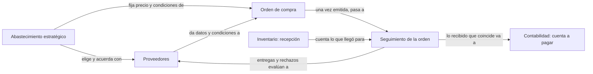

# Compras y abastecimiento

Compras y abastecimiento, como dominio de negocio, es lo que una empresa registra y hace para conseguir de afuera lo que necesita: a quién le compra y en qué condiciones, cómo decide a quién comprarle, cómo se pide y se aprueba una compra, qué se le ordena al proveedor y cómo se controla que llegó lo pedido. Es lo que lleva el módulo de compras de un ERP, pero existe antes del software: una carpeta de proveedores, un talonario de órdenes de compra y un remito firmado hacen lo mismo.

El tema termina cuando lo recibido coincide con lo pedido. Lo que pasa alrededor de esa línea es de otros dominios. Contar, inspeccionar y ubicar lo que baja del camión es de [Inventario y depósitos](../Inventario-y-depositos/inventario-y-depositos.md), en [recepción](../Inventario-y-depositos/Operacion-del-deposito/recepcion.md); también lo es la política de cuándo y cuánto reponer, en [punto de pedido](../Inventario-y-depositos/Reposicion/punto-de-pedido.md). El registro de la deuda con el proveedor y el cruce de la factura con la orden y la recepción son de [Contabilidad](../Contabilidad/contabilidad.md), en [compras y cuentas a pagar](../Contabilidad/Operaciones/compras-y-cuentas-a-pagar.md). El pronóstico y la reposición planificada son de Cadena de suministro y logística, y el pago, de Tesorería; ninguno está armado todavía.

Este tema es dueño del **proveedor como registro**, de **la solicitud de compra**, de **la orden de compra** y del **acuerdo con el proveedor**, y de los verbos elegir, negociar, pedir, ordenar y controlar que llegó lo pedido. La orden de compra de una empresa es el [pedido de venta](../Relacion-con-clientes/Pedido-de-venta/pedido-de-venta.md) de su proveedor: los dos documentos se parecen, pero cada empresa registra el suyo.

## Las cuatro partes del dominio

El tema se divide en el proveedor, la decisión de a quién comprarle, el pedido y el seguimiento hasta que llega lo pedido. El corte sigue a APQC 7.4, que parte «Procure materials and services» (4.2) en cuatro grupos: gobernar el abastecimiento y gestionar las categorías (4.2.1), seleccionar proveedores y armar contratos (4.2.2), ordenar materiales y servicios (4.2.3) y gestionar proveedores (4.2.4). La separación del pedido y su seguimiento es un criterio de la base, porque los documentos y los estados cambian después de emitir la orden; APQC no la hace.

- [Proveedores](Proveedores/proveedores.md): a quién se le compra y en qué condiciones. El proveedor como registro, el alta y la homologación (comprobar que un proveedor puede cumplir antes de comprarle), sus precios, plazos y mínimos, cómo se evalúa si cumple y cómo se maneja la relación y la dependencia.
- [Abastecimiento estratégico](Abastecimiento-estrategico/abastecimiento-estrategico.md): cómo se decide a quién comprarle y en qué términos. El análisis del gasto y la gestión por categorías, la matriz de Kraljic, hacer o comprar, el pedido de cotización y la licitación, la negociación del comprador, el costo total y el contrato marco.
- [Orden de compra](Orden-de-compra/orden-de-compra.md): el pedido interno y el compromiso con el proveedor. La solicitud de compra y su aprobación, la orden como documento con estados, sus tipos y cómo se cambia o se cancela.
- [Seguimiento de la orden](Seguimiento-de-la-orden/seguimiento-de-la-orden.md): de la orden emitida a lo recibido que coincide con lo pedido. La confirmación del proveedor, la recepción contra la orden con sus tolerancias y su saldo pendiente, y qué se hace con las diferencias.

Lo propio de la Argentina (verificar la condición fiscal del proveedor, qué factura se recibe según esa condición, la factura de crédito electrónica) está en [Compras y abastecimiento en la Argentina](compras-y-abastecimiento-en-argentina.md).

## Ideas que cruzan todo el tema

- **Dos mitades con ritmos distintos.** La parte estratégica (a quién comprarle, en qué términos) se decide pocas veces y pesa mucho; la transaccional (pedir, ordenar, recibir) se repite muchas veces y pesa poco cada una (lectura de la base). APQC separa el gobierno del abastecimiento y la gestión de categorías (4.2.1) de ordenar (4.2.3), y la base sigue el mismo corte en sus verticales. Es una partición entre varias: los modelos de proceso de compras también se clasifican como tácticos u operativos, estratégicos, cíclicos o de decisión (Bäckstrand y otros, 2019, según su resumen). Un contrato marco evita que la parte transaccional negocie cada vez.
- **Cada paso deja un documento, y los documentos se cruzan.** La solicitud, la orden, la recepción y la factura son cuatro registros distintos, de dominios distintos, que se comparan entre sí. Si lo recibido no coincide con lo pedido, el circuito se detiene en Compras. Si la factura no coincide con los dos, se detiene en Contabilidad, con el cruce de tres vías: la comparación de la factura con la orden y la recepción, explicada en [compras y cuentas a pagar](../Contabilidad/Operaciones/compras-y-cuentas-a-pagar.md).
- **Comprar es un lugar de fraude.** Dar de alta a un proveedor inventado, cambiarle la cuenta a uno verdadero o pagar algo que no llegó son esquemas conocidos. La facturación ficticia apareció en el 22 % de los casos del informe de la ACFE de 2024, citado en [autorizaciones](../Contabilidad/Control-interno/autorizaciones.md). Los controles (quién puede dar de alta, quién aprueba, quién paga) están en [Control interno](../Contabilidad/Control-interno/control-interno.md); este tema dice en qué paso del circuito se aplican.
- **El precio no es el costo.** Una compra barata puede salir cara por los rechazos, las demoras o el stock. Lo desarrolla [costo total de adquisición](Abastecimiento-estrategico/costo-total-de-adquisicion.md), y la crítica a los ahorros que se informan y no llegan al resultado está en [Fundamentos](Fundamentos/fundamentos-de-compras-y-abastecimiento.md).

## Qué leer según lo que estés haciendo

- Si tenés que diseñar la ficha del proveedor de un sistema: [proveedores](Proveedores/proveedores.md), [alta de proveedor](Proveedores/alta-de-proveedor.md) y [condiciones del proveedor](Proveedores/condiciones-del-proveedor.md); para la Argentina, [Compras y abastecimiento en la Argentina](compras-y-abastecimiento-en-argentina.md).
- Si tenés que diseñar el circuito de pedido y aprobación: [solicitud de compra](Orden-de-compra/solicitud-de-compra.md) y [orden de compra](Orden-de-compra/orden-de-compra.md); los niveles de aprobación están en [autorizaciones](../Contabilidad/Control-interno/autorizaciones.md), de Contabilidad.
- Si tenés que modelar los estados de una orden y qué pasa cuando cambia: [orden de compra](Orden-de-compra/orden-de-compra.md), [tipos de orden](Orden-de-compra/tipos-de-orden.md) y [cambios y cancelaciones](Orden-de-compra/cambios-y-cancelaciones-de-la-orden.md).
- Si tenés que diseñar el ingreso de mercadería contra la orden: [recepción contra lo pedido](Seguimiento-de-la-orden/recepcion-contra-lo-pedido.md) y [diferencias y devoluciones](Seguimiento-de-la-orden/diferencias-y-devoluciones.md); el conteo y la ubicación están en [recepción](../Inventario-y-depositos/Operacion-del-deposito/recepcion.md), de Inventario, y la factura, en [compras y cuentas a pagar](../Contabilidad/Operaciones/compras-y-cuentas-a-pagar.md).
- Si tenés que elegir un proveedor o pedir precios: [cotización y licitación](Abastecimiento-estrategico/cotizacion-y-licitacion.md), [costo total de adquisición](Abastecimiento-estrategico/costo-total-de-adquisicion.md) y [negociación de compras](Abastecimiento-estrategico/negociacion-de-compras.md).
- Si tenés que decidir cuánto esfuerzo poner en cada cosa que se compra: [análisis del gasto](Abastecimiento-estrategico/analisis-del-gasto.md) y [matriz de Kraljic](Abastecimiento-estrategico/matriz-de-kraljic.md).
- Si cada área compra por su cuenta y hay que ordenar el circuito: [solicitud de compra](Orden-de-compra/solicitud-de-compra.md), que define la compra fuera del circuito, [análisis del gasto](Abastecimiento-estrategico/analisis-del-gasto.md) y [contrato marco](Abastecimiento-estrategico/contrato-marco.md); si conviene centralizar las compras no tiene fuente todavía (lo dice [Fundamentos](Fundamentos/fundamentos-de-compras-y-abastecimiento.md)).
- Si se compra lo mismo todo el año: [contrato marco](Abastecimiento-estrategico/contrato-marco.md) y, para las órdenes que lo usan, [tipos de orden](Orden-de-compra/tipos-de-orden.md).
- Si te piden un tablero de proveedores: [evaluación de proveedores](Proveedores/evaluacion-de-proveedores.md).
- Si dependés de un solo proveedor: [relación con proveedores](Proveedores/relacion-con-proveedores.md).
- Si tenés que decidir cuándo y cuánto reponer: no es de acá; está en [Reposición](../Inventario-y-depositos/Reposicion/reposicion.md), de Inventario, y la reposición planificada, en Cadena de suministro y logística, todavía no armado.
- Si tenés que importar: el despacho, la aduana y el flete son de Cadena de suministro y logística, todavía no armado; la orden al exterior se arma con [orden de compra](Orden-de-compra/orden-de-compra.md).

Los términos con su nombre en inglés están en el [glosario de compras y abastecimiento](Fundamentos/glosario-de-compras-y-abastecimiento.md).

## Orden de lectura

Para quien construye software de gestión y no conoce el dominio: esta entrada, después [Orden de compra](Orden-de-compra/orden-de-compra.md) y [Seguimiento de la orden](Seguimiento-de-la-orden/seguimiento-de-la-orden.md), que se usan todos los días, y [Proveedores](Proveedores/proveedores.md), el dato maestro del que dependen. [Abastecimiento estratégico](Abastecimiento-estrategico/abastecimiento-estrategico.md) importa cuando hay que decidir a quién comprarle.

- [Fundamentos](Fundamentos/fundamentos-de-compras-y-abastecimiento.md): de dónde viene el campo, las escuelas, la evidencia contra lo que más se repite, las fuentes y el glosario.
