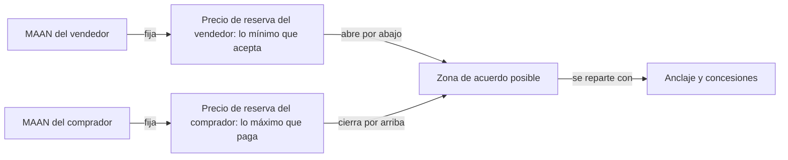

# Negociación

Negociar es acordar términos con alguien que quiere otra cosa, cuando a los dos les conviene más un acuerdo que seguir sin él. Toda negociación tiene una parte distributiva, repartir lo que hay, y casi siempre una integrativa, agrandar lo que se reparte; la vara para juzgar cualquier acuerdo es la propia MAAN.

Dentro de [Comunicación](../comunicacion.md), la negociación usa lo que dan otras dos partes. De [Escucha y conversación](../Escucha-y-conversacion/escucha-y-conversacion.md) toma cómo averiguar qué quiere el otro, sobre todo [preguntar](../Escucha-y-conversacion/preguntar.md); de [Persuasión](../Persuasion/persuasion.md), los argumentos. Pedir lo que uno necesita sin pelear ni ceder de entrada es [asertividad](../Escucha-y-conversacion/asertividad.md), y una negociación que se traba con un socio puede volverse una [conversación difícil](../Conversaciones-dificiles/conversaciones-dificiles.md).

Esta es la negociación como habilidad general: con un socio, con alguien del equipo, por el sueldo propio. La versión aplicada está desde el vendedor en [objeciones y negociación](../../Ventas/Objeciones-y-negociacion/objeciones-y-negociacion.md), que ya cuenta los cuatro principios de *Getting to Yes*, la primera oferta de Galinsky y Mussweiler y la crítica de White; desde el comprador, en [negociación de compras](../../Compras-y-abastecimiento/Abastecimiento-estrategico/negociacion-de-compras.md). Acá no se repiten.

## Repartir y agrandar: las dos caras de una negociación

El campo distingue dos tipos de negociación; la distinción se asocia a Walton y McKersie (1965), libro que esta base no leyó y del que el informe no verifica que sea el origen. La distributiva reparte una cantidad fija: lo que uno gana, el otro lo pierde, como el precio de un auto usado. La integrativa busca acuerdos en los que los dos quedan mejor, porque hay más de un tema y cada parte los valora distinto. Los manuales (Thompson; Lewicki, Barry y Saunders) siguen esa división, según el informe de esta base.

Casi ninguna negociación real es de un solo tipo. Esta base llama valor creado a lo que un acuerdo agrega frente a no acordar, y valor reclamado a la parte que se lleva cada uno. Las dos pasan en la misma mesa: un buen acuerdo se puede repartir mal, y un reparto ganado puede dejar sin crear valor disponible. Lo integrativo tiene su nota, [negociación integrativa](negociacion-integrativa.md); lo distributivo, el anclaje y las concesiones, está en [primera oferta y concesiones](primera-oferta-y-concesiones.md).

> [!NOTE] Sin fuente todavía: el origen de la pareja «crear y reclamar valor» y una definición publicada de cada término; acá se usan como vocabulario de esta base.

## La zona de acuerdo y el precio de reserva

La MAAN, mejor alternativa a un acuerdo negociado (BATNA en inglés), es lo que cada uno hará si no hay acuerdo. *Getting to Yes* la define, en la cita que trae Sebenius (2017), como «the standard against which any proposed agreement should be measured». Si negociar no da algo mejor que la MAAN, no conviene acordar.

Con las dos MAAN se arma la zona de acuerdo posible (ZOPA, por *zone of possible agreement*). Sebenius la define como «the set of agreements that are better for each side than its BATNA, as measured by its interests». Y agrega: «If either party prefers its BATNA to any proposed deal, then no zone of possible agreement exists». En ese caso negociar mejor no salva nada; lo que hay que cambiar es la alternativa o lo que se pone sobre la mesa.

El precio de reserva es el número en que una parte deja de preferir el acuerdo: el sueldo mínimo que se acepta, el máximo que se paga. Sebenius lo pone entre sus palabras clave (*reservation price*) sin definirlo; la definición es la del [glosario de ventas](../../Ventas/Fundamentos/glosario-de-ventas.md). Como lectura de esta base, el precio de reserva es la MAAN traducida a una cifra, y la ZOPA, el tramo entre los dos precios de reserva cuando se negocia un solo número.

## Lo que Sebenius corrige de la MAAN

Sebenius (2017) es un artículo conceptual, con ejemplos y citas de practicantes, sin datos propios. No discute la idea, que sigue llamando «immensely useful», sino tres lecturas simplificadas que, según él, «savvy negotiators and analysts generally avoid»:

| Error | Qué dice Sebenius |
|---|---|
| Creer que la MAAN no puede ser otro acuerdo negociado | «Your BATNA will often be another negotiated agreement»: la alternativa a cerrar con A suele ser cerrar con B. Lo llama un problema semántico menor |
| Tratarla como la mejor opción afuera, sin contar a la otra parte | Con una pareja, un socio o el único proveedor de algo esencial, decir que no no lleva a otra opción: cambia la relación. Propone preguntarse «What are the full consequences of saying my "no" to the other side's proposal» |
| Usarla solo como último recurso o si el otro es más poderoso | Hay que estimarla y mejorarla al prepararse, actualizarla durante la negociación y no esperar a que se trabe |

Para el tercer error cita a un abogado, Martin Lipton: sumar un competidor al principio vale «probably talking about 50 percent», frente a «1 or 2 percent» de más habilidad al final, que es opinión de practicante. Sebenius también aconseja que, mientras se exploran intereses, las MAAN queden «in the background . . . rather than being continually brandished».

El artículo cierra con tres clases de «no»: el táctico, el que reacomoda la situación y el final. El segundo error es el que más toca a una empresa chica, según esta base, porque ahí casi todo se negocia con alguien con quien se va a seguir trabajando.

## Las emociones en la mesa son una línea aparte

El estudio de las emociones en la negociación es una línea propia del campo, no un capítulo de las tácticas. Lo trabajan autores como Van Kleef, Sinaceur y Tiedens, y tiene una revisión en el *Negotiation Journal* (2014) que esta base conoce solo por sus metadatos. Su pregunta es qué le pasa al otro cuando uno muestra enojo, alegría o decepción.

El hallazgo más citado es que mostrarse enojado saca concesiones, pero solo en ciertas condiciones y con un costo en la relación; está en [primera oferta y concesiones](primera-oferta-y-concesiones.md#el-enojo-saca-concesiones-con-condiciones). Qué es una emoción y por qué la cara no la muestra tal cual está en [emoción](../../Psicologia/Motivacion-y-emocion/emocion.md), y cómo se baja una propia antes de contestar, en [regulación emocional](../../Psicologia/Motivacion-y-emocion/regulacion-emocional.md).

## De dónde viene la evidencia

Buena parte de la evidencia de esta vertical sale de experimentos de laboratorio, y de varios el informe no trae la muestra; hay excepciones (agentes inmobiliarios, recién contratados) que cada nota dice. Si lo del laboratorio vale entre profesionales no tiene fuente específica; Many Labs 1, que según resúmenes replicó el anclaje en 36 muestras (el informe no lo verificó efecto por efecto), da algo de contexto, y está en [heurísticas y sesgos](../../Psicologia/Juicio-y-decision/heuristicas-y-sesgos.md#anclaje-el-sesgo-mejor-sostenido). Casi todas las cifras salen de abstracts. Cómo leer un tamaño de efecto está en [cómo leer un estudio](../../Psicologia/Fundamentos/como-leer-un-estudio.md#cuánto-es-grande-el-tamaño-de-efecto).

> [!NOTE] Sin fuente todavía: estudios de negociación en empresas chicas, entre socios o entre fundadores; y evaluaciones independientes de *Getting to Yes* como método completo.

## Cómo preparar la MAAN antes de negociar

Los pasos salen de Sebenius (2017), salvo donde se dice otra cosa.

1. Escribí qué vas a hacer si no hay acuerdo, con números, aunque sea otro acuerdo todavía sin firmar.
2. Si vas a seguir trabajando con la otra parte, anotá qué pasa con la relación si decís que no.
3. Mejorá la MAAN antes de sentarte, por ejemplo con otra oferta, y revisala durante la negociación.
4. Estimá la MAAN del otro para saber si hay zona de acuerdo (inferencia de esta base desde la definición de ZOPA).
5. Traducí tu MAAN a un precio de reserva y no lo cambies en la mesa sin una razón nueva (criterio de esta base).
6. Mientras exploran intereses, dejá la MAAN de fondo y usala para decidir, no para amenazar.

## Qué hay adentro de Negociación

- [Negociación integrativa](negociacion-integrativa.md): intereses y posiciones, el intercambio entre temas, el sesgo del pastel fijo y los acuerdos en que pierden los dos, y qué motivo social rinde. Leela si sentís que la negociación es un tira y afloje sobre un solo número.
- [Primera oferta y concesiones](primera-oferta-y-concesiones.md): el anclaje, la oferta precisa, cuándo ofrecer primero es una desventaja, qué se sabe (poco) de cómo ceder y el enojo estratégico. Leela antes de decir el primer número.
- [Negociar el sueldo](negociar-el-sueldo.md): si negociar la oferta rinde, qué se sabe de las diferencias entre varones y mujeres y de qué dependen, y qué hace la transparencia salarial. Leela si te ofrecieron un puesto o vas a pedir un aumento.

Los términos de esta parte están en el [glosario de comunicación](../Fundamentos/glosario-de-comunicacion.md).
