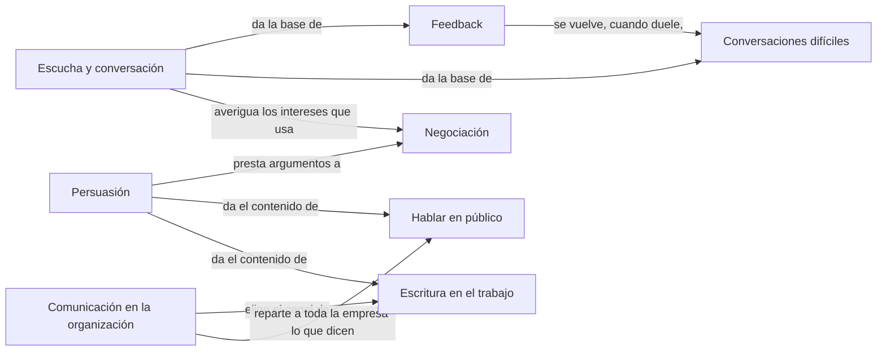

# Comunicación

Comunicación, en esta base, es lo que una persona hace al hablar o escribirle a otra en el trabajo para que entienda, cambie de idea o acuerde algo: escuchar, dar feedback, sostener una conversación difícil, convencer, negociar, presentar y escribir. El tema reúne la evidencia de cada habilidad y marca lo que solo dicen los practicantes.

El tema es el tercero del área «Personas» y se apoya en los otros dos. [Psicología](../Psicologia/psicologia.md) guarda el mecanismo: por qué la gente cede ante un grupo ([influencia social](../Psicologia/Cognicion-social/influencia-social.md)), por qué juzga mal la intención del otro ([atribución](../Psicologia/Cognicion-social/atribucion.md)) y cómo se baja una emoción fuerte ([regulación emocional](../Psicologia/Motivacion-y-emocion/regulacion-emocional.md)). [Liderazgo y dirección](../Liderazgo-y-direccion/liderazgo-y-direccion.md) usa estas habilidades al dirigir, en un [uno a uno](../Liderazgo-y-direccion/Gestion-de-personas/reuniones-uno-a-uno.md), una [evaluación](../Liderazgo-y-direccion/Gestion-de-personas/evaluacion-del-desempeno.md) o un [despido](../Liderazgo-y-direccion/Gestion-de-personas/rotacion-y-salidas.md). Acá va cómo se hace cada conversación; allá, cuándo y para qué la necesita quien dirige.

El tema termina donde empiezan cuatro vecinos que ya existen. La persuasión de un anuncio y los nudges son de [Marketing](../Marketing/Comunicacion/comunicacion.md); las objeciones y la negociación en una venta, de [Ventas](../Ventas/Objeciones-y-negociacion/objeciones-y-negociacion.md); contar una historia y ordenar un texto con la pirámide de Minto, de [Storytelling](../Storytelling/storytelling.md); y la retroalimentación al enseñar, de [Didáctica](../Didactica/Retroalimentacion/retroalimentacion.md). Este tema da la versión general entre dos personas y enlaza la aplicada.

## De qué está hecho comunicarse en el trabajo

El campo de la comunicación no se divide por habilidades. Craig (1999), según su abstract, ordena la teoría en siete tradiciones («rhetorical, semiotic, phenomenological, cybernetic, socio-psychological, sociocultural, and critical»), y la asociación de la disciplina en Estados Unidos, según una lista secundaria, la reparte por contexto: interpersonal, organizacional, política, salud y otras. Este tema, en cambio, se ordena por lo que hace una persona, de la conversación entre dos a lo que circula en toda la empresa. El corte en ocho partes es de esta base: seis vienen del acuerdo de los temas de «Personas», y Feedback y Negociación se sumaron porque las notas de Liderazgo y de Ventas las mandan acá. Cómo se estudia el campo está en [fundamentos de comunicación](Fundamentos/fundamentos-de-comunicacion.md).

- [Escucha y conversación](Escucha-y-conversacion/escucha-y-conversacion.md): lo que pasa en cualquier conversación entre dos. Entrá acá para saber qué es escuchar bien, qué provoca una buena pregunta, qué se sabe del lenguaje no verbal y cómo pedir algo o decir que no.
- [Feedback](Feedback/feedback.md): decirle a otro cómo está haciendo algo y pedírselo a él. Cuándo el feedback mejora el desempeño, cuándo lo empeora y qué hay de cierto en el sándwich y en los modelos de practicantes.
- [Conversaciones difíciles](Conversaciones-dificiles/conversaciones-dificiles.md): las conversaciones con mucho en juego y emociones fuertes. Los marcos de practicantes y su evidencia, cómo se da una mala noticia, cómo se pide disculpas y qué estilo de conflicto rinde.
- [Persuasión](Persuasion/persuasion.md): cambiar lo que otro piensa o hace con lo que se le dice. Los modelos del campo, los principios de Cialdini en las réplicas, qué mensaje convence más y por qué la gente se resiste.
- [Negociación](Negociacion/negociacion.md): acordar términos con alguien que quiere otra cosa. La zona de acuerdo, la MAAN, cómo se crea valor, quién ofrece primero, cómo se cede y cómo se negocia el sueldo propio.
- [Hablar en público](Hablar-en-publico/hablar-en-publico.md): presentar frente a un grupo. Cuánta gente le teme, qué tratamientos funcionan, qué cayó (las posturas de poder) y qué dicen los estudios de diapositivas.
- [Escritura en el trabajo](Escritura-en-el-trabajo/escritura-en-el-trabajo.md): escribir para que el otro entienda y actúe. El lenguaje claro, los mails y los chats que se leen mal, y cómo escribir para lectores ocupados.
- [Comunicación en la organización](Comunicacion-en-la-organizacion/comunicacion-en-la-organizacion.md): cómo circula lo que se dice en una empresa. Qué canal elegir, cómo se comunica un cambio o un recorte a todos y qué hace que la gente hable o se calle.

## Quien habla se equivoca sobre cómo lo reciben

Una idea cruza casi todas las verticales: la gente juzga mal el efecto de lo que dice. En los estudios de Huang y colegas (2017), según un resumen, quienes hacían más preguntas de seguimiento le caían mejor a su compañero de conversación, y quienes preguntaban no lo anticipaban. Flynn y Lake (2008), según un resumen, encontraron que la gente sobreestima en «about 50%» cuántas personas tiene que abordar para que alguien acepte un pedido de ayuda. Lo desarrollan [preguntar](Escucha-y-conversacion/preguntar.md) y [asertividad](Escucha-y-conversacion/asertividad.md), y el mismo error aparece en el tono de un mail en [mensajes escritos](Escritura-en-el-trabajo/mensajes-escritos.md).

Una lectura de esta base sobre eso: como el error va casi siempre en la misma dirección (callar, no pedir, no preguntar), la recomendación general es hacer un poco más de lo que da ganas. Ninguna fuente lo midió así; sale de juntar los estudios.

## La evidencia es de efectos chicos y de practicantes con mucha fama

Los efectos que mide la investigación de comunicación suelen ser chicos. El pedido chico antes del grande (el pie en la puerta) da, según un resumen del metaanálisis de Dillard, Hunter y Burgoon (1984), r = .17, aun en condiciones óptimas; cómo leer esa cifra está en [cómo leer un estudio](../Psicologia/Fundamentos/como-leer-un-estudio.md). La escucha tiene una de las asociaciones más fuertes del tema, pero en el metaanálisis de Kluger y colegas (2024) la mayor parte de los datos son autoinformes, y la relación con el desempeño baja de r̄ = .36 a r̄ = .21 cuando se los saca, según su abstract. Lo cuenta [escucha](Escucha-y-conversacion/escucha.md).

Del otro lado están los libros de practicantes que más circulan: *Crucial Conversations*, *Difficult Conversations*, *Comunicación No Violenta*, *Radical Candor* y *Getting to Yes*. Tienen pocos estudios independientes o ninguno, y cada nota dice cuáles. Entran como práctica, marcados así, y donde hay investigación se comparan con ella. Lo que circula sin sostén (el 7-38-55, el miedo a hablar en público por encima de la muerte, la razón de Losada) está en [mitos de comunicación](Fundamentos/mitos-de-comunicacion.md).

Casi ningún estudio es de empresas de 2 a 50 personas. La evidencia viene de laboratorios con estudiantes, de corporaciones, de medicina y de campañas políticas, y cada nota dice de dónde salió la suya.

## Qué leer según la conversación que tengas por delante

- Si tenés que decirle a alguien que su trabajo no está bien: [dar feedback](Feedback/dar-feedback.md) y, si la persona puede reaccionar mal, [conversaciones difíciles](Conversaciones-dificiles/conversaciones-dificiles.md). Para el uno a uno donde va a pasar: [reuniones uno a uno](../Liderazgo-y-direccion/Gestion-de-personas/reuniones-uno-a-uno.md).
- Si querés saber cómo te ven o cómo mejorar: [pedir y recibir feedback](Feedback/pedir-y-recibir-feedback.md).
- Si tenés que despedir a alguien, recortar algo o dar una mala noticia a un cliente: [dar malas noticias](Conversaciones-dificiles/dar-malas-noticias.md); si el recorte es para toda la empresa, [comunicar a toda la empresa](Comunicacion-en-la-organizacion/comunicar-a-toda-la-empresa.md). Lo de dirección está en [rotación y salidas](../Liderazgo-y-direccion/Gestion-de-personas/rotacion-y-salidas.md).
- Si te equivocaste con alguien: [disculparse](Conversaciones-dificiles/disculparse.md) y, si es un jefe con su equipo, [confianza en el líder](../Liderazgo-y-direccion/Liderar-personas/confianza-en-el-lider.md).
- Si discutís seguido con un socio o un compañero: [estilos de conflicto](Conversaciones-dificiles/estilos-de-conflicto.md), [marcos de conversación difícil](Conversaciones-dificiles/marcos-de-conversacion-dificil.md) y, si es en un equipo, [conflicto en equipos](../Liderazgo-y-direccion/Equipos-y-cultura/conflicto-en-equipos.md).
- Si tenés que convencer a alguien de un cambio: [persuasión](Persuasion/persuasion.md), [el mensaje que persuade](Persuasion/el-mensaje-que-persuade.md) y [resistencia y cambio de opinión](Persuasion/resistencia-y-cambio-de-opinion.md). Si la idea se cuenta mejor como historia: [historia o argumento](../Storytelling/Por-que-convence/historia-o-argumento.md).
- Si alguien te cita a Cialdini o un truco de persuasión: [principios de influencia](Persuasion/principios-de-influencia.md).
- Si vas a negociar algo que no es una venta (con un socio, un proveedor de un servicio, tu sueldo): [negociación](Negociacion/negociacion.md), [primera oferta y concesiones](Negociacion/primera-oferta-y-concesiones.md) y [negociar el sueldo](Negociacion/negociar-el-sueldo.md). Para una venta: [objeciones y negociación](../Ventas/Objeciones-y-negociacion/objeciones-y-negociacion.md); para una compra: [negociación de compras](../Compras-y-abastecimiento/Abastecimiento-estrategico/negociacion-de-compras.md).
- Si te cuesta pedir algo o decir que no: [asertividad](Escucha-y-conversacion/asertividad.md).
- Si querés escuchar mejor o que una charla no se corte: [escucha](Escucha-y-conversacion/escucha.md) y [preguntar](Escucha-y-conversacion/preguntar.md).
- Si tenés que presentar frente a un grupo: [hablar en público](Hablar-en-publico/hablar-en-publico.md), [miedo a hablar en público](Hablar-en-publico/miedo-a-hablar-en-publico.md) y [diapositivas](Hablar-en-publico/diapositivas.md); para presentar una idea en una reunión, [presentar ideas](../Storytelling/Usos/presentar-ideas.md), en Storytelling.
- Si escribís mails o documentos que nadie lee: [escritura en el trabajo](Escritura-en-el-trabajo/escritura-en-el-trabajo.md), [mensajes escritos](Escritura-en-el-trabajo/mensajes-escritos.md) y [lenguaje claro](Escritura-en-el-trabajo/lenguaje-claro.md); para ordenar un documento largo, [pirámide y SCQA](../Storytelling/Estructuras/piramide-y-scqa.md).
- Si no sabés si mandar un mensaje, llamar o juntarse: [elegir el canal](Comunicacion-en-la-organizacion/elegir-el-canal.md).
- Si un libro o un curso te vende una técnica de comunicación: [mitos de comunicación](Fundamentos/mitos-de-comunicacion.md) y la [bibliografía](Fundamentos/bibliografia-de-comunicacion.md).

## Por dónde empezar a leer

1. [Escucha y conversación](Escucha-y-conversacion/escucha-y-conversacion.md), que da lo que usan todas las demás.
2. [Feedback](Feedback/feedback.md) y [Conversaciones difíciles](Conversaciones-dificiles/conversaciones-dificiles.md), para lo que más cuesta en el día a día.
3. [Persuasión](Persuasion/persuasion.md) y [Negociación](Negociacion/negociacion.md), cuando hay que mover a alguien que piensa o quiere otra cosa.
4. [Hablar en público](Hablar-en-publico/hablar-en-publico.md), [Escritura en el trabajo](Escritura-en-el-trabajo/escritura-en-el-trabajo.md) y [Comunicación en la organización](Comunicacion-en-la-organizacion/comunicacion-en-la-organizacion.md), para hablarle a muchos.

[Fundamentos](Fundamentos/fundamentos-de-comunicacion.md) reúne cómo se estudia la comunicación, los mitos, el glosario y la bibliografía.
