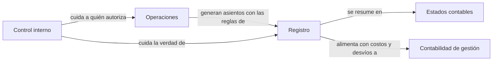

# Contabilidad

La contabilidad es el sistema con que una empresa registra en dinero cada hecho económico que la afecta, lo resume en estados contables para quien la mira desde afuera, lo usa para decidir adentro y lo controla para que diga la verdad.

Todo lo que hace una empresa que ya opera termina en un asiento: una venta, una compra, un sueldo, una máquina que se desgasta. Por eso este tema es el primero del área de gestión de la empresa: los demás dominios (compras, inventario, personal, activos) hacen su trabajo y le pasan a la contabilidad el hecho para registrar. La contabilidad no maneja la plata (eso es la tesorería), no decide qué impuesto se paga (eso es el tema de impuestos) ni cuenta el stock (eso es el depósito): es dueña de **cómo se registra** y de lo que sale de ese registro.

La idea que ordena todo el tema es el [devengado](Registro/devengado.md): un hecho se registra cuando pasa, no cuando se cobra o se paga. De ahí sale la diferencia entre el resultado y la caja, que explica por qué una empresa con ganancia se puede quedar sin plata y por qué el estado de flujo de efectivo existe aparte del estado de resultados.

## De qué está hecha la contabilidad

El tema se divide en cinco partes: el mecanismo de registro, cómo se registra cada operación habitual, cómo se resume el registro para afuera, cómo se usa para decidir adentro y cómo se controla.

- [Registro](Registro/registro-contable.md): la partida doble, el plan de cuentas, el asiento y los libros, el devengado y las cuentas corrientes de clientes y proveedores. Entrá acá primero: todo lo demás supone este mecanismo.
- [Operaciones](Operaciones/operaciones.md): cómo se registran las ventas, las compras, los gastos de empleados, el costo de lo vendido, los activos fijos y su amortización, y las operaciones en moneda extranjera. Entrá acá cuando tengas que saber qué asiento sale de un documento.
- [Estados contables](Estados-contables/estados-contables.md): el balance, el estado de resultados, el de flujo de efectivo, los ajustes de cierre y las normas que dicen cómo se presentan. Entrá acá para leer un balance o para saber qué tiene que poder emitir un registro.
- [Contabilidad de gestión](Contabilidad-de-gestion/contabilidad-de-gestion.md): clasificación de costos, sistemas de costeo, punto de equilibrio, presupuesto y centros de costo. Entrá acá cuando la pregunta sea para decidir adentro y no para informar afuera.
- [Control interno](Control-interno/control-interno.md): separación de funciones, conciliaciones (la bancaria incluida), autorizaciones, controles sobre los sistemas, auditoría y fraude. Entrá acá para saber qué tiene que impedir o detectar el registro.

## Dónde termina la contabilidad

El límite con cada vecino sigue una regla: cada dominio es dueño de un objeto y un verbo, y los demás lo enlazan. La tabla completa está en el [alcance del tema](ALCANCE.md). Lo que más se confunde:

- **Con la tesorería.** La contabilidad registra lo devengado y concilia el banco; la tesorería cobra, paga y cuida la posición de caja. El tema Tesorería y finanzas de la empresa en marcha todavía no está escrito.
- **Con las finanzas de una empresa que empieza.** La pista, el consumo mensual y el capital inicial siguen en [Finanzas de Emprender](../Emprender/Finanzas/finanzas.md); caja frente a resultado y el punto de equilibrio son de acá ([devengado](Registro/devengado.md), [punto de equilibrio](Contabilidad-de-gestion/punto-de-equilibrio.md)).
- **Con los impuestos.** Acá se registra el IVA o la provisión de Ganancias; qué se paga y cómo se declara va al tema Impuestos, todavía no escrito.
- **Con el cierre de período.** El cierre como recorrido entre áreas es un proceso de punta a punta (del registro al balance) del tema Procesos de negocio; acá quedan los [ajustes de cierre](Estados-contables/ajustes-de-cierre.md).
- **Con el software.** La partida doble tiene siglos (Pacioli la imprimió en 1494 y los primeros libros que la usan son anteriores) y nació en papel. Cómo la modela una base de datos está en [registro de movimientos](../Bases-de-datos/Modelos-de-datos/registro-de-movimientos.md) y va a estar en el tema Software de gestión.

## Qué leer según lo que estés haciendo

- Si tenés que construir el módulo contable de un sistema de gestión, en este orden: [partida doble](Registro/partida-doble.md), [asiento y libros](Registro/asiento-y-libros.md) y [devengado](Registro/devengado.md); [plan de cuentas](Registro/plan-de-cuentas.md) y [cuentas corrientes](Registro/cuentas-corrientes.md); las notas de [Operaciones](Operaciones/operaciones.md) que te toquen; [separación de funciones](Control-interno/separacion-de-funciones.md), [autorizaciones](Control-interno/autorizaciones.md), [controles sobre los sistemas](Control-interno/controles-sobre-sistemas.md) y [conciliaciones](Control-interno/conciliaciones.md); [ajustes de cierre](Estados-contables/ajustes-de-cierre.md) y [estados contables](Estados-contables/estados-contables.md); [centros de costo](Contabilidad-de-gestion/centros-de-costo.md) para las dimensiones; y lo del país, como [libros contables en Argentina](Registro/libros-contables-en-argentina.md).
- Si tenés que diseñar cómo un sistema registra ventas y cobros: [partida doble](Registro/partida-doble.md), [devengado](Registro/devengado.md), [ingresos y cuentas a cobrar](Operaciones/ingresos-y-cuentas-a-cobrar.md) y [cuentas corrientes](Registro/cuentas-corrientes.md).
- Si tenés que armar o revisar un plan de cuentas: [plan de cuentas](Registro/plan-de-cuentas.md) y [centros de costo](Contabilidad-de-gestion/centros-de-costo.md), que dice qué va en dimensiones en lugar de cuentas.
- Si tenés que modelar compras, facturas de proveedores y pagos: [compras y cuentas a pagar](Operaciones/compras-y-cuentas-a-pagar.md), [separación de funciones](Control-interno/separacion-de-funciones.md) y [autorizaciones](Control-interno/autorizaciones.md).
- Si tenés que decidir qué controles tiene que traer un sistema (permisos, cambios, registro de quién hizo qué): [controles sobre los sistemas](Control-interno/controles-sobre-sistemas.md) y [separación de funciones](Control-interno/separacion-de-funciones.md).
- Si tenés que valuar el stock o calcular el costo de lo vendido: [costo de lo vendido](Operaciones/costo-de-lo-vendido.md).
- Si tenés que llevar las máquinas, vehículos o equipos de una empresa: [activos fijos y amortización](Operaciones/activos-fijos-y-amortizacion.md).
- Si tenés que resolver los gastos de empleados y la caja chica: [gastos y rendiciones](Operaciones/gastos-y-rendiciones.md).
- Si tenés que entender o emitir un balance: [estados contables](Estados-contables/estados-contables.md), [balance](Estados-contables/balance.md), [estado de resultados](Estados-contables/estado-de-resultados.md) y [estado de flujo de efectivo](Estados-contables/estado-de-flujo-de-efectivo.md).
- Si tenés que preparar un cierre de mes: [ajustes de cierre](Estados-contables/ajustes-de-cierre.md) y [conciliaciones](Control-interno/conciliaciones.md); el recorrido entre áreas no tiene nota todavía (va a estar en Procesos de negocio).
- Si tenés que calcular cuánto vender para no perder o fijar un precio desde el costo: [punto de equilibrio](Contabilidad-de-gestion/punto-de-equilibrio.md), [clasificación de costos](Contabilidad-de-gestion/clasificacion-de-costos.md) y [sistemas de costeo](Contabilidad-de-gestion/sistemas-de-costeo.md).
- Si tenés que armar un presupuesto y seguir sus desvíos: [presupuesto](Contabilidad-de-gestion/presupuesto.md).
- Si tenés que operar con varias monedas: [moneda extranjera](Operaciones/moneda-extranjera.md); varias empresas, en la sección de consolidación de [normas contables](Estados-contables/normas-contables.md).
- Si tenés que saber qué exige la ley argentina: [libros contables en Argentina](Registro/libros-contables-en-argentina.md) y [normas contables en Argentina](Estados-contables/normas-contables-en-argentina.md).
- Si tenés que liquidar impuestos o sueldos: no hay nota acá; lo más cercano es la sección de sueldos de [operaciones](Operaciones/operaciones.md), y los temas Impuestos y Administración de personal y nómina, todavía no escritos.

## Orden de lectura

Para quien no es contador: esta entrada, [partida doble](Registro/partida-doble.md), [asiento y libros](Registro/asiento-y-libros.md) y [devengado](Registro/devengado.md); después [estados contables](Estados-contables/estados-contables.md) para ver a dónde llega todo, y recién ahí la operación que te toque.

- [Fundamentos](Fundamentos/fundamentos-de-contabilidad.md): de dónde viene la partida doble, las posiciones que la discuten y los mitos de quien no es contador.
- [Glosario de contabilidad](Fundamentos/glosario-de-contabilidad.md): cada término del tema en una línea, con su nombre en inglés y la nota que lo explica.
- [Fuentes de contabilidad](Fundamentos/fuentes-de-contabilidad.md): dónde se produce el saber contable y qué leer para cada parte.
