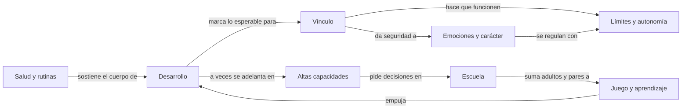

# Crianza

Criar es acompañar el desarrollo de un chico desde el nacimiento: darle un vínculo seguro, ayudarlo con sus emociones y sus límites, cuidar su cuerpo y darle juego y escuela; esta base lo explica para madres y padres de chicos de 0 a 6 años, con la evidencia de cada idea.

El chico no es una hoja en blanco que los padres escriben. Llega con un temperamento y una genética que pesan, y crece en una relación: lo que hacen los adultos cambia cómo usa lo que trae. Por eso la base separa lo que un chico hace solo porque crece ([desarrollo](Desarrollo/desarrollo-infantil.md)) de lo que los adultos pueden darle (vínculo, límites, juego, rutinas, escuela). Cuando algo preocupa, conviene preguntarse primero si es esperable para la edad.

El tema cubre de 0 a 6 años, con más profundidad entre los 2 y los 6. Quedan afuera los chicos más grandes, el embarazo y la alimentación, que vive en [Nutrición](../Nutricion/nutricion.md). Los trastornos, cómo se evalúan y cómo se tratan viven en [Psicología infantil](../Psicologia-infantil/psicologia-infantil.md), que mira lo mismo desde la disciplina y hasta los 12 años ([alcance](ALCANCE.md)).

> [!IMPORTANT]
> Esta base resume guías de sociedades de pediatría, revisiones de estudios y libros de divulgación, y dice cuál es cuál. No reemplaza al pediatra: una duda sobre el desarrollo, la salud o una conducta que preocupa se consulta con él.

## De qué está hecha la crianza

La crianza tiene ocho partes. El desarrollo es lo que el chico hace al crecer; las altas capacidades son una forma de ese desarrollo que pide sus propias decisiones. El vínculo es la base sobre la que se apoyan las emociones, los límites y el juego. La salud y las rutinas sostienen el cuerpo, y la escuela suma otros adultos y otros chicos.

- [Desarrollo](Desarrollo/desarrollo-infantil.md) — cómo crece un chico de 0 a 6: los hitos por área, el cerebro, cómo aprende a hablar, el bilingüismo y cuándo consultar. Entrar para saber si algo es esperable.
- [Altas capacidades](Altas-capacidades/altas-capacidades.md) — el chico adelantado: qué son, qué se puede saber antes de los 7 años, el desarrollo desparejo y qué hacer en casa y en la escuela.
- [Vínculo](Vinculo/vinculo.md) — el apego, la interacción de ida y vuelta, los adultos que cuidan y el bienestar de los padres.
- [Emociones y carácter](Emociones-y-caracter/emociones-y-caracter.md) — regulación emocional, berrinches, autocontrol, temperamento, empatía, cómo elogiar y cómo acompañar los cambios difíciles.
- [Límites y autonomía](Limites-y-autonomia/limites-y-autonomia.md) — la disciplina: estilos de crianza, cómo poner un límite, qué dice la evidencia sobre gritos y chirlos, premios y tareas.
- [Juego y aprendizaje](Juego-y-aprendizaje/juego-y-aprendizaje.md) — juego libre, juguetes, lectura, qué estimulación sirve, pantallas y actividades.
- [Salud y rutinas](Salud-y-rutinas/salud-y-rutinas.md) — sueño, actividad física, dejar los pañales, controles y vacunas, accidentes y educación sexual temprana.
- [Escuela](Escuela/escuela.md) — el jardín, qué mirar al elegir una escuela, la escuela bilingüe y la adaptación.

Aparte de las partes, [Fundamentos](Fundamentos/fundamentos-de-crianza.md) reúne lo que las cruza: los enfoques de crianza con nombre propio y su evidencia, los mitos, las fuentes y el glosario.

## Cuánto pesa lo que hacen los padres

La pregunta de fondo tiene dos respuestas que conviven. Los estudios de gemelos dicen que la genética explica mucho: un metaanálisis de 2015 (un estudio que junta los resultados de muchos otros) sobre 17.804 rasgos halló una heredabilidad promedio del 49 %, la parte de las diferencias entre personas que va con los genes, y poco efecto del «entorno compartido», lo que hace parecidos a hermanos criados juntos (Polderman y otros, según su resumen). Los programas que entrenan a los padres, en cambio, tienen ensayos (estudios que reparten a la gente al azar entre tratamiento y control) que muestran menos problemas de conducta en los chicos. La lectura prudente: los padres no fabrican un chico a medida, pero sí cambian cómo está, cómo se porta y qué oportunidades tiene. La discusión entera está en [cuánto pesa la crianza](Fundamentos/cuanto-pesa-la-crianza.md).

La misma prudencia vale para "estimular": los videos para bebés no mostraron que enseñen palabras y las ventajas de los programas tempranos tienden a desvanecerse (Neuman 2014 y Bailey 2017, según sus resúmenes). Está en [estimulación temprana](Juego-y-aprendizaje/estimulacion-temprana.md).

## Qué leer según lo que te pase

- Si te preguntás si algo es normal para la edad: [dominios e hitos](Desarrollo/dominios-e-hitos.md) y [señales de alarma](Desarrollo/senales-de-alarma.md).
- Si va adelantado en lo cognitivo pero no en lo emocional: [desarrollo asincrónico](Altas-capacidades/desarrollo-asincronico.md), [berrinches](Emociones-y-caracter/berrinches.md) y [señales y evaluación](Altas-capacidades/senales-y-evaluacion.md).
- Si hace berrinches o no sabés cómo poner un límite: [berrinches](Emociones-y-caracter/berrinches.md), [límites y consecuencias](Limites-y-autonomia/limites-y-consecuencias.md) y [castigo, gritos y chirlos](Limites-y-autonomia/castigo-gritos-y-chirlos.md).
- Si va a una escuela bilingüe o en casa hay dos idiomas: [crianza bilingüe](Desarrollo/crianza-bilingue.md) y [escuela bilingüe](Escuela/escuela-bilingue.md).
- Si tenés que decidir cuánta pantalla: [pantallas](Juego-y-aprendizaje/pantallas.md).
- Si querés estimularlo: [juego libre](Juego-y-aprendizaje/juego-libre.md), [lectura compartida](Juego-y-aprendizaje/lectura-compartida.md), [estimulación temprana](Juego-y-aprendizaje/estimulacion-temprana.md) y [elogio y mentalidad](Emociones-y-caracter/elogio-y-mentalidad.md).
- Si duerme mal o estás por sacarle los pañales: [sueño](Salud-y-rutinas/sueno.md) y [control de esfínteres](Salud-y-rutinas/control-de-esfinteres.md).
- Si tenés que elegir escuela: [elegir escuela](Escuela/elegir-escuela.md) y [escuela bilingüe](Escuela/escuela-bilingue.md); si va adelantado, además [señales y evaluación](Altas-capacidades/senales-y-evaluacion.md) y [opciones escolares](Altas-capacidades/opciones-escolares.md).
- Si escuchaste algo que suena a verdad de crianza (Mozart, videos para bebés, "los primeros tres años lo deciden todo"): [mitos de crianza](Fundamentos/mitos-de-crianza.md).
- Si una nota usa un término que no conocés (apego, funciones ejecutivas, heredabilidad, metaanálisis): [glosario de crianza](Fundamentos/glosario-de-crianza.md).
- Si te preocupa que algo sea más que una etapa (un miedo, la atención, la conducta, el habla), o te nombraron un diagnóstico: [Psicología infantil](../Psicologia-infantil/psicologia-infantil.md).
- Si no quiere comer: [el chico que no come](../Nutricion/Alimentacion-infantil/chico-que-no-come.md), en Nutrición.

## Por dónde empezar

Para leer de corrido: [desarrollo](Desarrollo/desarrollo-infantil.md), [vínculo](Vinculo/vinculo.md), [emociones y carácter](Emociones-y-caracter/emociones-y-caracter.md) y [límites y autonomía](Limites-y-autonomia/limites-y-autonomia.md). Con eso se entiende el resto, que se puede leer en cualquier orden.
