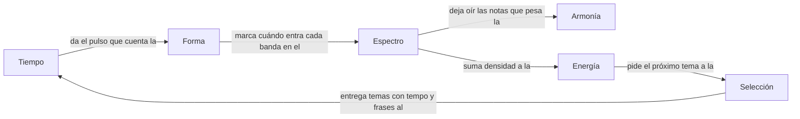

# DJ

Pinchar es elegir música y unirla en una secuencia continua para una pista de baile. Elegir y
unir son los dos actos del oficio, y cada unión se resuelve en cinco dimensiones: tiempo, forma,
espectro, armonía y energía.

El tema se escribe desde los principios. Un tocadiscos, un reproductor de cabina, un controlador o
un programa resuelven las mismas cinco dimensiones con perillas distintas, así que las notas hablan
de lo que hay que resolver y dejan los aparatos para unas pocas fichas.
Los ejemplos salen del techno de pista, con el sello [ARTS](Fundamentos/sello-arts.md) como
referencia. Queda afuera la producción musical y la carrera: conseguir fechas, cobrar, armar un
nombre.

## Elegir y unir

Una sesión es una cadena de decisiones de dos clases. Elegir es decidir qué tema va después y
por qué; unir es llevar la pista de uno al otro sin que el baile se corte. Las dos se pisan: un
tema mal elegido no se salva con una buena unión, y un buen tema mal unido rompe lo que venía
construyendo el anterior.

Dos estudios miran mezclas reales. Kim y otros analizaron 1557 mezclas con 20.765 transiciones: el
86,1 % de los temas se tocó con menos de 5 % de cambio de tempo, y los largos de transición tienen
picos cada 32 pulsos, una frase de ocho compases
([ISMIR 2020](https://program.ismir2020.net/static/final_papers/352.pdf)). Su corpus es sobre todo
de house y trance. Kell y Tzanetakis analizaron sets del programa Essential Mix de la BBC. Según su
resumen, el orden original difiere de forma estadísticamente significativa de uno al azar, y el
timbre aparece como un factor importante al elegir y ordenar temas
([ISMIR 2013](https://archives.ismir.net/ismir2013/paper/000210.pdf)).

## La transición cruza las cinco dimensiones

La transición es el tramo en que suenan dos temas a la vez. Ahí se juntan todas las
dimensiones, y cada una plantea una pregunta distinta:

| Dimensión | La pregunta en la transición | Si falla |
|---|---|---|
| [Tiempo](Tiempo/tiempo.md) | ¿Los dos pulsos van a la misma velocidad y caen juntos? | Los bombos galopan |
| [Forma](Forma/forma.md) | ¿Los dos temas están en el mismo lugar de su frase? | Un cambio cae en un momento raro |
| [Espectro](Espectro/espectro.md) | ¿Cada banda de frecuencia tiene un solo dueño? | Los graves se embarran, sube el volumen |
| [Armonía](Armonia/armonia.md) | ¿Las notas de los dos temas conviven? | Desafina, si hay material tonal |
| [Energía](Energia/energia.md) | ¿La intensidad sigue el camino que se quería? | La pista se cae o se cansa |

Las dos primeras son de sincronía y se resuelven antes de que el público oiga el tema nuevo. Las
dos siguientes son de convivencia y se resuelven con la ecualización y la elección. La última es
de dirección y conecta la unión con la [selección](Seleccion/seleccion.md).

## De qué está hecho el oficio

Seis partes, más los fundamentos que las cruzan. Tiempo y forma ponen a dos temas en el mismo lugar; espectro y armonía los hacen
convivir; energía da el rumbo de toda la sesión, y selección decide qué entra.

- [Tiempo](Tiempo/tiempo.md): pulso, tempo y fase; sincronizar dos fuentes a oído o con la máquina.
- [Forma](Forma/forma.md): compás, frase y sección; dónde puede entrar y salir un tema.
- [Espectro](Espectro/espectro.md): graves, medios y agudos; un solo bajo por vez; ganancia,
  volumen percibido y el cuidado del oído.
- [Armonía](Armonia/armonia.md): tonalidad, qué combina, qué choca y cuánto pesa en techno.
- [Energía](Energia/energia.md): densidad, tensión y descarga, repetición, el arco del set y la
  lectura de la pista.
- [Selección](Seleccion/seleccion.md): el criterio para elegir, la función de cada tema y la
  colección como vocabulario.
- [Fundamentos](Fundamentos/fundamentos-de-dj.md): historia, escuelas de mezcla, el sello ARTS y
  el glosario.

## Del pulso a la sesión

Para aprender, el orden es el del diagrama: primero se sincroniza, después se convive y al final
se dirige.

1. [Tempo y fase](Tiempo/tempo-y-fase.md), [beatmatching a oído](Tiempo/beatmatching-a-oido.md)
   y [sync y beatgrid](Tiempo/sync-y-beatgrid.md).
2. [Frase](Forma/frase.md), [secciones de un tema](Forma/secciones-de-un-tema.md) y
   [puntos de entrada y salida](Forma/puntos-de-entrada-y-salida.md).
3. [Enmascaramiento](Espectro/enmascaramiento.md), [swap de graves](Espectro/swap-de-graves.md),
   [ecualizador y filtros](Espectro/ecualizador-y-filtros.md) y
   [ganancia y volumen percibido](Espectro/ganancia-y-volumen-percibido.md).
4. [Tonalidad y compatibilidad](Armonia/tonalidad-y-compatibilidad.md).
5. [Tensión y descarga](Energia/tension-y-descarga.md), [repetición y variación](Energia/repeticion-y-variacion.md),
   [arco del set](Energia/arco-del-set.md) y [leer la pista](Energia/leer-la-pista.md).
6. [Criterio de selección](Seleccion/criterio-de-seleccion.md), [herramienta y pieza](Seleccion/herramienta-y-pieza.md)
   y [colección](Seleccion/coleccion.md).

Antes de la primera cabina, el [cuidado del oído](Espectro/cuidado-del-oido.md).

El [glosario](Fundamentos/glosario-de-dj.md) define los términos del oficio que las notas usan en
inglés, como cue, break o key lock.

## Qué leer según lo que estés haciendo

- Si tenés que practicar mezclas en casa: [beatmatching a oído](Tiempo/beatmatching-a-oido.md),
  [frase](Forma/frase.md) y [swap de graves](Espectro/swap-de-graves.md).
- Si tenés que preparar una fecha: [colección](Seleccion/coleccion.md) para preparar cada tema,
  [arco del set](Energia/arco-del-set.md) para el papel de tu franja (apertura, pico o cierre),
  [leer la pista](Energia/leer-la-pista.md) y el [cuidado del oído](Espectro/cuidado-del-oido.md).
  No hay nota propia sobre el warm-up; lo más cercano es la fila de apertura del arco del set.
- Si una transición suena mal y no sabés por qué: la tabla de [la transición](#la-transición-cruza-las-cinco-dimensiones)
  dice qué dimensión mirar según el síntoma.
- Si tenés que elegir entre dos temas: [criterio de selección](Seleccion/criterio-de-seleccion.md) y
  [herramienta y pieza](Seleccion/herramienta-y-pieza.md).
