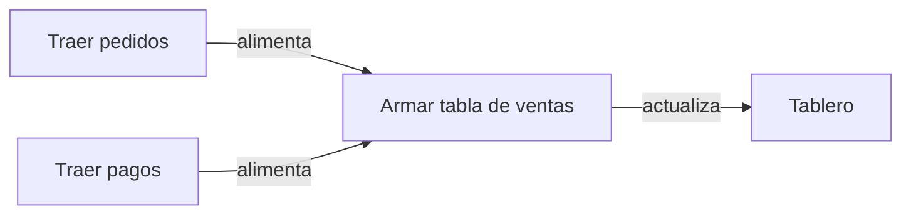

# Orquestación

La orquestación es encadenar y programar los pasos de un pipeline de datos para que corran solos,
en orden, a su hora y con reintentos, describiéndolos como un grafo de tareas con dependencias.

Es la tercera pieza de [ingesta y transformación](ingesta-y-transformacion.md): no trae ni
transforma nada, decide cuándo corre la [ingesta](ingesta.md), cuándo la
[transformación](etl-y-elt.md) y qué hacer si algo falla.

## Un pipeline es un grafo de tareas

Un pipeline nocturno de una tienda tiene cuatro pasos: traer los pedidos, traer los pagos, unirlos
en la tabla de ventas y actualizar el tablero. Los dos primeros no dependen entre sí y pueden correr
a la vez; el tercero espera a los dos; el cuarto, al tercero.

Ese dibujo es un grafo dirigido acíclico (*directed acyclic graph*, DAG): las flechas tienen
dirección y ninguna vuelve a una tarea anterior. La documentación de Airflow aclara que en esa
herramienta la palabra «has grown beyond that literal data structure»: un DAG agrupa todo lo que
hace falta para correr un flujo, que es el calendario, las tareas, las dependencias entre ellas, los
avisos y los ajustes de operación.

## Qué resuelve un orquestador

Un orquestador se encarga de cuatro cosas que, sin él, alguien hace a mano:

1. Calendario: corre el pipeline cada noche o cada hora.
2. Dependencias: una tarea arranca cuando terminan las anteriores. Por defecto, en Airflow, una
   tarea corre solo si todas las anteriores tuvieron éxito, salvo que se cambien las reglas de
   disparo.
3. Reintentos: si una tarea falla, la vuelve a intentar; el ejemplo de la documentación fija dos
   reintentos para todas las tareas del DAG.
4. Visibilidad: muestra qué corrió, qué falló y cuándo, y avisa.

Lo de Airflow viene de su documentación; el resto de la lista es lectura de la base.

El orquestador no sabe qué pasa adentro de cada tarea: solo sabe si terminó bien o mal. Por eso una
tarea que «termina bien» cargando datos vacíos pasa sin alarma, y hacen falta controles de
[calidad de datos](../Gobierno-y-calidad/calidad-de-datos.md) como tareas propias del grafo
(lectura de la base).

## Reintentar sin duplicar

Los reintentos solo sirven si correr una tarea dos veces deja el mismo resultado que correrla una.
A esa propiedad se la llama idempotencia. Una tarea que «agrega las ventas de ayer» duplica si se
reintenta; una que «reemplaza las ventas de ayer» no. Diseñar cada tarea para que se pueda repetir
es lo que hace confiables los reintentos y permite volver a correr un día viejo cuando se corrige
un error (lectura de la base).

## Cuándo hace falta un orquestador

Con un solo paso, una tarea programada del sistema operativo o de la propia base alcanza. El
orquestador empieza a pagar cuando hay varios pasos con dependencias, varias fuentes que pueden
fallar por separado y alguien que necesita saber a la mañana si los números son de hoy (lectura de
la base). Reis y Housley tratan la orquestación como una de las preocupaciones transversales que atraviesan todo el
ciclo de la ingeniería de datos, no como una etapa; es la estructura del libro según el informe,
que la conoce de memoria y no pudo verificarla.

Saber qué tablas dependen de cuáles sirve también para otra cosa: rastrear de dónde sale un número
del tablero, que es [metadatos y linaje](../Gobierno-y-calidad/metadatos-y-linaje.md).

## Dónde se lee la versión larga

La página de DAGs de la documentación de Airflow, con su ejemplo de cuatro tareas A, B, C y D, es la
referencia del vocabulario aunque se use otra herramienta. Conviene fijarse en cómo se declaran las
dependencias y en que el DAG no conoce el contenido de las tareas. Las herramientas de orquestación,
con licencia y precio, están en la ficha de [herramientas de pipeline](herramientas-de-pipeline.md).
