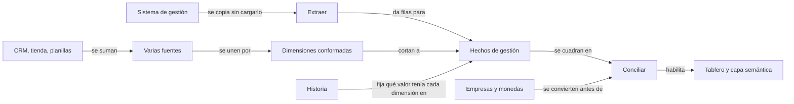

# BI sobre el software de gestión

El BI sobre el software de gestión es el análisis que se arma con los datos de un sistema de gestión (ventas, compras, stock, cuentas corrientes, mayor, horas) sacados a una copia, ordenados en hechos y dimensiones, con su historia y conciliados contra el sistema y el balance. Empieza donde el sistema ya no alcanza: cuando hace falta juntar fuentes, mirar años o cortar de otra forma que la del sistema.

Es una parte de [Visualización y BI](../visualizacion-y-bi.md) que aplica el recorrido de [Datos](../../datos.md) a una fuente concreta. Lo general está en la [ingesta](../../Ingesta-y-transformacion/ingesta.md), el [modelado dimensional](../../Modelado-y-almacenamiento/modelado-dimensional.md), los [datos maestros](../../Gobierno-y-calidad/datos-maestros.md), la [capa semántica](../capa-semantica.md) y el [tablero](../tablero.md). Cómo está hecho el sistema (sus documentos, su registro de movimientos, sus fechas de bloqueo) es del tema [Software de gestión](../../../Software-de-gestion/software-de-gestion.md), y qué mide cada dominio, de su tema en Gestión de la empresa.

## Dónde termina el reporte del sistema y empieza el BI

Los listados del día y los libros que pide la ley los emite el propio sistema ([reportes operativos y legales](../../../Software-de-gestion/Columnas-tecnicas/reportes-operativos-y-legales.md)). El BI empieza cuando la pregunta pide algo que el sistema no guarda o no cruza:

| Pregunta | Dónde se contesta | Por qué |
|---|---|---|
| ¿Qué pedidos faltan entregar hoy? | el sistema | necesita el dato de este momento y toca pocas filas |
| ¿Qué dice el libro de IVA ventas de octubre? | el sistema | es un reporte legal: sale de la base de registro, con corte a una fecha |
| ¿Cómo evolucionó el margen por cliente en los últimos cuatro años? | el BI | pide historia que el sistema no guarda o que quedó en el sistema anterior |
| ¿Qué canal deja más margen, si se suman la tienda online y el CRM? | el BI | junta fuentes con claves distintas |
| ¿Cuánto se vendió por región, con las regiones como estaban el año pasado? | el BI | pide la historia de una dimensión, además de su valor actual |

La tabla es lectura de esta base, apoyada en dos autores. Inmon define el almacén de datos como «subject-oriented, integrated, time-variant, nonvolatile collection of data in support of management's decision making process». En el mundo operativo, dice, el dato es exacto «as of the moment of access» y cubre de hoy a sesenta o noventa días; el almacén cubre de cinco a diez años, como «a long series of snapshots». Kimball y Ross: «operational systems typically do not maintain history, but rather update data to reflect the most current state».

La herramienta no marca la frontera. Un tablero que lee la base del sistema para mostrar los pedidos de hoy es un reporte operativo, y un listado que junta el sistema con una planilla de metas ya es BI, aunque viva en una planilla (lectura de esta base).

## El recorrido, de la base del sistema al tablero

1. Sacar el dato sin frenar al sistema y traer solo lo que cambió, anulaciones y fechas pasadas incluidas: [extraer de un sistema de gestión](extraer-de-un-sistema-de-gestion.md).
2. Ordenar lo que pasó en hechos, una tabla por proceso (facturar, recibir, mover stock, imputar horas) con los indicadores de su dominio: [hechos de gestión](hechos-de-gestion.md).
3. Cortar todos los hechos por las mismas dimensiones para compararlos: [dimensiones conformadas](dimensiones-conformadas.md).
4. Guardar la historia que el sistema pisa, como el vendedor que tenía cada cliente: [historia en el BI de gestión](historia-en-el-bi-de-gestion.md).
5. Juntar el sistema con el CRM, la tienda y las planillas, cada uno con sus claves, granos y definiciones: [varias fuentes de gestión](varias-fuentes-de-gestion.md).
6. Convertir empresas y monedas antes de sumar: [multiempresa y moneda en el BI](multiempresa-y-moneda-en-el-bi.md), y la inflación en [BI de gestión en la Argentina](bi-de-gestion-en-argentina.md).
7. Cuadrar contra el sistema y el balance antes de mostrar un número: [conciliar el BI](conciliar-el-bi.md).

Después vienen la [capa semántica](../capa-semantica.md), que define cada métrica una vez, y el [tablero](../tablero.md). En el cierre contable, el informe de gestión es el paso que lee este BI, según [del registro al balance](../../../Procesos-de-negocio/del-registro-al-balance.md).

## Por qué no alcanza con copiar la base

Copiar la base solo evita que el análisis le quite recursos al sistema que factura. Fowler, sobre la base de reportes: «Queries run against the reporting database don't add to the load on the operational database». Kimball y Ross siguen encontrando sistemas de BI que son «mere copies of the operational systems of record stored on a separate hardware platform», que separan la carga pero «do nothing to address the other inherent differences between the two types of systems».

Esas diferencias (la historia, la integración, los cortes propios) llenan esta parte. Inmon llama ODS (*operational data store*) a la estructura intermedia, alimentada con un retraso de uno o dos segundos (clase I) a una noche (clase III). Para él, copiar tablas enteras sin integrar es «a very weak form», una clase 0, y «the real worth of the ODS appears in the ability to hold integrated data».

## La posición contraria: analizar sobre el mismo sistema

> [!IMPORTANT]
> Las bases HTAP (*hybrid transactional and analytical processing*) proponen no separar: atienden transacciones y análisis en el mismo motor. Según una revisión académica de 2024, la arquitectura «aims to eliminate the need for an explicit Extract-Transform-Load (ETL) process», y sus primeras bases (2010 a 2014) apuntaban a aplicaciones analíticas con cargas transaccionales de lectura, como los ERP. La misma revisión marca el costo: estas bases «must strike a trade-off between performance isolation and data freshness». El argumento original, que las aplicaciones de gestión compartan una base para las dos cargas, es de Plattner (2009), cofundador de un proveedor que vende ese motor; solo se leyeron sus diapositivas.
>
> La escuela de Kimball pide no saltear el almacén. Mundy (2015) repasa los intentos de simplificar, «from building the BI layer directly on the transaction system, to so-called virtual data warehouses», y sostiene que, salvo que se controle todo el dato de origen, el ETL, el almacenamiento y el BI van separados.
>
> En lectura de esta base, las dos posiciones discuten cosas distintas. HTAP ataca la frescura del dato y el costo de copiarlo; la separación se defiende por la historia, la integración y los cortes propios, que un motor único sobre un solo sistema no resuelve. Kimball y Ross admiten que un ERP que cubre toda la empresa reduce el problema de integración («could help address these shortcomings»).

## Cuándo lo necesita un negocio chico

Un negocio con un solo sistema, pocos años de datos y preguntas que el sistema ya contesta no necesita un almacén: le alcanzan sus reportes y una planilla sobre una exportación. En lectura de esta base, tres señales dicen que llegó el momento. Una pregunta cruza el sistema con otra fuente, la historia que importa ya no está en el sistema (porque la [migración](../../../Software-de-gestion/Implementacion/migracion-de-datos.md#qué-se-migra-y-qué-se-deja) la dejó en el viejo) o el reporte pesado frena la facturación. El tamaño que la justifica se discute en [cuánta infraestructura necesita un negocio chico](../../datos.md#cuánta-infraestructura-necesita-un-negocio-chico).

> [!NOTE]
> Sin fuente todavía: evidencia sobre cuántas pymes arman BI sobre su sistema de gestión y con qué resultado, y una fuente neutral sobre los módulos de análisis que traen los propios sistemas. El Toolkit tiene una sección «Role of OLAP and Packaged Analytic Solutions» (cap. 7) que no se leyó.

## Lo que hay adentro del BI sobre el software de gestión

- [Extraer de un sistema de gestión](extraer-de-un-sistema-de-gestion.md): por qué no sobre la base en vivo, las cuatro formas de sacar el dato y los cambios que llegan después.
- [Hechos de gestión](hechos-de-gestion.md): cada proceso del sistema como tabla de hechos, con sus indicadores.
- [Dimensiones conformadas](dimensiones-conformadas.md): cliente, artículo, centro de costo y período compartidos por todos los hechos.
- [Historia en el BI de gestión](historia-en-el-bi-de-gestion.md): el dato como era o como es hoy, y lo que llega tarde.
- [Varias fuentes de gestión](varias-fuentes-de-gestion.md): el sistema junto al CRM, la tienda online y las planillas.
- [Multiempresa y moneda en el BI](multiempresa-y-moneda-en-el-bi.md): sumar empresas y monedas sin inventar un número.
- [BI de gestión en la Argentina](bi-de-gestion-en-argentina.md): la inflación, la reexpresión y los pesos frente a los dólares.
- [Conciliar el BI](conciliar-el-bi.md): cuadrar contra la extracción, los reportes y el balance.
