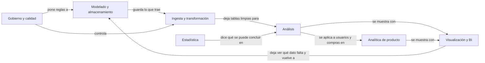

# Datos

Datos es el trabajo de llevar un hecho registrado (una venta, un clic, un alta) hasta una
decisión: guardarlo, moverlo, dejarlo limpio, analizarlo y mostrarlo para que alguien lo use.

Es para quien aprende Data Analytics y para quien mide un comercio o un producto digital. Tiene
dos mitades que comparten el mismo dato. La gestión y la ingeniería de datos lo consiguen y lo
cuidan. El análisis lo convierte en una respuesta. El tema empieza donde un sistema registra un
hecho y termina en la decisión. Qué decidir con esa respuesta (qué construir, en qué canal
invertir) es de [Producto](../Producto/producto.md) y de [Marketing](../Marketing/marketing.md).
Dos temas vecinos cubren las herramientas: [Bases de datos](../Bases-de-datos/bases-de-datos.md)
explica la base de un sistema y [SQL](../Bases-de-datos/SQL/sql.md) como lenguaje, y
[Planillas de cálculo](../Planillas-de-calculo/planillas-de-calculo.md), la planilla como
herramienta de trabajo.

La idea que ordena el tema: un número vale lo que valen su definición y su camino. Dos personas que
cuentan «ventas del mes» con filtros distintos, o sobre una tabla con duplicados, llegan a números
distintos, y ninguna gráfica lo arregla. Por eso cada vertical cuida un tramo del camino, y el
análisis dice qué afirma un número y qué no: casi todo lo que muestra un tablero es descriptivo y
no prueba causas (lectura de la base).

## Del hecho registrado a la decisión

El campo se divide por el recorrido del dato. Reis y Housley (2022) lo cortan en cinco etapas:
generar, almacenar, ingerir, transformar y servir. Debajo corren seis preocupaciones que cruzan
todas: seguridad, gestión de datos, DataOps, arquitectura, orquestación e ingeniería de software,
según la lista que el propio Reis repitió en 2026. Ese ciclo termina en «servir», donde empiezan el
análisis y la visualización. La rueda de DAMA-DMBOK2 mira lo mismo desde las funciones de gestión,
con el gobierno de datos en el centro. Los dos marcos, con sus salvedades, están en
[Fundamentos](Fundamentos/fundamentos-de-datos.md#dos-marcos-que-dividen-el-campo).

Las verticales de ingeniería, escritas como panorama:

- [Modelado y almacenamiento](Modelado-y-almacenamiento/modelado-y-almacenamiento.md) — cómo se guarda el dato: la base de la aplicación contra la base para analizar, el modelo relacional, el modelado dimensional, los almacenes analíticos y la tabla de eventos.
- [Ingesta y transformación](Ingesta-y-transformacion/ingesta-y-transformacion.md) — cómo viaja el dato de los sistemas donde nace al almacén: ingesta, ETL y ELT, orquestación.
- [Gobierno y calidad](Gobierno-y-calidad/gobierno-y-calidad.md) — las reglas que hacen confiable un dato: calidad, linaje, datos maestros y la privacidad de los datos personales en Argentina.

Las verticales de análisis, más hondas:

- [Análisis](Analisis/analisis.md) — el proceso que va de una pregunta a una respuesta: formularla, limpiar, consultar con SQL, explorar y segmentar. Se lee primero.
- [Estadística](Estadistica/estadistica.md) — qué se puede concluir de un número: resumir una distribución, inferir de una muestra, distinguir correlación de causa y reconocer los sesgos.
- [Analítica de producto](Analitica-de-producto/analitica-de-producto.md) — el análisis aplicado a lo que hacen los usuarios: cómo se define una métrica, el embudo y el análisis de cohortes con retención y churn.
- [Visualización y BI](Visualizacion-y-BI/visualizacion-y-bi.md) — cómo se muestra: elegir un gráfico, armar un tablero, definir cada métrica una sola vez y contar un hallazgo.

La estadística no es una etapa del recorrido. Atraviesa el análisis y los experimentos, y está
como vertical porque es lo que más se estudia por separado. Ninguno de los dos marcos de referencia
cubre la analítica de producto: sale del mundo de las herramientas de producto, no de la ingeniería
de datos.

Aparte, [Fundamentos](Fundamentos/fundamentos-de-datos.md) reúne lo que cruza todo: los
[roles](Fundamentos/roles-de-datos.md) que se reparten el recorrido, la
[bibliografía](Fundamentos/bibliografia-de-datos.md) del tema y las rutas para aprenderlo.

## Cuánta infraestructura necesita un negocio chico

Casi toda la bibliografía de ingeniería de datos parece venir de empresas con mucho volumen (lectura de la base). Tigani, que
trabajó en BigQuery, cuenta en «Big Data is Dead» (c. 2023) que «the vast majority of customers had
less than a terabyte of data in total data storage», y que en los clientes que gastaban más de
USD 1.000 al año el 90 % de las consultas procesaba menos de 100 MB. Es cofundador de una empresa
que vende un motor para datos chicos, así que es un argumento de parte, y sus cifras son de clientes
de BigQuery, no de comercios. Para un comercio con unos miles de ventas por
mes, la planilla o la base de la propia tienda suelen alcanzar para empezar. El [almacén
analítico](Modelado-y-almacenamiento/almacenes-analiticos.md) y los
[pipelines](Ingesta-y-transformacion/ingesta-y-transformacion.md) se suman cuando hay varias fuentes que cruzar o consultas que la base de la aplicación ya
no aguanta (lectura de la base).

## Qué leer según lo que estés haciendo

- Si te piden un tablero de ventas de un comercio: [Análisis](Analisis/analisis.md) para el proceso, [pregunta de análisis](Analisis/pregunta-de-analisis.md) para acordar qué tiene que contestar, [ingesta](Ingesta-y-transformacion/ingesta.md) y [limpieza de datos](Analisis/limpieza-de-datos.md) para llegar de los datos crudos a una tabla confiable, [definición de métrica](Analitica-de-producto/definicion-de-metrica.md) para cada número y [tablero](Visualizacion-y-BI/tablero.md) para armarlo.
- Si tenés que decidir si algo causó un cambio (una promoción, un rediseño): [correlación y causalidad](Estadistica/correlacion-y-causalidad.md) y [sesgos](Estadistica/sesgos.md); si podés probarlo con dos grupos al azar, el [experimento A/B](../Producto/Medicion/experimento-ab.md) de Producto y su [significancia](Estadistica/significancia.md).
- Si tenés que definir una métrica para que todos la calculen igual: [definición de métrica](Analitica-de-producto/definicion-de-metrica.md) y [capa semántica](Visualizacion-y-BI/capa-semantica.md).
- Si tenés que saber si los clientes vuelven: [análisis de cohortes](Analitica-de-producto/Cohortes/analisis-de-cohortes.md) y [retención y churn](Analitica-de-producto/Retencion-y-churn/retencion-y-churn.md).
- Si tenés que ver dónde se pierden las compras en una tienda: [embudo](Analitica-de-producto/embudo.md), y para el checkout en sí, [Comercio electrónico](../Comercio-electronico/comercio-electronico.md).
- Si tenés que agrupar clientes para tratarlos distinto: [segmentación](Analisis/segmentacion-de-clientes.md).
- Si te llegó una planilla sucia: [limpieza de datos](Analisis/limpieza-de-datos.md), y para ordenarla dentro de Excel o Sheets, [datos ordenados](../Planillas-de-calculo/Datos-en-la-planilla/datos-ordenados.md) de Planillas.
- Si tenés que escribir una consulta SQL: [SQL para análisis](Analisis/sql-para-analisis.md) para el grano y las trampas que cambian un número sin error, y [SQL](../Bases-de-datos/SQL/sql.md) de Bases de datos para el lenguaje, con su [ruta de ejercicios](../Bases-de-datos/Fundamentos/ruta-de-sql.md).
- Si tenés que contar un hallazgo a alguien que no es de datos: [contar con datos](Visualizacion-y-BI/contar-con-datos.md) y [elegir un gráfico](Visualizacion-y-BI/elegir-un-grafico.md).
- Si tenés que elegir entre la base de la aplicación, un data warehouse o un data lake: [OLTP y OLAP](Modelado-y-almacenamiento/oltp-y-olap.md) y [almacenes analíticos](Modelado-y-almacenamiento/almacenes-analiticos.md); antes, [cuánta infraestructura necesita un negocio chico](#cuánta-infraestructura-necesita-un-negocio-chico).
- Si tenés que decidir qué eventos registrar en una tienda o una app: [tabla de eventos](Modelado-y-almacenamiento/tabla-de-eventos.md).
- Si tenés que decidir qué datos personales de clientes guardar o mandar a una herramienta del exterior: [privacidad de datos personales](Gobierno-y-calidad/privacidad-de-datos-personales.md), que no reemplaza a un abogado.
- Si tenés que armar tableros sobre un sistema de gestión: [BI sobre el software de gestión](Visualizacion-y-BI/BI-sobre-software-de-gestion/bi-sobre-software-de-gestion.md), y para cuadrarlos con el balance, [conciliar el BI](Visualizacion-y-BI/BI-sobre-software-de-gestion/conciliar-el-bi.md).
- Si los números de dos reportes no coinciden: [calidad de datos](Gobierno-y-calidad/calidad-de-datos.md), [metadatos y linaje](Gobierno-y-calidad/metadatos-y-linaje.md) y [definición de métrica](Analitica-de-producto/definicion-de-metrica.md).
- Si estás eligiendo qué rol de datos aprender: [roles de datos](Fundamentos/roles-de-datos.md) y [ruta de Data Analytics](Fundamentos/ruta-de-data-analytics.md).

## De la pregunta al tablero

Para aprender en orden: [Análisis](Analisis/analisis.md) primero, porque da el proceso que usan
todas las demás. Después [Estadística](Estadistica/estadistica.md), [Analítica de
producto](Analitica-de-producto/analitica-de-producto.md) y [Visualización y
BI](Visualizacion-y-BI/visualizacion-y-bi.md). Con ejercicios: la [ruta de Data
Analytics](Fundamentos/ruta-de-data-analytics.md). Para practicar un análisis entero sobre un caso,
el recorrido [Análisis de cohortes desde cero](Fundamentos/recorrido-analisis-de-cohortes.md), trece
pasos que van de la cohorte a armar una tabla de cohortes desde datos crudos.
