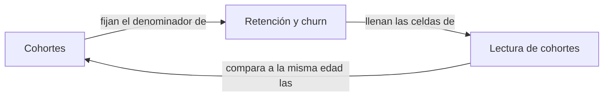

# Datos

Datos reúne conceptos y métricas de análisis de datos; por ahora cubre el análisis de
cohortes: cómo se agrupa a los usuarios, qué se mide sobre cada grupo (retención y churn) y cómo
se lee el resultado.

Es para quien está aprendiendo Data Analytics. La idea que ordena el tema: un promedio de toda la
base mezcla usuarios nuevos con veteranos y esconde los cambios, así que se sigue a grupos fijos
que empezaron en el mismo período y se los compara a la misma edad. El análisis es descriptivo:
muestra diferencias entre grupos, no prueba causas. El valor de vida del cliente (LTV) todavía no
tiene nota.

## De qué está hecho un análisis de cohortes

Tres partes, encadenadas: las cohortes definen a quién se sigue, la retención y el churn dicen qué
se mide sobre cada una, y la tabla y la curva muestran el resultado para compararlas.

- [Cohortes](Cohortes/cohortes.md) — qué es una cohorte, sus dos tipos y por qué se comparan a la misma edad. Se lee
  primero.
- [Retención y churn](Retencion-y-churn/retencion-y-churn.md) — qué significa quedarse o irse, las métricas que lo
  cuentan y cómo se llaman en cada herramienta de analítica.
- [Lectura de cohortes](Lectura-de-cohortes/lectura-de-cohortes.md) — la tabla de cohortes, la curva de retención y
  cómo armar la tabla desde una tabla de eventos.

Aparte, [Fundamentos de datos](Fundamentos/fundamentos-de-datos.md) guarda el recorrido para aprender el
tema desde cero.

## Una retención sin sus tres definiciones no se compara

Cada número de retención depende de quién empieza (la cohorte), qué cuenta como seguir (el evento
de retorno) y cuándo se mira (el período). Cambiar cualquiera de las tres cambia el número, y lo
mismo pasa con la forma de contar el retorno: en el período exacto o en ese período o después.
Por eso una D7 de una herramienta no se compara con la retención unbounded de otra, y la tasa de
churn de toda la base no es 100 % menos la retención de una cohorte.

## De la cohorte a la tabla armada a mano

Para aprenderlo en orden: [Análisis de cohortes desde cero](Fundamentos/recorrido-analisis-de-cohortes.md), trece
pasos que van de la cohorte a armar una tabla de cohortes desde datos crudos.
