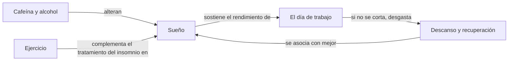

# Energía y salud

Energía y salud es la parte del desarrollo personal que cuida el cuerpo que sostiene todo lo demás: dormir lo suficiente, moverse, cortar con el trabajo para recuperarse y manejar la cafeína y el alcohol. Sus cantidades salen de guías de organismos de salud, y su intervención mejor probada es la terapia cognitivo-conductual para el insomnio.

> [!WARNING]
> Las notas de esta vertical resumen guías y estudios para adultos sanos. No reemplazan a un profesional de la salud: un insomnio que dura, un problema con el alcohol o una condición que limite el ejercicio piden consulta, como dice [cuándo consultar](../Emociones-y-bienestar/cuando-consultar.md).

Dentro de [Desarrollo personal](../desarrollo-personal.md) es la parte que pone la energía. Le da a [Hábitos y cambio](../Habitos-y-cambio/habitos-y-cambio.md) la materia de muchos de sus hábitos (acostarse a horario, salir a caminar) y amortigua o agrava lo que pasa en [Emociones y bienestar](../Emociones-y-bienestar/emociones-y-bienestar.md). [El founder por dentro](../El-founder-por-dentro/el-founder-por-dentro.md) la aprieta con horas largas. El mecanismo vive en Psicología: qué hace el cuerpo bajo presión sostenida está en [respuesta de estrés](../../Psicologia/Estres-y-resiliencia/respuesta-de-estres.md), y el desgaste crónico del trabajo, en [burnout](../../Psicologia/Estres-y-resiliencia/burnout.md).

## Cuatro prácticas que se tocan entre sí

Las cuatro partes de la vertical no son independientes. El sueño es el centro: la cafeína y el alcohol lo alteran, el ejercicio figura en la guía europea de insomnio como complemento del tratamiento, y la recuperación del trabajo se asocia con dormir mejor. Por eso un cambio en una suele mover las otras.

Que el desgaste del día vuelva sobre la recuperación es inferencia de esta base, armada con las correlaciones de desconexión y fatiga que trae [descanso y recuperación](descanso-y-recuperacion.md).

## Qué recomiendan las guías y cuánto se apoya cada cosa

Cada práctica viene con un tipo de evidencia distinto, y conviene saber cuál antes de elegir por dónde empezar.

| Práctica | Qué dice la fuente | Tipo de fuente | Cuántas fuentes independientes |
|---|---|---|---|
| Dormir lo suficiente | Adultos, 7 horas o más por noche de forma regular | Consenso de expertos AASM/SRS (2015) | Una sola |
| Tratar el insomnio crónico | Terapia cognitivo-conductual como primer tratamiento | Tres guías clínicas (ACP 2016, AASM 2021, europea 2023) | Tres |
| Moverse | 150 a 300 minutos semanales de actividad moderada, o 75 a 150 de vigorosa, más fuerza | Guía de la OMS (2020) | Una sola para los minutos |
| Ejercicio y ánimo | Baja síntomas de depresión y ansiedad, con certeza baja | Una revisión paraguas (2023) y un metaanálisis en red (2024) | Dos |
| Cortar con el trabajo | Desconectarse se asocia con menos fatiga y mejor sueño | Un metaanálisis de correlaciones (2017) | Una sola |
| Horas largas | 55 horas semanales o más, con más riesgo de cardiopatía isquémica y ACV | Revisiones de la OMS y la OIT | Una sola línea |
| Cafeína | La FDA cita 400 mg por día para la mayoría de los adultos | Regulador | Una leída entera |
| Alcohol | Sin dosis para recomendar; dos versiones del mismo estudio global discrepan | OMS y estudio GBD | Dos, en disputa |

## Por dónde empezar si se duerme mal y se trabaja mucho

Ninguna fuente leída ordena estas prácticas por cuánto rinden. El orden que sigue es inferencia de esta base, armada con lo que tiene evidencia más firme y con lo que cuesta menos cambiar.

1. Si hace semanas que no podés dormir bien, consultá y preguntá por la terapia cognitivo-conductual para el insomnio: es lo único de la vertical con tres guías clínicas a favor, y está en [sueño](sueno.md).
2. Si dormís poco porque no te alcanza el día, el problema es de horario: la cifra de las 7 horas y lo que pasa con menos están en [sueño](sueno.md).
3. Cortá la cafeína varias horas antes de acostarte y mirá cuánto alcohol tomás de noche, con lo que dice [cafeína y alcohol](cafeina-y-alcohol.md).
4. Sumá movimiento sin esperar a llegar a los minutos de la guía: la OMS dice que algo es mejor que nada, como cuenta [ejercicio](ejercicio.md).
5. Protegé un tiempo sin pensar en el trabajo y pausas durante el día, según [descanso y recuperación](descanso-y-recuperacion.md).

Para convertir cualquiera de estos pasos en rutina sirve [diseñar un hábito](../Habitos-y-cambio/disenar-un-habito.md).

## Cómo falla el cuidado de la energía

Falla de tres maneras (inferencia de esta base, a partir de los resultados citados). La primera es acostumbrarse a dormir poco: un experimento de restricción de sueño encontró déficits cognitivos acumulados con 6 horas por noche, como cuenta [sueño](sueno.md). La segunda es tratar el insomnio solo con consejos de higiene del sueño, que en las revisiones rinden menos que la terapia cognitivo-conductual.

La tercera es esperar que las vacaciones compensen un año sin cortes. Según el metaanálisis de vacaciones de 2009, el efecto positivo se desvanece al volver al trabajo; los datos están en [descanso y recuperación](descanso-y-recuperacion.md).

## Qué hay adentro de energía y salud

- [Sueño](sueno.md): cuántas horas recomiendan, qué pasa cuando se duerme poco de forma crónica y qué hacer, de la higiene del sueño a la terapia para el insomnio.
- [Ejercicio](ejercicio.md): cuánto recomienda la OMS, qué se sabe de la fuerza y el sedentarismo, y cuánto ayuda al ánimo.
- [Descanso y recuperación](descanso-y-recuperacion.md): desconectarse del trabajo, micropausas, vacaciones y el riesgo de las horas largas.
- [Cafeína y alcohol](cafeina-y-alcohol.md): cómo alteran el sueño, el límite de cafeína de la FDA y la disputa sobre si hay una dosis de alcohol sin riesgo.

## Cuánto se sostiene

La recomendación más firme de la vertical es tratar el insomnio crónico con terapia cognitivo-conductual, con tres guías de organismos distintos. Las cantidades de sueño y de ejercicio son de guías, cada una con una sola fuente leída. Lo demás (desconexión, pausas, vacaciones) descansa en un metaanálisis por tema, en su mayoría de correlaciones o con pocos estudios.
