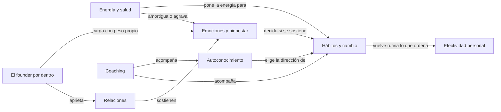

# Desarrollo personal

El desarrollo personal es la práctica de mejorar a propósito cómo se vive: el cuerpo que sostiene el trabajo, los hábitos, las emociones, los vínculos, la forma de ordenar el día y la manera de aguantar un rol exigente. En esta base reúne qué se hace en cada área, cuánto ayuda según la evidencia y cuándo hace falta un profesional.

El tema es la práctica, y [Psicología](../Psicologia/psicologia.md) es el mecanismo. Cuando una nota de acá dice cómo armar un hábito, el porqué de que un hábito se forme y cuánto tarda vive en [formación de hábitos](../Psicologia/Aprendizaje-y-memoria/formacion-de-habitos.md); cuando dice cómo bajar el estrés, qué es el estrés vive en [respuesta de estrés](../Psicologia/Estres-y-resiliencia/respuesta-de-estres.md). Las notas de acá enlazan ese mecanismo y no lo repiten.

El campo mezcla tres clases de saber que no valen lo mismo: intervenciones probadas en ensayos (la terapia cognitivo-conductual para el insomnio, el seguimiento del progreso hacia una meta), guías de organismos de salud (cuántas horas dormir, cuánto moverse) y consejos de practicantes que venden libros, cursos o sesiones. Cada nota dice de cuál de las tres viene lo que afirma. Muchas recomendaciones populares no tienen evidencia, y algunas que la tenían se achicaron cuando se repitieron los estudios, como cuenta la [crisis de replicación](../Psicologia/Fundamentos/crisis-de-replicacion.md).

El tema termina en tres bordes. Donde empieza la clínica: los trastornos, el diagnóstico y la psicoterapia quedan afuera, y [cuándo consultar](Emociones-y-bienestar/cuando-consultar.md) dice dónde está ese límite. Donde empiezan los otros: liderar personas es de [Liderazgo y dirección](../Liderazgo-y-direccion/liderazgo-y-direccion.md), y las habilidades de conversar (dar una devolución, escuchar, sostener una conversación difícil) son de [Comunicación](../Comunicacion/comunicacion.md). Y donde empieza la empresa: el reparto de la propiedad entre socios vive en [Fundadores y equipo](../Emprender/Fundadores-y-equipo/fundadores-y-equipo.md).

## Las ocho partes y cómo se apoyan

Las ocho partes del tema no son etapas: se apoyan unas en otras. El cuerpo pone la energía, el autoconocimiento elige hacia dónde, los hábitos convierten esa elección en conducta diaria y la efectividad personal la ordena en el tiempo. Las emociones y los vínculos deciden si el esfuerzo se puede sostener, y el rol de founder carga todo lo anterior con un peso propio. El coaching es una forma de acompañar cualquiera de esas partes.

- [Autoconocimiento](Autoconocimiento/autoconocimiento.md): saber qué se valora, en qué se es bueno y cómo lo ven a uno los demás. Entrá acá antes de elegir metas o cuando una decisión grande no cierra.
- [Hábitos y cambio](Habitos-y-cambio/habitos-y-cambio.md): cómo se diseña un cambio de conducta, cómo se corta un hábito y qué hacer cuando se recae.
- [Energía y salud](Energia-y-salud/energia-y-salud.md): sueño, ejercicio, descanso, cafeína y alcohol. Es la parte que pone la energía para las demás.
- [Emociones y bienestar](Emociones-y-bienestar/emociones-y-bienestar.md): manejar el estrés, meditar, tratarse mejor, las prácticas de psicología positiva y cuándo consultar a un profesional.
- [Relaciones](Relaciones/relaciones.md): por qué los vínculos importan para la salud y cómo se cuidan la pareja, las amistades y el límite entre trabajo y familia.
- [Efectividad personal](Efectividad-personal/efectividad-personal.md): cómo se manejan las tareas, las prioridades, el foco y el aprendizaje por cuenta propia.
- [Coaching](Coaching/coaching.md): qué es, cuánto funciona, sus escuelas (el coaching ontológico entre ellas, con su falta de evidencia) y cómo elegir un coach.
- [El founder por dentro](El-founder-por-dentro/el-founder-por-dentro.md): lo que le pasa por dentro a quien funda o dirige una empresa: salud mental, identidad, soledad, el síndrome del impostor y el fracaso.

## Por qué cada nota dice de dónde viene lo que recomienda

Un consejo de desarrollo personal se puede leer en tres registros, y cada nota marca cuál es:

| Registro | De dónde sale | Ejemplo |
|---|---|---|
| Evidencia | Ensayos controlados y metaanálisis | La terapia cognitivo-conductual para el insomnio, recomendada como primera línea por guías médicas |
| Guía | Recomendación de un organismo de salud, que resume la evidencia | Cuántos minutos de actividad física por semana recomienda la OMS |
| Practicante | Un libro, un curso o una escuela, sin ensayos propios | Los sistemas de productividad y el coaching ontológico |

Que algo venga de un practicante no lo hace falso: muchas técnicas de productividad aplican mecanismos que sí tienen evidencia. Pero el practicante no midió si su técnica funciona, y la nota lo dice. Las ideas que más circulan y no aguantaron la medición (los 21 días para formar un hábito, las 10.000 horas que se achicaron al medirlas, la ley de atracción sin prueba directa) están juntas en [mitos del desarrollo personal](Fundamentos/mitos-del-desarrollo-personal.md). Lo que una nota agrega por su cuenta, sin fuente que lo diga, va marcado como inferencia de esta base.

## Qué leer según lo que estés haciendo

- Si dormís mal o trabajás muchas horas y no sabés por dónde empezar: [sueño](Energia-y-salud/sueno.md), [descanso y recuperación](Energia-y-salud/descanso-y-recuperacion.md) y [ejercicio](Energia-y-salud/ejercicio.md).
- Si estás al borde del burnout dirigiendo o trabajando: [burnout](../Psicologia/Estres-y-resiliencia/burnout.md) para saber qué es, [cuándo consultar](Emociones-y-bienestar/cuando-consultar.md), [descanso y recuperación](Energia-y-salud/descanso-y-recuperacion.md), [sueño](Energia-y-salud/sueno.md) y [salud mental del founder](El-founder-por-dentro/salud-mental-del-founder.md).
- Si querés sostener un cambio de conducta: [diseñar un hábito](Habitos-y-cambio/disenar-un-habito.md), [metas personales](Habitos-y-cambio/metas-personales.md) y [recaídas](Habitos-y-cambio/recaidas.md).
- Si querés cortar algo que hacés sin pensar (el celular, picar entre comidas): [cortar un hábito](Habitos-y-cambio/cortar-un-habito.md).
- Si estás pensando en contratar un coach: [evidencia del coaching](Coaching/evidencia-del-coaching.md), [escuelas de coaching](Coaching/escuelas-de-coaching.md), [coaching ontológico](Coaching/coaching-ontologico.md) y [elegir un coach](Coaching/elegir-un-coach.md).
- Si como founder te sentís solo, ansioso o impostor: [salud mental del founder](El-founder-por-dentro/salud-mental-del-founder.md), [soledad y pares](El-founder-por-dentro/soledad-y-pares.md), [síndrome del impostor](El-founder-por-dentro/sindrome-del-impostor.md) y [cuándo consultar](Emociones-y-bienestar/cuando-consultar.md).
- Si tenés demasiadas cosas abiertas: [gestión de tareas](Efectividad-personal/gestion-de-tareas.md), [tiempo y prioridades](Efectividad-personal/tiempo-y-prioridades.md) y [trabajo profundo](Efectividad-personal/trabajo-profundo.md).
- Si querés probar una práctica de bienestar (gratitud, meditación, escribir): [intervenciones de psicología positiva](Emociones-y-bienestar/intervenciones-de-psicologia-positiva.md), [mindfulness y meditación](Emociones-y-bienestar/mindfulness-y-meditacion.md) y [escritura reflexiva](Autoconocimiento/escritura-reflexiva.md).
- Si tenés que decidir algo grande de tu vida o tu carrera: [valores personales](Autoconocimiento/valores-personales.md) y [propósito y sentido](Autoconocimiento/proposito-y-sentido.md); para el sesgo al decidir, [heurísticas y sesgos](../Psicologia/Juicio-y-decision/heuristicas-y-sesgos.md).
- Si el trabajo se está comiendo la pareja o la familia: [trabajo y familia](Relaciones/trabajo-y-familia.md) y [pasión e identidad](El-founder-por-dentro/pasion-e-identidad.md).
- Si una empresa tuya cerró o está por cerrar: [fracaso y duelo](El-founder-por-dentro/fracaso-y-duelo.md).
- Si un libro o un curso te promete cambiarte la vida: [escuelas del desarrollo personal](Fundamentos/escuelas-de-desarrollo-personal.md), [mitos](Fundamentos/mitos-del-desarrollo-personal.md) y [cómo leer un estudio](../Psicologia/Fundamentos/como-leer-un-estudio.md).

## Por dónde empezar a leer

1. [Energía y salud](Energia-y-salud/energia-y-salud.md), porque el sueño y el ejercicio sostienen lo demás (inferencia de esta base) y la recomendación mejor sostenida de la vertical, la terapia cognitivo-conductual para el insomnio, está ahí.
2. [Hábitos y cambio](Habitos-y-cambio/habitos-y-cambio.md), para convertir cualquier otra parte en conducta diaria.
3. [Emociones y bienestar](Emociones-y-bienestar/emociones-y-bienestar.md) y, si fundás o dirigís, [El founder por dentro](El-founder-por-dentro/el-founder-por-dentro.md).
4. Las demás partes, según la necesidad.

[Fundamentos](Fundamentos/fundamentos-de-desarrollo-personal.md) reúne lo que cruza todas las partes: las escuelas y las críticas al campo, los mitos, la bibliografía y el [glosario](Fundamentos/glosario-de-desarrollo-personal.md).
