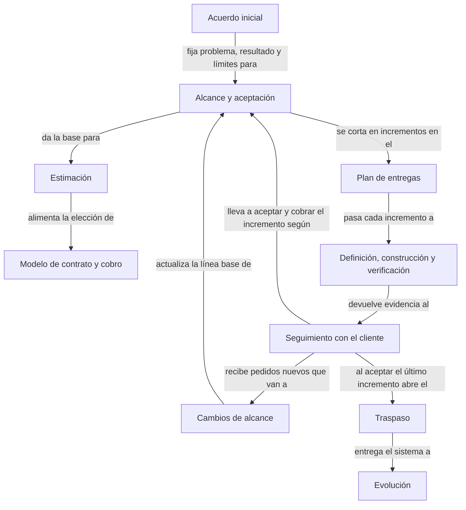

# Encargo

El encargo es el ciclo con el cliente en un desarrollo a medida: se acuerda qué problema se resuelve y cómo se sabe que está resuelto, se estima y se elige cómo se cobra, se entregan incrementos que el cliente usa y acepta, se manejan los cambios y al final se le traspasa el sistema para que sea suyo.

Es el ciclo de afuera de los dos que describe [Desarrollo](../desarrollo.md). Empieza cuando la venta terminó: la [propuesta](../../Ventas/La-propuesta/la-propuesta.md) y la negociación son de Ventas, y cuánto se cobra de lista y en qué planes es de [pricing y empaquetado](../../Producto/Monetizacion/pricing-y-empaquetado.md). Termina cuando el sistema pasa a [Evolución](../Evolucion/evolucion.md), sea en manos del cliente, de otro proveedor o de un abono de mantenimiento. En el medio le pasa a [Definición](../Definicion/definicion.md) el alcance acordado, que ahí se vuelve una [especificación](../Definicion/especificacion.md), y recibe de [Verificación](../Verificacion/verificacion.md) la evidencia con la que el cliente acepta cada incremento.

## El ciclo con el cliente, de la idea al traspaso

El encargo tiene un tramo de una sola vez al principio, un lazo que se repite por incremento y un cierre. El lazo es donde el encargo se cruza con el ciclo técnico: cada incremento se define, se construye y se verifica adentro, y se muestra, se acepta y se cobra afuera.

El orden del tramo inicial no es estricto. La estimación y el modelo de cobro se negocian juntos con el alcance, y el primer tramo puede ser un descubrimiento pago que se cotiza aparte antes de cotizar la construcción (lo propone Boag, una sola fuente), como cuenta [proyecto a precio cerrado](../../Producto/Planificacion-y-entrega/proyecto-a-precio-cerrado.md#cotizar-después-de-achicar-la-incertidumbre).

## Lo que se acuerda es lo que se especifica y se acepta

La idea que ordena la vertical es una cadena: el alcance escrito es la línea base, los cambios se comparan contra esa línea base y la aceptación se hace contra criterios acordados antes. El *Agile Contracts Primer* lo plantea con dos preguntas que el contrato tiene que contestar, «Is it done?» y «What to do if not done?», y propone que en una entrega iterativa la aceptación final sea la suma de las aceptaciones de cada iteración, basadas en «conformance to a prior agreed-on acceptance-test».

De ahí sale por qué esta vertical y [Definición](../Definicion/definicion.md) están pegadas. Los [criterios de aceptación](../Definicion/criterios-de-aceptacion.md) que el cliente confirma en el encargo son los mismos que se especifican, contra los que se construye y con los que se verifica. Si el criterio está mal, todo lo de abajo cumple con algo que el cliente no pidió. El *Scrum Guide* pone la otra condición: «In order to provide value, the Increment must be usable». Un incremento que no se puede usar no se puede aceptar.

## Qué cambia cuando el código lo escribe un agente

Según DORA 2025, la IA amplifica lo que la organización ya hace bien y lo que hace mal. Para el encargo, la lectura de esta base es que el costo se corre: escribir el código se abarata, y definir, verificar, integrar y conversar con el cliente no. Ninguna fuente lo midió. Un agente construye rápido lo que se le dice, así que un problema mal entendido en el [acuerdo inicial](acuerdo-inicial.md) se convierte rápido en software equivocado. No hay una medición de cuánto bajó el costo de un proyecto a medida por usar agentes; los informes de la vertical lo declaran como hueco grande.

El cobro es donde más se nota. Brynjolfsson y Petropoulos, en un *working paper* de agosto de 2026, sostienen que la IA vuelve menos observable para el cliente cuánto insumo lleva un entregable, lo que empuja hacia contratos híbridos. Es un marco teórico, sin datos de agencias de software, y se desarrolla en [modelos de contrato y cobro](modelos-de-contrato-y-cobro.md).

## Dónde la evidencia es floja

La vertical se apoya sobre todo en practicantes (el *Primer*, Fowler, Shape Up, el *Scrum Guide*) y en estudios de estimación. Tres partes tienen menos que eso. El [seguimiento con el cliente](seguimiento-con-el-cliente.md) no tiene fuente primaria sobre cadencia ni formato de reporte. El [traspaso](traspaso.md) se apoya en guías de agencias que se parecen entre sí y cuentan como una sola fuente. Y para los contratos ágiles de precio fijo hay una sola línea de estudios, delgada, cuando el dinero pide dos. Cada nota lo marca donde corresponde.

## Las piezas del encargo

- [Acuerdo inicial](acuerdo-inicial.md): entender el problema, el resultado que busca el cliente, quién decide y qué queda afuera, antes de especificar nada.
- [Alcance y aceptación](alcance-y-aceptacion.md): qué entra, qué no y cómo se decide que un incremento o el proyecto está terminado.
- [Estimación](estimacion.md): cuánto lleva y con cuánta incertidumbre: rangos, clase de referencia, apetito y previsión por ritmo.
- [Modelos de contrato y cobro](modelos-de-contrato-y-cobro.md): precio cerrado, tiempo y materiales, alcance variable, por resultado y abono, y quién carga el riesgo en cada uno.
- [Plan de entregas](plan-de-entregas.md): cortar el alcance en incrementos que el cliente pueda ver y usar, y en qué orden.
- [Cambios de alcance](cambios-de-alcance.md): qué regla se aplica cuando el cliente pide otra cosa a mitad de camino.
- [Seguimiento con el cliente](seguimiento-con-el-cliente.md): qué se le muestra, cada cuánto y con qué evidencia; la parte con menos fuentes.
- [Traspaso](traspaso.md): entregar código, accesos, documentación y operación, y lo que sigue después: garantía y soporte.

El caso profundo del precio cerrado (sobrecostos, contingencia, control de cambios por escrito, aceptación formal) vive en Producto: [proyecto a precio cerrado](../../Producto/Planificacion-y-entrega/proyecto-a-precio-cerrado.md).
