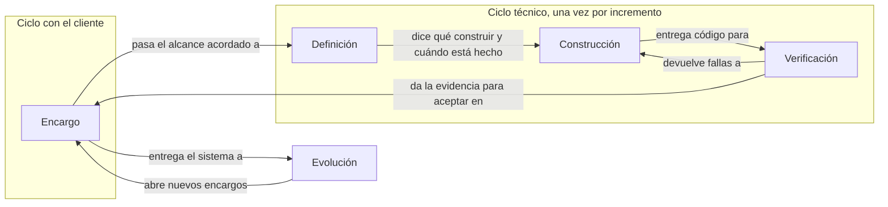

# Desarrollo

Desarrollar software para alguien es convertir su necesidad en software andando que recibe y puede mantener, con dos ciclos uno adentro del otro: con el cliente se acuerda, se entrega por partes, se acepta y se traspasa; adentro, cada parte se define, se construye, se verifica y se integra.

El tema trata el proceso, no el producto ni la estructura del sistema. Qué conviene construir, para quién y por qué está en [Producto](../Producto/producto.md); cómo se estructura el sistema (estilos, módulos, patrones), en [Arquitectura](../Arquitectura/arquitectura.md); cómo se integra, se despliega y se opera, en [DevOps](../DevOps/devops.md); y cómo se vende el proyecto, en [Ventas](../Ventas/ventas.md). Este tema empieza cuando hay alguien con una necesidad y termina cuando el software es suyo.

Se escribe desde cómo se trabaja hoy: con agentes de código como parte normal del oficio. Eso no agrega una etapa, pero cambia dónde está el trabajo difícil. Según el criterio de esta base, escribir código se abarató y definir bien qué se pide y verificar lo que salió pesan más que antes. Lo que perdió peso con ese cambio se nombra una sola vez, en [lo que pierde peso](Fundamentos/lo-que-pierde-peso-en-desarrollo.md).

## Los dos ciclos del desarrollo

El ciclo de afuera es la relación con el cliente: se acuerda qué problema se resuelve y cómo se sabe que está resuelto, se entregan incrementos que el cliente puede usar, se acepta cada uno y al final se traspasa todo. El ciclo de adentro corre una vez por incremento: se define con precisión, se construye, se verifica contra lo definido y se integra. La norma ISO/IEC/IEEE 12207 agrupa sus procesos en cuatro: acuerdo, habilitación organizacional del proyecto, gestión técnica y procesos técnicos (según fuentes secundarias sobre la edición 2017; existe una edición 2026 que no se verificó). El corte en dos ciclos es de esta base.

- [Encargo](Encargo/encargo.md): el ciclo con el cliente: el acuerdo inicial, el alcance y cómo se acepta, la estimación y el modelo de cobro, el plan de entregas, los cambios a mitad de camino, el seguimiento y el traspaso.
- [Definición](Definicion/definicion.md): pasar de una intención a algo que se puede construir sin adivinar: especificación, historias, criterios de aceptación, descomposición en tareas y modelo de dominio.
- [Construcción](Construccion/construccion.md): escribir el código, con agentes: el contexto que el repositorio le da al agente, cómo trabaja un agente de código, la plantilla de proyecto, la configuración y Git.
- [Verificación](Verificacion/verificacion.md): cómo se sabe que lo construido hace lo que se pidió: niveles de prueba, TDD, revisión de código y cómo se verifica el trabajo de un agente.
- [Evolución](Evolucion/evolucion.md): el software después de la primera entrega: deuda técnica, refactorización, código heredado, migraciones y actualizaciones.
- [Fundamentos](Fundamentos/fundamentos-de-desarrollo.md): las escuelas, lo que pierde peso, la bibliografía y el glosario.

Dos etapas del ciclo técnico viven en otros temas y se enlazan desde acá. Diseñar la estructura del sistema es [Arquitectura](../Arquitectura/arquitectura.md); integrar y desplegar es [integración y entrega](../DevOps/Integracion-y-entrega/integracion-y-entrega.md), en DevOps.

## Optimizar para aprender

La idea que ordena el tema viene de Farley (*Modern Software Engineering*), que dedica una parte del libro a optimizar para aprender. Según su índice (lo único que se leyó del libro), esa parte tiene cinco capítulos: trabajar de forma iterativa, retroalimentación, incrementalismo, empirismo y ser experimental. Esta base lo lee así: el desarrollo es aprender qué hay que construir mientras se construye. En el ciclo de afuera se ve como entregas chicas que el cliente usa; en el de adentro, como pruebas que dicen en minutos si lo construido anda.

La tercera parte del libro, optimizar para gestionar la complejidad (modularidad, cohesión, acoplamiento), está en [Arquitectura](../Arquitectura/arquitectura.md).

## Lo que cambia cuando el código lo escribe un agente

Según DORA 2025, la IA funciona como amplificador: magnifica lo que la organización ya hace bien y lo que hace mal. El mismo informe encuentra una relación positiva entre la adopción de IA y el rendimiento de la entrega, y una negativa con su estabilidad. La evidencia sobre cuánto acelera un agente es mixta: hay estudios controlados que miden ganancias y otros que miden pérdidas (el detalle está en [agente de código](Construccion/agente-de-codigo.md)).

De ahí salen las tres apuestas del tema. Lo que se le pide a un agente tiene que estar escrito y ser verificable, y por eso [Definición](Definicion/definicion.md) va a fondo. Lo que entrega un agente se acepta con evidencia y no con su palabra, y para eso está [verificar lo que hizo un agente](Verificacion/verificar-lo-que-hizo-un-agente.md). El cliente acepta software andando, no informes de avance, como se ve en [alcance y aceptación](Encargo/alcance-y-aceptacion.md).

## Qué leer según lo que estés haciendo

- Si te llega un cliente con una idea: [acuerdo inicial](Encargo/acuerdo-inicial.md), después [especificación](Definicion/especificacion.md) y [modelo de dominio](Definicion/modelo-de-dominio.md).
- Si tenés que estimar o cotizar un proyecto: [estimación](Encargo/estimacion.md), [modelos de contrato y cobro](Encargo/modelos-de-contrato-y-cobro.md) y, si es a precio cerrado, [proyecto a precio cerrado](../Producto/Planificacion-y-entrega/proyecto-a-precio-cerrado.md).
- Si tenés que preparar trabajo para un agente: [descomposición en tareas](Definicion/descomposicion-en-tareas.md), [criterios de aceptación](Definicion/criterios-de-aceptacion.md) y [contexto del repositorio](Construccion/contexto-del-repositorio.md).
- Si tenés que revisar lo que hizo un agente: [verificar lo que hizo un agente](Verificacion/verificar-lo-que-hizo-un-agente.md) y [revisión de código](Verificacion/revision-de-codigo.md).
- Si el cliente cambia lo que quiere a mitad de camino: [cambios de alcance](Encargo/cambios-de-alcance.md).
- Si tenés que entregar un sistema para que lo mantenga otro: [traspaso](Encargo/traspaso.md).
- Si te toca un código que no escribiste: [sistema heredado](Evolucion/sistema-heredado.md) y [deuda técnica](Evolucion/deuda-tecnica.md).
- Si tenés que actualizar dependencias o versiones en muchos lugares: [migraciones y actualizaciones](Evolucion/migraciones-y-actualizaciones.md).
- Si tenés que armar un proyecto nuevo: [plantilla de proyecto](Construccion/plantilla-de-proyecto.md); la estructura del sistema está en [elegir un estilo](../Arquitectura/Estilos/elegir-un-estilo.md).
- Si tenés que decidir qué estudiar primero: [lo que pierde peso](Fundamentos/lo-que-pierde-peso-en-desarrollo.md) y la [bibliografía](Fundamentos/bibliografia-de-desarrollo.md).
