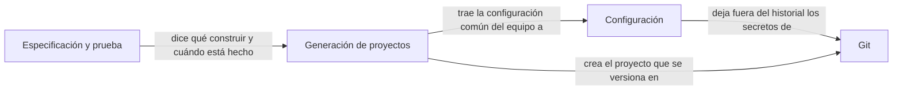

# Desarrollo

Desarrollo es el oficio de escribir software, visto desde sus herramientas y prácticas:
especificar y probar una funcionalidad, generar el proyecto, separar la configuración del código
y versionarlo con Git.

El tema trata lo que hace quien escribe un servicio. Los patrones entre servicios (capas de APIs,
circuit breaker, saga, idempotencia, multi-tenancy) están en el tema
[Arquitectura](../Arquitectura/arquitectura.md). Cómo se integra y se entrega el código, y cómo se organiza un equipo
alrededor de Git, está en [DevOps](../DevOps/devops.md).

## De la historia de usuario al código versionado

Cuatro partes, en el orden en que aparecen al hacer una funcionalidad: se especifica qué construir y
cómo se prueba, se genera el proyecto, se separa la configuración que cambia por entorno y todo se
versiona en Git.

- [Especificación y prueba](Especificacion-y-prueba/especificacion-y-prueba.md) — cómo se describe una funcionalidad
  con historias de usuario y cómo se arma la suite de casos de prueba de una API.
- [Generación de proyectos](Generacion-de-proyectos/generacion-de-proyectos.md) — plantillas de proyecto de Maven para
  que todos los servicios nuevos arranquen con la misma estructura.
- [Configuración](Configuracion/configuracion.md) — YAML, qué va en `application.properties` y qué se inyecta desde el
  entorno, y cómo levantar la app en local.
- [Git](Git/git.md) — cómo funciona Git por dentro, cómo se integran cambios, cómo se recupera trabajo y cómo se
  usa en repositorios grandes; la entrada para cualquier duda de Git.

## Los originales archivados

El backlog y la suite de pruebas del MVP de e-commerce, y la referencia de YAML en inglés, están
sin cambios en `Archivo/Desarrollo/`. Los manuales de Git que dieron origen a la parte de Git están en
`Archivo/Desarrollo/git/` y en `Archivo/DevOps/git/` (estos últimos llegaron con el Tema DevOps).
