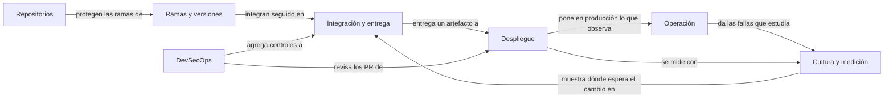

# DevOps

DevOps es la forma de trabajo que une desarrollo y operaciones para entregar cambios chicos,
frecuentes y confiables.

Un cambio recorre un camino desde la idea hasta el usuario en producción, el
[flujo de valor](Cultura-y-medicion/flujo-de-valor.md), y la mayor parte de ese tiempo no es
trabajo sino espera entre tramos. DevOps acorta ese camino sin perder estabilidad. Comprar
herramientas no alcanza: automatiza el mismo proceso con los mismos silos. Por eso
[CALMS](Fundamentos/calms.md) mira cinco dimensiones juntas: cultura, automatización,
lean, medición y compartir.

El tema termina donde empieza la organización: los equipos y la plataforma interna que sostienen
estas prácticas son el tema hermano [Platform Engineering](../Platform-Engineering/platform-engineering.md).
DevOps tampoco es un equipo intermedio entre Dev y Ops; eso es el
[Anti-patrón del equipo DevOps](../Platform-Engineering/Colaboracion-Dev-Ops/anti-patron-equipo-devops.md). Cómo funciona
la herramienta Git (merge, rebase, reflog, LFS, mirrors) está en [Git](../Desarrollo/Construccion/Git/git.md), en
el tema Desarrollo.

## De qué está hecha la entrega de un cambio

Siete partes. El código se integra en ramas que se versionan, dentro de repositorios con reglas; un
pipeline deja cada cambio listo para producción; el despliegue lo lleva a cada entorno y lo
mantiene como está declarado; la operación muestra cómo se comporta en producción. La seguridad
corre en cada etapa, y la medición dice dónde se pierde el tiempo.

- [Ramas y versiones](Ramas-y-versiones/ramas-y-versiones.md) — qué ramas existen, cuánto viven y cómo se numera lo que se publica.
- [Repositorios](Repositorios/repositorios.md) — cómo se reparte el código, quién cambia qué y cómo se sigue cada despliegue hasta su commit.
- [Integración y entrega](Integracion-y-entrega/integracion-y-entrega.md) — integración, entrega y despliegue continuos, y el pipeline que los automatiza.
- [Despliegue](Despliegue/despliegue.md) — cómo una versión reemplaza a otra en un entorno, la promoción entre entornos y GitOps.
- [DevSecOps](DevSecOps/devsecops.md) — la seguridad como responsabilidad compartida y automatizada en todo el ciclo.
- [Operación](Operacion/operacion-en-devops.md) — la observabilidad de lo que corre en producción y la práctica de definir la telemetría con cada cambio.
- [Cultura y medición](Cultura-y-medicion/cultura-y-medicion.md) — el flujo de valor, el postmortem sin culpa y las métricas DORA.

Aparte de las siete partes, [Fundamentos](Fundamentos/fundamentos-de-devops.md) reúne lo
que las cruza: el marco CALMS y el recorrido para aprender el tema en orden.

## Tres ideas que cruzan las siete partes

- **Lotes chicos.** Integrar a la rama principal al menos una vez por día
  ([integración continua](Integracion-y-entrega/integracion-continua.md)), con ramas que viven horas
  ([trunk-based development](Ramas-y-versiones/trunk-based-development.md)), hace que si algo falla
  se sepa qué commit lo causó ([despliegue continuo](Integracion-y-entrega/despliegue-continuo.md)).
  Es la práctica lean que pide el flujo de valor.
- **Construir una sola vez.** El paquete que llega a producción es el mismo que se probó,
  identificado por el commit que lo originó y nunca por "latest"
  ([pipeline de CI/CD](Integracion-y-entrega/pipeline-de-ci-cd.md)). Eso permite volver a la
  versión anterior ([estrategias de despliegue](Despliegue/estrategias-de-despliegue.md)) y seguir
  cada despliegue hasta su revisión ([trazabilidad de cambios](Repositorios/trazabilidad-de-cambios.md)).
- **Git como registro.** La infraestructura vive en archivos versionados
  ([infraestructura como código](../Infraestructura/Aprovisionamiento/infraestructura-como-codigo.md)), el estado deseado de
  cada entorno también ([GitOps](Despliegue/gitops.md)), y el historial de Git es la auditoría.

## Del commit a producción, en orden

Para aprenderlo de cero, [DevOps desde cero](Fundamentos/recorrido-devops.md) recorre
las partes en el orden en que un cambio las necesita, de CALMS a las métricas DORA. Para
consultar, conviene entrar por la entrada de cada parte.

## Lo que falta

- SLO y SLI: sin nota todavía; van en [Operación](Operacion/operacion-en-devops.md), junto a la [observabilidad](Operacion/observabilidad.md).
- Ansible: hay solo un temario sin contenido, archivado en `Archivo/DevOps/ansible-roadmap.md`.

## Ver también

- [FinOps](../Cloud/FinOps/finops.md) — la responsabilidad sobre el costo de la nube; en el tema Cloud.
