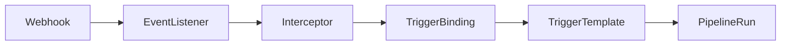

# Tekton

Tekton es un framework de CI/CD nativo de Kubernetes: define Tasks y Pipelines como recursos del
clúster, con params y workspaces, y los dispara ante eventos externos con Tekton Triggers.

## Por qué importa

Un [Pipeline de CI/CD](pipeline-de-ci-cd.md) en Tekton vive en el mismo clúster donde se despliega: se versiona como
cualquier manifiesto, escala con los nodos y no necesita un servidor de CI aparte. OpenShift lo
distribuye como OpenShift Pipelines.

## Cómo funciona

- **Step**: un contenedor que corre una herramienta hasta terminar o fallar.
- **Task**: una lista ordenada de steps. Cada Task corre como un Pod (el grupo de contenedores
  que Kubernetes programa junto en un nodo).
- **Pipeline**: un grafo de Tasks. Por defecto las Tasks corren en paralelo; el orden se fija con
  `runAfter` o al usar el resultado de otra Task.
- **TaskRun y PipelineRun**: cada ejecución concreta, con los valores de esa vez.

Dos mecanismos separan la definición de la ejecución:

- **Params**: valores que la Task o el Pipeline declaran y el Run provee, como la URL del
  repositorio o la rama. Se leen con `$(params.nombre)`.
- **Workspaces**: partes del sistema de archivos que la Task declara y el Run vincula a un volumen
  real: `emptyDir`, un PVC (un pedido de disco persistente), un `volumeClaimTemplate`, un Secret
  o un ConfigMap. Así una Task clona el código en un workspace y la siguiente lo compila desde ahí.

```yaml
apiVersion: tekton.dev/v1
kind: Task
metadata:
  name: saludar
spec:
  params:
    - name: mensaje
      type: string
  workspaces:
    - name: fuente
  steps:
    - name: echo
      image: alpine
      script: echo "$(params.mensaje)" && ls $(workspaces.fuente.path)
```

**Tekton Triggers** agrega la entrada por eventos, es decir, por webhooks: llamadas HTTP que un
servicio como Azure Repos o GitHub hace cuando pasa algo, con el detalle en JSON.

- **EventListener**: recibe el webhook en un Service `el-<nombre>` (puerto 8080 por defecto).
- **Interceptor**: valida o filtra el evento antes de usarlo, por ejemplo con una expresión CEL
  (Common Expression Language, un lenguaje chico de condiciones).
- **TriggerBinding**: extrae campos del JSON del evento.
- **TriggerTemplate**: crea el PipelineRun con esos campos como params.



## Ejemplo

Argo CD es el agente de [GitOps](gitops.md) que aplica en el clúster lo que hay en un repositorio. Un push llega al EventListener; el TriggerBinding toma la URL del repositorio y la rama; el
TriggerTemplate crea un PipelineRun que clona, construye la imagen y actualiza `values.yaml` en el
repositorio GitOps; Argo CD detecta el commit y despliega (ver [Promoción entre entornos](promocion-entre-entornos.md)).

## No confundir con

Argo CD. Tekton ejecuta pasos (CI, empaquetado); Argo CD reconcilia el estado declarado en Git con
el clúster (ver [GitOps](gitops.md)). Suelen usarse juntos.

## Relaciones

- Base de: [Disparar Tekton desde Azure DevOps](disparar-tekton-desde-azure-devops.md) — la guía para conectar Triggers con Azure Repos.
- Ver también: [Pipeline de CI/CD](pipeline-de-ci-cd.md) — el concepto general que Tekton implementa.
- Ver también: [GitOps](gitops.md) — el modelo de despliegue que suele seguir al pipeline de Tekton.
