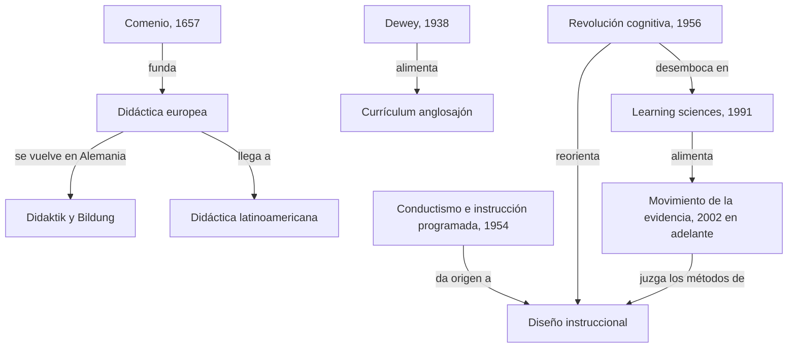

# Historia de la didáctica

La didáctica nació como el arte de enseñar todo a todos con Comenio en el siglo XVII y se partió en dos tradiciones: la europea y latinoamericana de la didáctica, que pregunta qué contenido forma, y la anglosajona del currículum y el diseño instruccional, que pregunta qué método funciona. Desde los años 90 las cruzan las ciencias del aprendizaje y el movimiento de la evidencia.

Esta nota es de toda el área Pedagogía: los otros cuatro temas ([Ciencias del aprendizaje](../../Ciencias-del-aprendizaje/ciencias-del-aprendizaje.md), [Diseño instruccional](../../Diseno-instruccional/diseno-instruccional.md), [Evaluación educativa](../../Evaluacion-educativa/evaluacion-educativa.md) y [Tecnología educativa](../../Tecnologia-educativa/tecnologia-educativa.md)) la enlazan en lugar de repetirla. Las teorías del aprendizaje (conductismo, cognitivismo, constructivismo, sociocultural) se nombran acá como hitos y se desarrollan en [teorías del aprendizaje](../../Ciencias-del-aprendizaje/Fundamentos/teorias-del-aprendizaje.md), de Ciencias del aprendizaje. Casi todo lo de esta nota viene de enciclopedias y resúmenes, no de las obras originales.

## Comenio y el arte de enseñar todo a todos

Comenio escribió la *Didactica Magna* entre 1627 y 1638 y la publicó en 1657. Su título completo la presenta como el «artificio universal para enseñarlo todo a todos», y su fin era la pansofía: toda persona es educable y la escuela tiene que llegar a todos. La Wikipedia alemana la llama «die erste Didaktik der Neuzeit». Wolfgang Ratke ya había usado «didáctica» como disciplina en 1629, antes de que Comenio publicara.

Desde Comenio, y sobre todo desde Herbart, la didáctica europea piensa la enseñanza como una relación de tres: el contenido, quien aprende y quien enseña. El triángulo pedagógico de Houssaye formaliza esa relación con tres procesos: enseñar (profesor y saber), formar (profesor y alumno) y aprender (alumno y saber).

## Dos tradiciones que se separan

Desde el siglo XIX conviven dos maneras de pensar la enseñanza. La Wikipedia en inglés las llama «the Anglo-Saxon tradition of curriculum studies» y «the Continental and North European tradition of didactics», y agrega que la didáctica «carries much less weight in much of the English-speaking world».

| | Didáctica (Europa continental, América Latina) | Currículum y diseño instruccional (mundo anglosajón) |
|---|---|---|
| Pregunta central | Qué contenido forma a la persona, y por qué | Qué se enseña, en qué orden y con qué método |
| Foco | El contenido y su valor formativo | Los métodos y los resultados medibles |
| Lugar del método | Subordinado al contenido («Primat der Didaktik») | Central |
| Vínculo con la tecnología | Lateral | Desde el origen, según el artículo «eyes like twins» |

Según un resumen del artículo comparativo de *SpringerPlus* (2012), la didáctica general se centra más en el contenido y el diseño instruccional en los métodos, y comparten rasgos sobre todo cuando adoptan un enfoque constructivista.

**La Didaktik alemana.** Su idea de fondo es la *Bildung*, la formación de la persona por la cultura, distinta del adiestramiento (*Ausbildung*) y vinculada a Humboldt. Wolfgang Klafki (1927-2016) propuso en «Didaktische Analyse als Kern der Unterrichtsvorbereitung» (1958; otra fuente da 1963) preguntas para preparar una clase: qué significado ejemplar tiene el contenido, qué significado presente y futuro, cuál es su estructura y cómo se vuelve accesible. Más tarde planteó los problemas clave de la época (paz, ambiente, técnica, democratización, derechos humanos) como contenido. Se lo criticó como «Feiertagsdidaktik», didáctica de días feriados, por la poca atención al método.

**La didáctica latinoamericana.** En la Argentina, Alicia Camilloni define la didáctica como «una disciplina teórica que se ocupa de estudiar la acción pedagógica», para describir, explicar y fundamentar las prácticas de enseñanza y «enunciar normas» que resuelvan los problemas de los docentes. Distingue una didáctica general de didácticas específicas, que clasifica por cinco criterios ([Didácticas específicas](../Didacticas-especificas/didacticas-especificas.md)). Edith Litwin propuso en *Las configuraciones didácticas* (Paidós, 1997) que contenido y método son «dos dimensiones clásicas e indisociables», y entendió la didáctica como análisis «multireferencial» de situaciones de enseñanza concretas. María Cristina Davini (1948-2015) escribió *Corrientes didácticas contemporáneas* (1996) y *Métodos de enseñanza* (2008). Las citas de Camilloni y Litwin vienen de la Wikipedia en castellano; sus libros no se leyeron.

**El currículum y Dewey.** John Dewey publicó *Experience and Education* en 1938. Criticó a la vez a la escuela tradicional, por estática, y a la progresista, por no tener una filosofía de la experiencia: una experiencia «mis-educative» frena las siguientes, y quien enseña tiene que ordenar el material para que haya continuidad con lo que el alumno ya vivió. Ya en *The Child and the Curriculum* (1902) había criticado tanto el currículo rígido como los excesos de quienes se decían sus seguidores.

## Del conductismo al diseño instruccional

B. F. Skinner presentó «The science of learning and the art of teaching» en 1954, con una máquina de enseñar experimental. Las máquinas, con material en pasos chicos y respuesta inmediata, dieron la instrucción programada, investigada a fines de los años 50; Sidney Pressey ya había hecho máquinas en 1927. El diseño instruccional nació de ahí, de la psicología conductual y cognitiva y de la ingeniería de sistemas, con fuerte desarrollo en el entrenamiento militar de posguerra. Su historia sigue en [historia del diseño instruccional](../../Diseno-instruccional/Fundamentos/historia-del-diseno-instruccional.md).

La revolución cognitiva cambió la pregunta de la conducta a la mente. George Miller la fecha en una reunión del MIT del 11 de septiembre de 1956, el año en que publicó «The Magical Number Seven, Plus or Minus Two»; Neisser publicó *Cognitive Psychology* en 1967. De ahí salen la memoria de trabajo y la carga cognitiva que justifican la [instrucción explícita](../Explicar-y-modelar/explicar-y-modelar.md).

## Las ciencias del aprendizaje y el movimiento de la evidencia

Las *learning sciences* se armaron como campo interdisciplinario a principios de los 90. El *Journal of the Learning Sciences* salió en 1991, con Janet Kolodner como editora, y ese agosto el Institute for the Learning Sciences de Northwestern organizó la primera conferencia internacional. La sociedad internacional (ISLS) se constituyó en 2002; un extracto de Cambridge da 1991 y la discrepancia no se resolvió.

En paralelo creció la idea de que la enseñanza tiene que basarse en evidencia. David Hargreaves dijo en 1996 que «Teaching is not at present a research-based profession». Siguieron instituciones: el [What Works Clearinghouse](evidencia-en-educacion.md#los-resúmenes-de-evidencia-y-cómo-leer-cada-uno) (2002, dentro del Institute of Education Sciences de EE. UU.), la Education Endowment Foundation (2011, en Inglaterra, con 125 millones de libras iniciales), researchED (2013, fundada por Tom Bennett, de docentes) y *The Science of Learning* de Deans for Impact (2015, seis preguntas, con Daniel Willingham y Paul Bruno). Cómo leer lo que producen está en [evidencia en educación](evidencia-en-educacion.md).

Gert Biesta, crítico del movimiento, cuestiona la pregunta y no los datos: sostiene que juzgar la educación solo por su eficacia deja afuera para qué se educa. Esa crítica también está en [evidencia en educación](evidencia-en-educacion.md).

> [!NOTE] Sin fuente todavía: las obras originales de Comenio, Klafki, Dewey, Camilloni (*El saber didáctico*) y Litwin; la tradición francesa más allá de Houssaye (Chevallard y la transposición didáctica aparecen solo mencionados); una historia de la didáctica en castellano que no sea enciclopedia.
